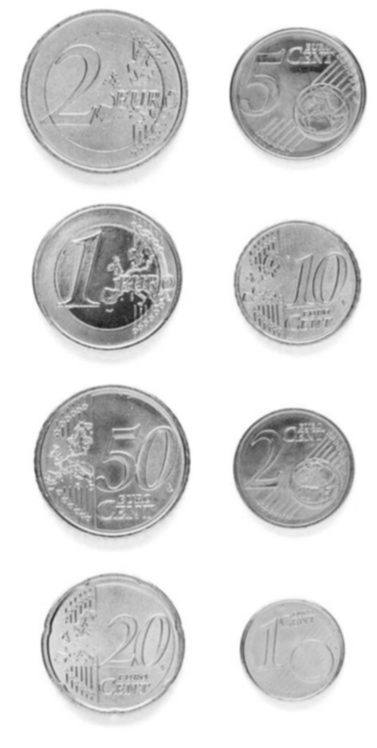
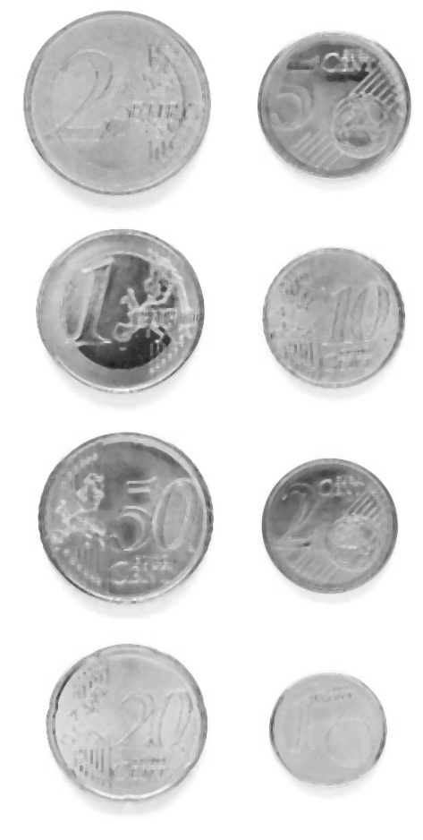
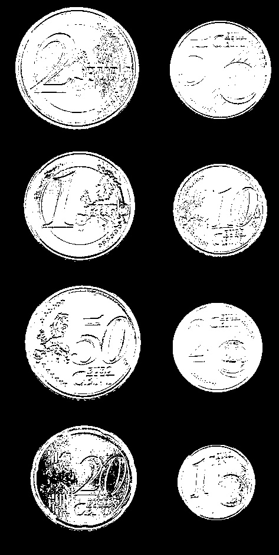
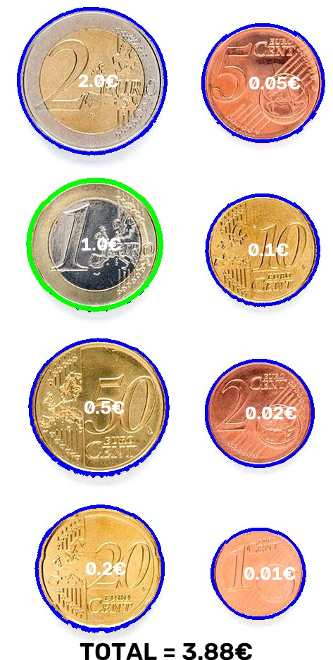

# Práctica 3 - Detección y reconocimiento de formas

Práctica de la asignatura **Visión por Computador** dedicada a la extracción de información geométrica de objetos presentes en una imagen, con el fin de caracterizarlos e identificarlos de forma automática en distintas categorías sin hacer uso de modelos de aprendizaje profundo _(Deep Learning)_.

## 👥 Autores

Este trabajo ha sido realizado por el **`Grupo 27`**: 
- [Alba Quintana Ramos](https://github.com/albaquiintanaa)
- [Néstor Jesús Henríquez Medina](https://github.com/NestorJHM)

## Contenidos

1. [Requisitos y ejecución](#requisitos-y-ejecución)
2. [Tarea 1 - Detección y reconocimiento de monedas](#tarea-1---detección-y-reconocimiento-de-monedas)
    - [Tarea 1.1: Cálculo del dinero en una imagen](#tarea-11-cálculo-del-dinero-en-una-imagen)
    - [Tarea 1.2: Demostrador interactivo en tiempo real](#tarea-12-demostrador-interactivo-en-tiempo-real)
3. [Tarea 2 - Segmentación y clasificación de microplásticos](#tarea-2---segmentación-y-clasificación-de-microplásticos)
4. [Estructura del proyecto](#estructura-del-proyecto)
5. [Referencias](#referencias)


---

## Requisitos y ejecución

### Dependencias

Además de las librerías habituales, para poder interactuar con la ventana gráfica en la Tarea 1.1 es **imprescindible** instalar el *backend* `PyQt5`. Para las futuras métricas de la Tarea 2 se requerirán herramientas de análisis de datos:

* OpenCV (`opencv-python`)
* NumPy (`numpy`)
* Matplotlib (`matplotlib`)
* **PyQt5 (`PyQt5`)** *(Necesario para habilitar `%matplotlib qt`)*
* Scikit-Learn (`scikit-learn`)
* Seaborn (`seaborn`)

Las dependencias pueden instalarse con:

```bash
pip install opencv-python numpy matplotlib PyQt5 scikit-learn seaborn

```

### Ejecución

1. Clonar o descargar este repositorio (rama `P3`).
2. Abrir `VC_P3.ipynb` con Jupyter Notebook o VS Code.
3. Cada celda es independiente en su ejecución.
4. **Importante (Tarea 1.1):** Es necesario tener configurado el entorno gráfico interactivo (`%matplotlib qt`) para la calibración manual con el ratón. Al ejecutar la celda, se abrirá una ventana emergente donde se debe hacer clic.


---
# Tareas realizadas
---

## Tarea 1 - Detección y reconocimiento de monedas

### Tarea 1.1: Cálculo del dinero en una imagen

#### Objetivo

Determina la cantidad total de dinero presente en una imagen estática de monedas a partir de sus dimensiones. Para ello, se establece una relación paramétrica entre píxeles y milímetros utilizando como referencia una moneda de valor conocido (1€) y se comparan los diámetros medidos con las dimensiones oficiales de las monedas de euro.

#### Procedimiento

1. Se carga la imagen y se convierte a escala de grises.
2. Para mitigar el ruido y aislar las monedas, se evaluaron dos filtros de desenfoque:
    - **Filtro Mediana (`cv2.medianBlur`):** Si bien elimina eficazmente el ruido sal y pimienta, tiende a deformar la circularidad de los contornos finos.
    - **Filtro Gaussiano (`cv2.GaussianBlur`):** Al ponderar la vecindad por cercanía, suaviza las texturas internas de la moneda preservando de manera más precisa su geometría circular global. Se seleccionó este filtro para el procesamiento final.
3. Se emplea el método de **Otsu** (`cv2.THRESH_OTSU`) para separar automáticamente la figura del fondo, generando una máscara binaria invertida (monedas blancas sobre fondo oscuro)
4. Se localizan las componentes conectadas de los objetos detectados mediante `cv2.findContours`.
5. Mediante `plt.ginput`, se solicita al usuario que haga clic sobre la moneda de 1€. El sistema verifica en qué contorno fue el clic mediante la función de testeo de polígonos `cv2.pointPolygonTest`, calcula el radio de la circunferencia envolvente (`cv2.minEnclosingCircle`) y se establece el factor de escala (mm/px).

    ```python
    contorno_ref = None
    for contorno in contornos:
        ref = cv2.pointPolygonTest(contorno, (clic_x, clic_y), False)
        if ref >= 0:
            contorno_ref = contorno
    	    print("Esto es una moneda")
            break
    
    if contorno_ref is not None:
        _, radio_ref = cv2.minEnclosingCircle(contorno_ref)
        diametro_ref = radio_ref * 2
        escala = diametro_monedas[1.00] / diametro_ref
    ```

6. Se iteran los contornos filtrando previamente el ruido ambiental (objetos menores a 15mm), se extrapola el diámetro en milímetros y se clasifica iterando sobre un diccionario de medidas reales, asignando el valor de la moneda que devuelva el error absoluto mínimo respecto a la medida en píxeles.


#### Resultado de la Tarea 1.1

Las fases por las que ha pasado para obtener dicho resultado son las siguientes:

| Paso del algoritmo | Previsualización | Descripción |
| :---: | :---: | :--- |
| **1. Original** |  | Imagen de entrada original leída en formato BGR y convertida a escala de grises. |
| **2a. Filtro Gaussiano (Elegido)** |  | Filtro lineal (`5x5`). Se selecciona para el procesamiento final ya que suaviza las texturas internas de la moneda preservando mejor la forma geométrica global del contorno. |
| **2b. Filtro Mediana (Descartado)** |  | Filtro no lineal. Aunque elimina eficazmente el ruido sal y pimienta, tiende a deformar y pixelar la circularidad de los bordes. |
| **3. Binarización** |  | Separación de fondo y figura aplicando el método de umbralización invertida automática de Otsu (`cv2.THRESH_OTSU`) sobre la imagen suavizada. |
| **4. Resultado Final** |  | Extracción de contornos externos, cálculo del diámetro haciendo el click en la moneda indicada y clasificación de los valores. |


---

### Tarea 1.2: Demostrador interactivo en tiempo real

#### Objetivo

Diseña un demostrador que utilice la cámara para detectar las monedas presentes en una escena y determinar la cantidad de dinero total, sin utilizar modelos de aprendizaje profundo.

#### Procedimiento

Para lograr un sistema "robusto", se sigue un desarrollo iterativo. En el código se expone primero una aproximación geométrica básica para ilustrar sus debilidades en entornos reales, y posteriormente se presenta la versión definitiva que las soluciona:

1. **Aproximación por Binarización y Contornos:**
Este primer método captura el fotograma y aplica una ecualización de histograma local (**CLAHE**), suavizándolo con un filtro bilateral (`cv2.bilateralFilter`) para reducir el ruido conservando bordes. 
    - A continuación, binariza la imagen usando un umbral adaptativo (`cv2.adaptiveThreshold`) y limpia los resultados con operaciones morfológicas (cierre y apertura). 
    - Tras calibrar el punto de referencia mediante `cv2.pointPolygonTest`, se miden las monedas usando `cv2.minEnclosingCircle`. 
    - Se incorpora la tecla 'R' para invertir la máscara binaria, adaptándose a fondos claros u oscuros.

    > Aunque funciona en condiciones ideales, falla drásticamente en tiempo real. Si dos monedas se solapan o simplemente se tocan, la función cv2.minEnclosingCircle las fusiona en una única figura gigante. Además, los reflejos de luz destruyen las máscaras por dentro.

- Se intentó segmentar las monedas dividiéndolas únicamente en dos grupos: "doradas" y "plateadas". Esta idea se descartó en pruebas previas porque los cambios en la iluminación ambiental confundían ambos colores y, especialmente, porque las monedas bimetálicas (1€ y 2€) hacían colapsar la clasificación bidimensional al contener ambos tonos simultáneamente.


2. **Versión Definitiva (Transformada de Hough + HSV en 3 grupos):**
    - **Detección Geométrica:** Se sustituyeron los contornos por la **Transformada de Hough para gradientes circulares (`cv2.HoughCircles`)**. Este algoritmo busca curvas matemáticas, lo que permite detectar circunferencias perfectas aunque las monedas estén juntas, solapadas o tengan brillos intensos.

    ```python
    circulos = cv2.HoughCircles(
        gris_suavizado, cv2.HOUGH_GRADIENT, 1, 30,
        param1=100, param2=40, minRadius=15, maxRadius=80
    )
    ```

* **Clasificación Cromática Segregada:** Dado que monedas como la de 1€ (23.25 mm) y la de 50 céntimos (24.25 mm) difieren apenas 1 mm, se evitó la competencia por tamaño midiendo el color en el espacio **HSV**. 
    - El programa extrae el color del centro (40% del radio) y del anillo exterior (85%). Si la diferencia de saturación entre centro y borde es grande, la moneda se aísla en el grupo "Bimetal". El resto se separa en "Cobre" o "Doradas" evaluando su matiz.
    
    ```python
    # Segregación de monedas bimetálicas mediante análisis anular
    dif_saturacion = abs(int(hsv_centro[1]) - int(hsv_anillo[1]))
    es_bimetal = dif_saturacion > 40
    ```

* **Estabilización Temporal:** El ruido del sensor provocaba que el recuento final vibrara, teniendo muy poca estabilidad. Se evaluó estabilizar los datos con la media, la mediana y la moda. La media y la mediana resultaban arrastradas por errores puntuales de la cámara. Se decidió implementar la **moda** matemática sobre los totales redondeados a 2 decimales en una ventana de 15 fotogramas. Esto descarta en medida las lecturas anómalas de fotogramas aislados y reduce las fluctuaciones del total, ofreciendo los resultados más estables logrados durante el desarrollo.

    ```python
    # Efecto ventana (últimos 15 fotogramas) con moda matemática
    total = max(set(ultimos_totales), key=ultimos_totales.count)
    ```

> _**Nota sobre la estabilidad:** Aunque este código mejora los resultados notablemente frente a la detección por contornos y suaviza drásticamente las oscilaciones, el sistema en vídeo directo no alcanza una estabilidad absoluta. Las micro-variaciones lumínicas, el parpadeo del sensor y los cambios en el ángulo de perspectiva provocan fluctuaciones puntuales. No obstante, representa un equilibrio funcional óptimo dentro de las restricciones de la visión clásica._

#### Resultado de la Tarea 1.2

| Fase del desarrollo | Demostración | Comentarios |
| --- | --- | --- |
| **Primer Método** |  | Cuando las monedas se tocan, el método por contornos crea una figura irregular gigante o no detecta ningún círculo, fallando el conteo. |
| **Método Definitivo** |  | El uso de `HoughCircles` permite separar los objetos, mientras que la separación HSV en 3 grupos y la moda temporal congelan el resultado del cálculo en vivo. |


---

## Tarea 2 - Segmentación y clasificación de microplásticos

### Objetivo

Aplicar técnicas de umbralizado y análisis morfológico para segmentar muestras de microplásticos procedentes de imágenes reales, desarrollando un clasificador automático basado en descriptores geométricos y visuales.


### Procedimiento


### Resultado de la Tarea 2


---

## Estructura del Proyecto

---

## Referencias

- [Material docente oficial: ULPGC - Visión por Computador, Tema 3 (Procesamiento de imagen).](https://aep27.ulpgc.es/mod/resource/view.php?id=183113)
- [Material docente oficial: ULPGC - Visión por Computador, Tema 4 (Detección de características).](https://aep27.ulpgc.es/mod/resource/view.php?id=183117)

### Tarea 1: Detección y reconocimiento de monedas

- [Tutorial OpenCV - Función findContours (HetPro)](https://hetpro-store.com/TUTORIALES/opencv-findcontours/?srsltid=AU7gw4Vh8qvHAzdz3LKVhhBp38z6-qQP5ekuIxHiYYR8xJRL_PztFQNX)
- [Documentación Matplotlib - matplotlib.pyplot.ginput](https://matplotlib.org/stable/api/_as_gen/matplotlib.pyplot.ginput.html)
- [Documentación OpenCV - Contour Features](https://docs.opencv.org/4.13.0/dd/d49/tutorial_py_contour_features.html)
- [GeeksForGeeks - Click response on video output using events in OpenCV](https://www.geeksforgeeks.org/python/click-response-on-video-output-using-events-in-opencv-python/)
- [GeeksForGeeks - CLAHE Histogram Equalization OpenCV](https://www.geeksforgeeks.org/python/clahe-histogram-eqalization-opencv/)
- [GeeksForGeeks - Python Bilateral Filtering](https://www.geeksforgeeks.org/python/python-bilateral-filtering/)
- [Luis Llamas - OpenCV Operaciones Morfológicas (Erosión y Dilatación)](https://www.luisllamas.es/opencv-operaciones-morfologicas-erosion-dilatacion/)
- [Luis Llamas - OpenCV Transformada Hough (Líneas y Círculos)](https://www.luisllamas.es/opencv-transformada-hough-lineas-circulos/)
- Búsquedas de Google: 
    - "ginput() en ipynb"
    - "Averiguar punto dentro de un contorno con findContours()".

### Tarea 2: Segmentación y clasificación de microplásticos


---

## NOTA: Uso de IA

* En la elaboración de esta práctica se ha empleado uso de IA como apoyo para la estructuración del documento `README.md`. Todo el código ha sido verificado y comprendido íntegramente por los autores para ajustarse a las especificaciones teóricas evaluables en la asignatura.

---