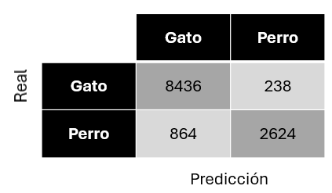

# Práctica 3 - Detección y reconocimiento de formas

Práctica de la asignatura **Visión por Computador** dedicada a la extracción de información geométrica de objetos presentes en una imagen, con el fin de caracterizarlos e identificarlos de forma automática en distintas categorías sin hacer uso de modelos de aprendizaje profundo _(Deep Learning)_.

## 👥 Autores

Este trabajo ha sido realizado por el **`Grupo 27`**: 
- [Alba Quintana Ramos](https://github.com/albaquiintanaa)
- [Néstor Jesús Henríquez Medina](https://github.com/NestorJHM)

## Contenidos

1. [Requisitos y ejecución](#requisitos-y-ejecución)
2. [Tarea 1.1 — Detección, clasificación y conteo en imagen](#tarea-11--detección,-clasificación-y-conteo-en-imagen)

---

## Requisitos y ejecución

### Dependencias

Además de las librerías habituales de visión, para poder interactuar con la ventana gráfica en la Tarea 1.1 es **imprescindible** instalar el *backend* `PyQt5`. Para las futuras métricas de la Tarea 2 se requerirán herramientas de análisis de datos:

* OpenCV (`opencv-python`)
* NumPy (`numpy`)
* Matplotlib (`matplotlib`)
* **PyQt5 (`PyQt5`)** *(Necesario para habilitar `%matplotlib qt`)*
* Scikit-Learn (`scikit-learn`)
* Seaborn (`seaborn`)

Las dependencias pueden instalarse con:

```bash
pip install opencv-python numpy matplotlib PyQt5 scikit-learn seaborn

```

### Ejecución

1. Clonar o descargar este repositorio (rama `P3`).
2. Abrir `VC_P3.ipynb` con Jupyter Notebook o VS Code.
3. Cada celda es independiente en su ejecución.
4. **Importante (Tarea 1.1):** Es necesario tener configurado el entorno gráfico interactivo (`%matplotlib qt`) para la calibración manual con el ratón. Al ejecutar la celda, se abrirá una ventana emergente donde se debe hacer clic.


---
# Tareas realizadas
---

## Tarea 1.1 — Detección, clasificación y conteo en imagen

### Objetivo

Determinar el valor individual y la cantidad total de dinero presente en una imagen estática (`Monedas.jpg`) que contiene distintas monedas. El reto radica en establecer una correspondencia métrica real a partir de los píxeles de la imagen basándose en una referencia conocida.

### Procedimiento

El proceso se divide en dos fases principales: **segmentación** y **clasificación geométrica mediante calibración**.

**1. Preprocesamiento y Segmentación:**

* La imagen original se convierte a escala de grises.
* Se aplica una umbralización automática utilizando el método de **Otsu** (`cv2.THRESH_OTSU`), que busca de manera autónoma el corte óptimo para separar las monedas del fondo.
* Se extraen únicamente los contornos externos mediante `cv2.findContours` con el flag `cv2.RETR_EXTERNAL`.

**2. Calibración interactiva:**

* El sistema muestra la imagen y detiene la ejecución esperando un clic del usuario (`plt.ginput`).
* El usuario debe **hacer clic sobre una moneda de 1€**.
* Mediante `cv2.pointPolygonTest`, el algoritmo identifica en qué contorno cayó el clic.
* Una vez aislado, se calcula su círculo envolvente mínimo (`cv2.minEnclosingCircle`) para obtener su diámetro en píxeles.
* Al saber que la moneda de 1€ mide oficialmente `23.25 mm`, se establece el **factor de escala** (mm por píxel). El contorno de referencia se resalta en 🟢 **verde** para confirmar la selección.

**3. Clasificación y recuento:**

* El algoritmo vuelve a iterar sobre todos los contornos encontrados.
* Se aplica un **filtro de ruido**: cualquier contorno con un diámetro inferior a 15 mm (según la escala calculada) es ignorado.
* Para los contornos válidos, se mide su diámetro, se convierte a milímetros reales y se compara con un diccionario interno que contiene los tamaños oficiales del Euro.
* Se asigna el valor cuya diferencia absoluta de diámetro sea la menor.
* Se anota de forma dinámica sobre la imagen el valor detectado en el centroide de cada moneda y se suma al montante total, representándose en el límite inferior de la imagen de forma centrada.


### Resultado de la Tarea 1.1


---


---

- En la **primera tarea**, el reto o tarea consiste en determinar la cantidad de dinero y monedas presentes en la imagen captada en vivo con la webcam. Una extensión válida sería la presencia de objetos que no sean monedas en la imagen analizada.

- En la **segunda tarea**, deben desarrollar un procedimiento que extraiga partículas de una imagen de test, y las clasifique en tres clases posibles. Deben tener claro que la imagen de test no puede utilizarse para ajustar el procedimiento, para ello cuentan con las imágenes de entrenamiento. En este sentido, además de la imagen de test *MPs_test.jpg* con su correspondiente archivo de anotaciones *MPs_test_bbs.csv*, se proporcionan de cara al entrenamiento, imágenes de tres clases de objetos recogidos en playas canarias: fragmentos plásticos, *pellets* y alquitrán. Para cada categoría se proporciona una imagen completa y una subimagen de la misma. Las dos primeras categorías se consideran microplásticos cuando miden menos de 5mm, mientras que la tercera es muy habitual encontrarlas en playas canarias. Observar que dado que cada imagen contiene muestras de una única categoría, a efectos prácticos disponen de un conjunto de datos anotado. La tarea propuesta consiste en hacer uso de las imágenes de entrenamiento proporcionadas, extraer de forma automatizada las partículas e identificar patrones en sus características geométricas y de apariencia o entrenar un clasificador con ellas, que puedan permitir la clasificación de las partículas en la imagen de test. El resultado obtenido en la imagen de test, debe mostrarse por medio las métricas mostradas en el cuaderno, incluyendo la matriz de confusión, donde se comparan las anotaciones con las predicciones.

  
*Ejemplo de matriz de confusión*

A la hora de considerar posibles características geométricas, como punto de partida para la extracción de descriptores de las partículas, se proporciona enlace al trabajo [SMACC: A System for Microplastics Automatic Counting and Classification](https://doi.org/10.1109/ACCESS.2020.2970498) en el que se adoptan algunas propiedades geométricas para dicho fin. De forma resumida, las características geométricas utilizadas en dicho trabajo fueron:

- Área en píxeles (A)
- Perímetro en píxeles (P)
- Compacidad (relación del cuadrado del perímetro con el área C=P^2/A)
- Relación del área de la partícula con el área del contenedor que la contiene
- Relación del ancho y el alto del contenedor
- Relación entre los ejes de la elipse ajustada
- Definido el centroide, relación entre las distancias menor y mayor al contorno

En relación a la segmentación de las partículas, una probable primera observación es que la aplicación del umbralizado para separarlas del fondo, es delicada. Preprocesamiento como el ecualizado del histograma, suavizar la imagen de entrada o reducir su tamaño, o aplicar heurísticas basadas en el tamaño mínimo y máximo de los contornos localizados, y la distancia mínima entre ellos, pueden ayudar a filtrar falsas detecciones, pero a pesar de ello, será un desafío obtener una separación perfecta para todas las imágenes con la misma estrategia. Añadir, que la imagen de fragmentos contiene unas 80 partículas, la de *pellets* unas 55 y la de alquitrán unas 54.

<!--
  
*Ejemplo ilustrativo contornos detectados en la imagen de fragmentos*

Si quieren ir más allá, sugerir explorar técnicas de segmentación recientes y potentes como [Segment anything o SAM](https://segment-anything.com) o [OneFormer](https://github.com/SHI-Labs/OneFormer), y extensiones como , [SAM 2](https://github.com/facebookresearch/segment-anything-2), [FastSAM](https://github.com/CASIA-IVA-Lab/FastSAM) o [Count anything](https://github.com/ylqi/Count-Anything). No duden en compartir otras alternativas que descubran.-->

---