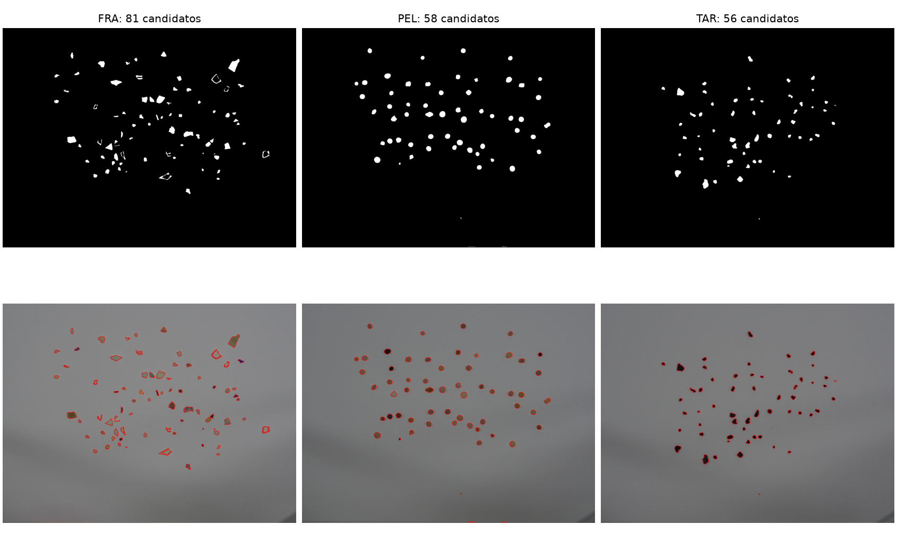
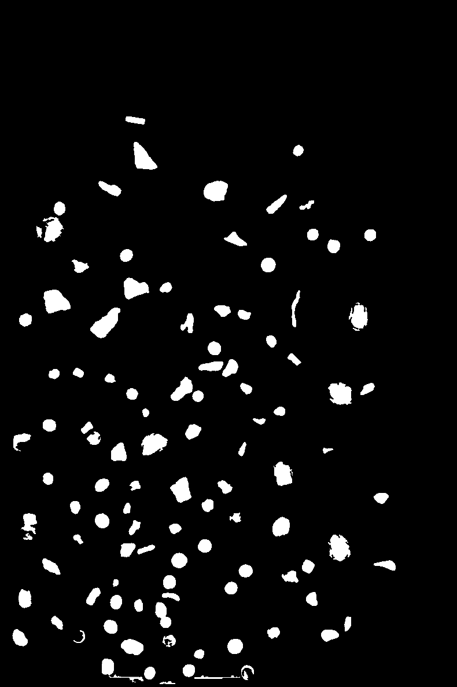
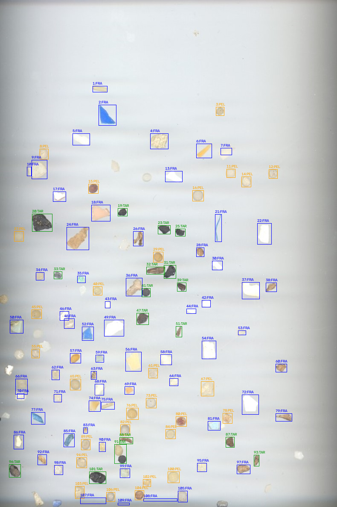
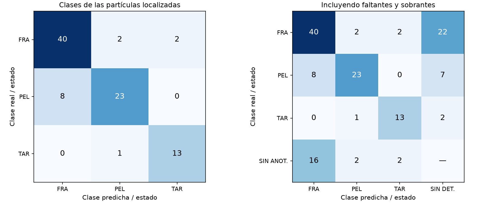
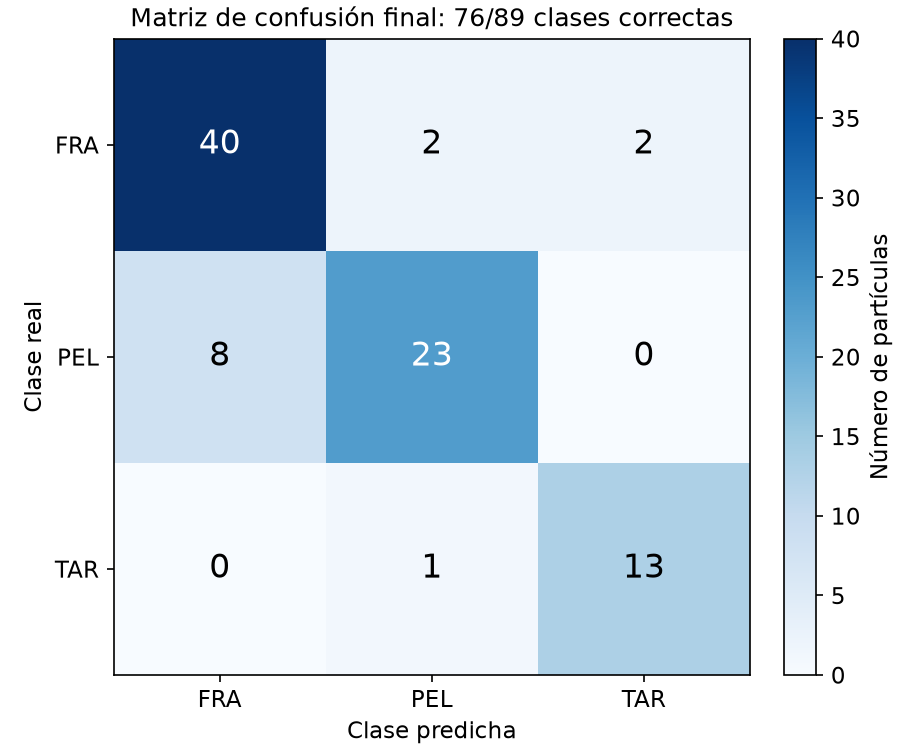

# Práctica 3 - Detección y reconocimiento de formas

Práctica de la asignatura **Visión por Computador** dedicada a la extracción de información geométrica de objetos presentes en una imagen, con el fin de caracterizarlos e identificarlos de forma automática en distintas categorías sin hacer uso de modelos de aprendizaje profundo _(Deep Learning)_.

## 👥 Autores

Este trabajo ha sido realizado por el **`Grupo 27`**: 
- [Alba Quintana Ramos](https://github.com/albaquiintanaa)
- [Néstor Jesús Henríquez Medina](https://github.com/NestorJHM)

## Contenidos

1. [Requisitos y ejecución](#requisitos-y-ejecución)
2. [Tarea 1 - Detección y reconocimiento de monedas](#tarea-1---detección-y-reconocimiento-de-monedas)
    - [Tarea 1.1: Cálculo del dinero en una imagen](#tarea-11-cálculo-del-dinero-en-una-imagen)
    - [Tarea 1.2: Demostrador interactivo en tiempo real](#tarea-12-demostrador-interactivo-en-tiempo-real)
3. [Tarea 2 - Segmentación y clasificación de microplásticos](#tarea-2---segmentación-y-clasificación-de-microplásticos)
    
    - [Paso 1: carga de imágenes](#paso-1-cargar-las-imágenes)
    - [Paso 2: Separar y medir las partículas de entrenamiento](#paso-2-separar-y-medir-las-partículas-de-entrenamiento)
    - [Paso 3: Reglas de características para las clases FRA, PEL y TAR](#paso-3-reglas-de-características-para-fra-pel-y-tar)
    - [Paso 4: Encontrar y clasificar las partículas del test](#paso-4-encontrar-y-clasificar-las-partículas-del-test)
    - [Paso 5: Comprobar los aciertos y los errores](#paso-5-comprobar-los-aciertos-y-los-errores)

4. [Estructura del proyecto](#estructura-del-proyecto)
5. [Referencias](#referencias)


---

## Requisitos y ejecución

### Dependencias

Además de las librerías habituales, para poder interactuar con la ventana gráfica en la Tarea 1.1 es **imprescindible** instalar el *backend* `PyQt5`. Para las futuras métricas de la Tarea 2 se requerirán herramientas de análisis de datos:

* OpenCV (`opencv-python`)
* NumPy (`numpy`)
* Matplotlib (`matplotlib`)
* **PyQt5 (`PyQt5`)** *(Necesario para habilitar `%matplotlib qt`)*
* Scikit-Learn (`scikit-learn`)
* Seaborn (`seaborn`)

Las dependencias pueden instalarse con:

```bash
pip install opencv-python numpy matplotlib PyQt5 scikit-learn seaborn

```

### Ejecución

1. Clonar o descargar este repositorio (rama `P3`).
2. Abrir `VC_P3.ipynb` con Jupyter Notebook o VS Code.
3. Cada celda es independiente en su ejecución.
4. **Importante (Tarea 1.1):** Es necesario tener configurado el entorno gráfico interactivo (`%matplotlib qt`) para la calibración manual con el ratón. Al ejecutar la celda, se abrirá una ventana emergente donde se debe hacer clic.


---
# Tareas realizadas
---

## Tarea 1 - Detección y reconocimiento de monedas

### Tarea 1.1: Cálculo del dinero en una imagen

#### Objetivo

Determina la cantidad total de dinero presente en una imagen estática de monedas a partir de sus dimensiones. Para ello, se establece una relación paramétrica entre píxeles y milímetros utilizando como referencia una moneda de valor conocido (1€) y se comparan los diámetros medidos con las dimensiones oficiales de las monedas de euro.

#### Procedimiento

1. Se carga la imagen y se convierte a escala de grises.
2. Para mitigar el ruido y aislar las monedas, se evaluaron dos filtros de desenfoque:
    - **Filtro Mediana (`cv2.medianBlur`):** Si bien elimina eficazmente el ruido sal y pimienta, tiende a deformar la circularidad de los contornos finos.
    - **Filtro Gaussiano (`cv2.GaussianBlur`):** Al ponderar la vecindad por cercanía, suaviza las texturas internas de la moneda preservando de manera más precisa su geometría circular global. Se seleccionó este filtro para el procesamiento final.
3. Se emplea el método de **Otsu** (`cv2.THRESH_OTSU`) para separar automáticamente la figura del fondo, generando una máscara binaria invertida (monedas blancas sobre fondo oscuro)
4. Se localizan las componentes conectadas de los objetos detectados mediante `cv2.findContours`.
5. Mediante `plt.ginput`, se solicita al usuario que haga clic sobre la moneda de 1€. El sistema verifica en qué contorno fue el clic mediante la función de testeo de polígonos `cv2.pointPolygonTest`, calcula el radio de la circunferencia envolvente (`cv2.minEnclosingCircle`) y se establece el factor de escala (mm/px).

    ```python
    contorno_ref = None
    for contorno in contornos:
        ref = cv2.pointPolygonTest(contorno, (clic_x, clic_y), False)
        if ref >= 0:
            contorno_ref = contorno
    	    print("Esto es una moneda")
            break
    
    if contorno_ref is not None:
        _, radio_ref = cv2.minEnclosingCircle(contorno_ref)
        diametro_ref = radio_ref * 2
        escala = diametro_monedas[1.00] / diametro_ref
    ```

6. Se iteran los contornos filtrando previamente el ruido ambiental (objetos menores a 15mm), se extrapola el diámetro en milímetros y se clasifica iterando sobre un diccionario de medidas reales, asignando el valor de la moneda que devuelva el error absoluto mínimo respecto a la medida en píxeles.


#### Resultado de la Tarea 1.1

Las fases por las que ha pasado para obtener dicho resultado son las siguientes:

| Paso del algoritmo | Previsualización | Descripción |
| :---: | :---: | :--- |
| **1. Original** |  | Imagen de entrada original leída en formato BGR y convertida a escala de grises. |
| **2a. Filtro Gaussiano (Elegido)** |  | Filtro lineal (`5x5`). Se selecciona para el procesamiento final ya que suaviza las texturas internas de la moneda preservando mejor la forma geométrica global del contorno. |
| **2b. Filtro Mediana (Descartado)** |  | Filtro no lineal. Aunque elimina eficazmente el ruido sal y pimienta, tiende a deformar y pixelar la circularidad de los bordes. |
| **3. Binarización** |  | Separación de fondo y figura aplicando el método de umbralización invertida automática de Otsu (`cv2.THRESH_OTSU`) sobre la imagen suavizada. |
| **4. Resultado Final** |  | Extracción de contornos externos, cálculo del diámetro haciendo el click en la moneda indicada y clasificación de los valores. |


---

### Tarea 1.2: Demostrador interactivo en tiempo real

#### Objetivo

Diseña un demostrador que utilice la cámara para detectar las monedas presentes en una escena y determinar la cantidad de dinero total, sin utilizar modelos de aprendizaje profundo.

#### Procedimiento

Para lograr un sistema "robusto", se sigue un desarrollo iterativo. En el código se expone primero una aproximación geométrica básica para ilustrar sus debilidades en entornos reales, y posteriormente se presenta la versión definitiva que las soluciona:

1. **Aproximación por Binarización y Contornos:**
Este primer método captura el fotograma y aplica una ecualización de histograma local (**CLAHE**), suavizándolo con un filtro bilateral (`cv2.bilateralFilter`) para reducir el ruido conservando bordes. 
    - A continuación, binariza la imagen usando un umbral adaptativo (`cv2.adaptiveThreshold`) y limpia los resultados con operaciones morfológicas (cierre y apertura). 
    - Tras calibrar el punto de referencia mediante `cv2.pointPolygonTest`, se miden las monedas usando `cv2.minEnclosingCircle`. 
    - Se incorpora la tecla 'R' para invertir la máscara binaria, adaptándose a fondos claros u oscuros.

    > Aunque funciona en condiciones ideales, falla drásticamente en tiempo real. Si dos monedas se solapan o simplemente se tocan, la función cv2.minEnclosingCircle las fusiona en una única figura gigante. Además, los reflejos de luz destruyen las máscaras por dentro.

- Se intentó segmentar las monedas dividiéndolas únicamente en dos grupos: "doradas" y "plateadas". Esta idea se descartó en pruebas previas porque los cambios en la iluminación ambiental confundían ambos colores y, especialmente, porque las monedas bimetálicas (1€ y 2€) hacían colapsar la clasificación bidimensional al contener ambos tonos simultáneamente.


2. **Versión Definitiva (Transformada de Hough + HSV en 3 grupos):**
    - **Detección Geométrica:** Se sustituyeron los contornos por la **Transformada de Hough para gradientes circulares (`cv2.HoughCircles`)**. Este algoritmo busca curvas matemáticas, lo que permite detectar circunferencias perfectas aunque las monedas estén juntas, solapadas o tengan brillos intensos.

    ```python
    circulos = cv2.HoughCircles(
        gris_suavizado, cv2.HOUGH_GRADIENT, 1, 30,
        param1=100, param2=40, minRadius=15, maxRadius=80
    )
    ```

* **Clasificación Cromática Segregada:** Dado que monedas como la de 1€ (23.25 mm) y la de 50 céntimos (24.25 mm) difieren apenas 1 mm, se evitó la competencia por tamaño midiendo el color en el espacio **HSV**. 
    - El programa extrae el color del centro (40% del radio) y del anillo exterior (85%). Si la diferencia de saturación entre centro y borde es grande, la moneda se aísla en el grupo "Bimetal". El resto se separa en "Cobre" o "Doradas" evaluando su matiz.
    
    ```python
    # Segregación de monedas bimetálicas mediante análisis anular
    dif_saturacion = abs(int(hsv_centro[1]) - int(hsv_anillo[1]))
    es_bimetal = dif_saturacion > 40
    ```

* **Estabilización Temporal:** El ruido del sensor provocaba que el recuento final vibrara, teniendo muy poca estabilidad. Se evaluó estabilizar los datos con la media, la mediana y la moda. La media y la mediana resultaban arrastradas por errores puntuales de la cámara. Se decidió implementar la **moda** matemática sobre los totales redondeados a 2 decimales en una ventana de 15 fotogramas. Esto descarta en medida las lecturas anómalas de fotogramas aislados y reduce las fluctuaciones del total, ofreciendo los resultados más estables logrados durante el desarrollo.

    ```python
    # Efecto ventana (últimos 15 fotogramas) con moda matemática
    total = max(set(ultimos_totales), key=ultimos_totales.count)
    ```

> _**Nota sobre la estabilidad:** Aunque este código mejora los resultados notablemente frente a la detección por contornos y suaviza drásticamente las oscilaciones, el sistema en vídeo directo no alcanza una estabilidad absoluta. Las micro-variaciones lumínicas, el parpadeo del sensor y los cambios en el ángulo de perspectiva provocan fluctuaciones puntuales. No obstante, representa un equilibrio funcional óptimo dentro de las restricciones de la visión clásica._

#### Resultado de la Tarea 1.2

| Fase del desarrollo | Demostración | Comentarios |
| --- | --- | --- |
| **Primer Método** |  | Cuando las monedas se tocan, el método por contornos crea una figura irregular gigante o no detecta ningún círculo, fallando el conteo. |
| **Método Definitivo** |  | El uso de `HoughCircles` permite separar los objetos, mientras que la separación HSV en 3 grupos y la moda temporal congelan el resultado del cálculo en vivo. |


---

## Tarea 2 - Segmentación y clasificación de microplásticos

### Objetivo

Aplicar técnicas de umbralizado y análisis morfológico para segmentar muestras de microplásticos procedentes de imágenes reales, desarrollando un clasificador automático basado en descriptores geométricos y visuales.


### PROCEDIMIENTO
---
### Paso 1. Cargar las imágenes

Las tres primeras fotografías que vamos a cargar contienen ejemplos de una sola clase cada fotografía. Por eso sabemos a qué clase corresponde los objetos de cada una de ellas.

También vamos a cargar la fotografía de prueba "MPs_test.jpg", que mezcla las tres clases; **todavía no vamos a leer sus anotaciones**: primero vamos a predecir y después comprobaremos los errores.

---
### Paso 2. Separar y medir las partículas de entrenamiento

Pasamos cada fotografía a gris y suavizamos un poco la imagen con `GaussianBlur` de **5 × 5** para reducir pequeñas variaciones. Después usamos un umbral que se adapta a cada zona (`adaptiveThreshold`): compara cada píxel con una referencia de sus vecinos, usando una ventana de **151 × 151** y restando **5** a esa referencia, así obligamos a que el píxel sea suficientemente más oscuro que su entorno.

El resultado es una **máscara**, donde las zonas candidatas son blancas y el resto negro. Aplicamos un cierre de **3 × 3**, para unir pequeños cortes o interrupciones de la máscara antes de buscar contornos de partículas. Encontramos los bordes de las zonas blancas con `findContours` y conservamos las de **área ≥ 200 píxeles²** que no tocan el borde de la fotografía. Rellenamos cada borde exterior para medir su silueta. (función `obtener_contornos(mascara, area_minima)`)

De cada silueta extraemos siete medidas que usaremos como características (función `medir_geometría(contorno)`):

| Medida | Qué nos dice |
|---|---|
| Área | Cuánta superficie ocupa, estimada en píxeles². |
| Perímetro | Cuánto mide su borde, en píxeles. |
| Compacidad: perímetro² / área | Cuánto borde tiene respecto a su superficie. Un círculo ideal vale aproximadamente 12,57; formas menos regulares suelen dar valores mayores. |
| Área / área del rectángulo que la contiene | Cuánto llena el rectángulo que la rodea. |
| Ancho / alto de ese rectángulo | Si ocupa más en horizontal o en vertical. Cambia al girar la partícula. |
| Eje menor / eje mayor de una elipse ajustada | Si su forma se parece más a algo redondo o alargado. Cerca de 1 indica ejes parecidos. |
| Distancia menor / distancia mayor desde su centro al borde | Si el borde está a una distancia parecida del centro. Cerca de 1 apunta a una forma redondeada. |

El **centro** se calcula con los momentos de la silueta (`moments`). La distancia menor se mide hasta los segmentos del borde con `pointPolygonTest`; la mayor se calcula hasta sus puntos. En una forma muy cóncava el centro puede quedar fuera: usamos el valor absoluto de la distancia aunque esta medida no es una garantía de que dicha forma redonda.

Para reconocer el **alquitrán**, además, miramos dos cosas: lo oscura que es la partícula y cuánto color tiene.
- **Gris corregido**: indica lo oscura que es la partícula comparada con el fondo de su fotografía. Un valor cercano a 0 indica que es muy oscura; cercano a 1, que es parecida al fondo o más clara. Así intentamos que las diferencias de iluminación entre fotografías afecten menos.
- **Saturación media**: indica cuánto color tiene la partícula. Un objeto negro o gris suele tener poca saturación; uno azul intenso puede tener mucha, aunque también sea oscuro. Esto ayuda a distinguir algunos fragmentos de las partículas de alquitrán.

Para calcular el gris corregido usamos tres referencias:

1. El **gris de la partícula**. Ordenamos sus píxeles de más oscuros a más claros y tomamos el valor situado en la posición del 25 %. Así los reflejos claros influyen menos.

2. El **gris del fondo cercano**. Miramos una pequeña franja alrededor de la partícula y tomamos su valor central de gris, evitando las demás partículas detectadas.

3. El **gris más oscuro de toda la fotografía**. Lo usamos como referencia para ajustar la comparación.

Con esos valores obtenemos un número entre 0 y 1. Es un ajuste aproximado, puesto que puede fallar si hay ruido o cambia mucho la iluminación. (funcion `medir_apariencia(gris, saturacion, siluetas, contorno, referencia_oscura)`)



---
### Paso 3. Reglas de características para FRA, PEL y TAR

Una vez obtenidas las siete medidas de forma, además del gris corregido y saturación media, a continuación, para decidir qué tipo de fragmento se va a predecir, usaremos **cinco medidas**: compacidad, relación de distancias, ocupación del rectángulo, gris corregido y saturación media.

Aplicamos estas condiciones **en este orden**. La primera que se cumple decide la clase:

| Orden | Condición | Resultado |
|---|---|---|
| 1 | Gris corregido ≤ 0,30 **y** saturación ≤ 0,10 | TAR muy oscuro y casi sin color, incluso si es redondeado. |
| 2 | Relación de distancias ≥ 0,70 **y** compacidad ≤ 16; **o bien** ocupación del rectángulo ≥ 0,75 **y** compacidad ≤ 16,5 | PEL: forma redondeada o compacta que llena bien su rectángulo. |
| 3 | Si no cumplió las condiciones 1 y 2: gris corregido ≤ 0,50 **y** saturación ≤ 0,30 | TAR oscuro que no ha mostrado la forma de PEL. |
| 4 | Resto de los casos | FRA. |

La primera condición permite encontrar alquitrán negro sin obligarle a ser irregular. Su límite de saturación es estricto para no tomar como alquitrán cualquier pellet oscuro que conserve color. La condición de PEL protege los pellets algo oscuros pero redondeados. La segunda condición TAR admite alquitrán menos negro, siempre que no tenga demasiado color ni haya cumplido la condición de PEL. **Los dos caminos hacia TAR exigen oscuridad: una partícula clara nunca recibe esa clase.** Todavía puede haber pellets negros o fragmentos oscuros que cumplan una condición TAR; son los límites de estas reglas, pues no son perfectas.

#### Resultados del entrenamiento
```
Clase / medida: percentil 25, mediana, percentil 75, percentil 90
FRA / compacidad: 16.749, 18.596, 25.521, 76.530
FRA / relacion_distancias: 0.278, 0.433, 0.571, 0.633
FRA / ocupacion_contenedor: 0.508, 0.633, 0.675, 0.714
FRA / gris_corregido: 0.557, 0.776, 0.828, 0.861
FRA / saturacion_media: 0.094, 0.138, 0.264, 0.409
PEL / compacidad: 14.299, 14.462, 14.865, 15.878
PEL / relacion_distancias: 0.735, 0.832, 0.871, 0.894
PEL / ocupacion_contenedor: 0.738, 0.757, 0.769, 0.782
PEL / gris_corregido: 0.491, 0.591, 0.667, 0.696
PEL / saturacion_media: 0.239, 0.317, 0.414, 0.548
TAR / compacidad: 15.379, 16.009, 16.973, 18.354
TAR / relacion_distancias: 0.488, 0.553, 0.653, 0.746
TAR / ocupacion_contenedor: 0.648, 0.677, 0.706, 0.744
TAR / gris_corregido: 0.106, 0.134, 0.158, 0.200
TAR / saturacion_media: 0.076, 0.086, 0.096, 0.113

Entrenamiento: 162/183 aciertos (88.5 %)
Filas: clase real; columnas: FRA, PEL, TAR
    
 FRA [  65  1   8]
 PEL [  6   44  5]
 TAR [  0   1   53]
       FRA PEL TAR
 ```

---

### Paso 4. Encontrar y clasificar las partículas del test

La imagen de prueba `MPs_test.jpg` tiene otro tamaño y un fondo menos uniforme. Para separar las partículas combinamos zonas oscuras, coloreadas y casi blancas:

1. Pasamos a gris y suavizamos con **5 × 5**. Un suavizado mayor, de **51 × 51**, da una referencia aproximada del fondo cercano.
2. Marcamos las zonas **más oscuras que esa referencia por más de 8** niveles. `subtract` deja a cero las diferencias negativas y evita que aparezcan valores erróneos al restar imágenes de 8 bits.
3. Añadimos zonas con **saturación > 25**. La saturación es el canal S de HSV y señala cuánto color tiene un píxel; así recuperamos objetos coloreados con poco contraste en gris.
4. Añadimos zonas con **gris suavizado > 245**, para incluir partículas casi blancas.
5. Unimos las tres máscaras con `bitwise_or`, aplicamos un cierre **elíptico de 3 × 3** y conservamos contornos de **área ≥ 50 píxeles²** que no tocan el borde.

El área mínima es menor porque las partículas del test aparecen más pequeñas. Estos valores se aplican a esta fotografía; pueden necesitar cambios con otra iluminación o resolución. El cierre ayuda con pequeños cortes, pero también puede unir objetos cercanos.

Después medimos **las mismas siete características de forma y las dos de apariencia** y aplicamos **exactamente las reglas del paso 3**. En este punto guardaremos las predicciones. Encontrar un contorno no garantiza que sea una partícula completa ni que su clase sea correcta.
```
Candidatos encontrados: 109
FRA: 64
PEL: 28
TAR: 17
```




---
### Paso 5. Comprobar los aciertos y los errores

Ahora leemos `MPs_test_bbs.csv`, que nos indica la clase y el rectángulo de cada partícula real (anotación). Utilizaremos las anotaciones para **comprobar** nuestro clasificador.

Para decidir si hemos encontrado una partícula comparamos su rectángulo real con uno detectado. Usamos **IoU**: área que comparten dividida entre el área total que cubren ambos. Vale 1 si coinciden y 0 si no se tocan. Establecemos un umbral de emparejamiento de **IoU ≥ 0,50**. Ordenamos de mayor a menor coincidencia y aceptamos una pareja si ninguno de sus rectángulos se ha usado.

Nos haremos dos preguntas:

- **Detección:** ¿hemos localizado la partícula, sin importar qué clase hemos dicho?
- **Clasificación:** entre las partículas localizadas, ¿hemos acertado FRA, PEL o TAR?

La matriz de confusión tiene las **clases reales en las filas** y las **predichas en las columnas**. Su diagonal contiene los aciertos. La primera matriz solo incluye parejas; la segunda añade las anotaciones sin pareja y las detecciones sobrantes. La casilla inferior derecha de esta última no tiene significado y la mostramos con un guion.

Para las métricas usamos estos recuentos: **TP** son aciertos, **FP** son Falsos Positivos (resultados que damos de más) y **FN** son los casos que no acertamos (Falsos Negativos). 

| Medida | Explicación sencilla |
|---|---|
| Precisión = TP / (TP + FP) | De lo que damos como resultado, qué parte está bien. |
| Recall = TP / (TP + FN) | De lo que había que encontrar o reconocer, qué parte conseguimos. |
| F1 = 2·TP / (2·TP + FP + FN) | Combina precisión y recall. Cerca de 1 es mejor. |
| F1 macro completo | Media del F1 de FRA, PEL y TAR, dando el mismo peso a cada clase. |
| Exactitud de las parejas | Clases correctas divididas entre las partículas localizadas. |
| Aciertos completos sobre todas las anotaciones | Partículas bien localizadas y clasificadas, divididas entre todas las reales. |
```
Anotaciones: 120 | Detecciones: 109 | Parejas: 89
Sin pareja real: 31 | Detecciones sobrantes: 20
Clases correctas entre las parejas: 76/89 = 85.4 %
Aciertos completos sobre todas las anotaciones: 76/120 = 63.3 %
F1 macro completo: 0.700

Alcance / clase              Precisión     Recall         F1
deteccion / GLOBAL               0.817      0.742      0.777
proceso_completo / FRA           0.625      0.606      0.615
proceso_completo / PEL           0.821      0.605      0.697
proceso_completo / TAR           0.765      0.812      0.788
```


#### **Interpretación de resultados**

El proceso encuentra **109 candidatos**, de los que **89** se emparejan con las 120 anotaciones. Entre estas parejas se aciertan **76 clases**: **40 FRA, 23 PEL y 13 TAR**. Esto supone un **85,4 %** de clases correctas entre las localizadas y un **63,3 %** de aciertos completos sobre todas las partículas anotadas.

Hay **13 confusiones de clase**, **31 anotaciones sin pareja** y **20 detecciones sobrantes**. Por eso es importante contar también las partículas que faltan y los resultados que sobran, además de revisar las etiquetas acertadas.

La detección obtiene una precisión de **0,817**, recall **0,742** y F1 **0,777**. El F1 macro del proceso completo es **0,700**.

### Matriz final de confusión


---
## Estructura del Proyecto

La estructura actual del proyecto es la siguiente. El cuaderno `VC_P3.ipynb` contiene las dos tareas: reconocimiento de monedas y clasificación de partículas.

```text
VC_PRACTICAS/
├── README.md                        # Descripción y explicación de la práctica
├── VC_P3.ipynb                      # Tarea 1: monedas y Tarea 2: microplásticos
├── Monedas.jpg                      # Imagen de monedas para la Tarea 1
├── monedas2.jpg                     # Otra imagen de monedas
├── FRA.JPG                          # Imagen completa de fragmentos
├── PEL.JPG                          # Imagen completa de pellets
├── TAR.JPG                          # Imagen completa de alquitrán
├── FRA-MINI.png                     # Recorte con fragmentos
├── PEL-MINI.png                     # Recorte con pellets
├── TAR-MINI.png                     # Recorte con alquitrán
├── MPs_test.jpg                     # Imagen de test con las tres clases
├── MPs_test_bbs.csv                 # Clases y rectángulos de las partículas anotadas
├── tarea_1/                         # Resultados del procesamiento de monedas
│   ├── 1_original_gris.jpg
│   ├── 2_suavizada_gaussiana.jpg
│   ├── 2_suavizada_mediana.jpg
│   ├── 3_binarizada.jpg
│   └── 4_resultado.jpg
└── tarea_2/                         # Resultados de la clasificación de partículas
    └── resultados/                  # Máscaras, predicciones y evaluación del test
        ├── FRA_mascara.png                    # Máscara de los fragmentos de entrenamiento
        ├── PEL_mascara.png                    # Máscara de los pellets de entrenamiento
        ├── TAR_mascara.png                    # Máscara del alquitrán de entrenamiento
        ├── entrenamiento.png                  # Máscaras y contornos del entrenamiento
        ├── caracteristicas_entrenamiento.csv  # Medidas de cada partícula de entrenamiento
        ├── resumen_entrenamiento.csv          # Resumen de las medidas por clase
        ├── mascara_test.png                   # Partículas separadas del fondo del test
        ├── test_clasificado.png               # Imagen con las clases predichas
        ├── resultado_test.png                 # Máscara y clasificación juntas
        ├── predicciones_test.csv              # Clase, rectángulo y medidas de cada candidato
        ├── asociaciones_test.csv              # Parejas entre detecciones y anotaciones
        ├── metricas_test.csv                  # Precisión, recall y F1
        ├── resumen_test.csv                   # Totales de detecciones, aciertos y errores
        ├── matrices_confusion.png             # Recuentos con y sin faltantes y sobrantes
        └── matriz_confusion_final.png         # Matriz de clasificación FRA, PEL y TAR
```

- Todos los archivos de entrada están en la carpeta principal, junto a `VC_P3.ipynb`. 

- La **Tarea 1** utiliza las imágenes de monedas.

- La **Tarea 2** utiliza las imágenes completas `FRA.JPG`, `PEL.JPG` y `TAR.JPG` para medir las partículas de entrenamiento; después clasifica `MPs_test.jpg` y consulta `MPs_test_bbs.csv` para comprobar los resultados.

- Las imágenes y los CSV de `tarea_2/resultados/` se generan al ejecutar las celdas de la Tarea 2 en orden.

---

# Referencias

- [Material docente oficial: ULPGC - Visión por Computador, Tema 3 (Procesamiento de imagen).](https://aep27.ulpgc.es/mod/resource/view.php?id=183113)
- [Material docente oficial: ULPGC - Visión por Computador, Tema 4 (Detección de características).](https://aep27.ulpgc.es/mod/resource/view.php?id=183117)

### Tarea 1: Detección y reconocimiento de monedas

- [Tutorial OpenCV - Función findContours (HetPro)](https://hetpro-store.com/TUTORIALES/opencv-findcontours/?srsltid=AU7gw4Vh8qvHAzdz3LKVhhBp38z6-qQP5ekuIxHiYYR8xJRL_PztFQNX)
- [Documentación Matplotlib - matplotlib.pyplot.ginput](https://matplotlib.org/stable/api/_as_gen/matplotlib.pyplot.ginput.html)
- [Documentación OpenCV - Contour Features](https://docs.opencv.org/4.13.0/dd/d49/tutorial_py_contour_features.html)
- [GeeksForGeeks - Click response on video output using events in OpenCV](https://www.geeksforgeeks.org/python/click-response-on-video-output-using-events-in-opencv-python/)
- [GeeksForGeeks - CLAHE Histogram Equalization OpenCV](https://www.geeksforgeeks.org/python/clahe-histogram-eqalization-opencv/)
- [GeeksForGeeks - Python Bilateral Filtering](https://www.geeksforgeeks.org/python/python-bilateral-filtering/)
- [Luis Llamas - OpenCV Operaciones Morfológicas (Erosión y Dilatación)](https://www.luisllamas.es/opencv-operaciones-morfologicas-erosion-dilatacion/)
- [Luis Llamas - OpenCV Transformada Hough (Líneas y Círculos)](https://www.luisllamas.es/opencv-transformada-hough-lineas-circulos/)
- Búsquedas de Google: 
    - "ginput() en ipynb"
    - "Averiguar punto dentro de un contorno con findContours()".

### Tarea 2: Segmentación y clasificación de microplásticos
- [Material docente de la asignatura.](https://github.com/otsedom/otsedom.github.io/tree/main/VC/P3)
- [Documentación Matplotlib](https://matplotlib.org/stable/index.html)
- [Documentación OpenCV](https://docs.opencv.org/)

---

## NOTA: Uso de IA

* En la elaboración de esta práctica se ha empleado uso de IA como apoyo para la estructuración del documento `README.md`. Todo el código ha sido verificado y comprendido íntegramente por los autores para ajustarse a las especificaciones teóricas evaluables en la asignatura.

---
