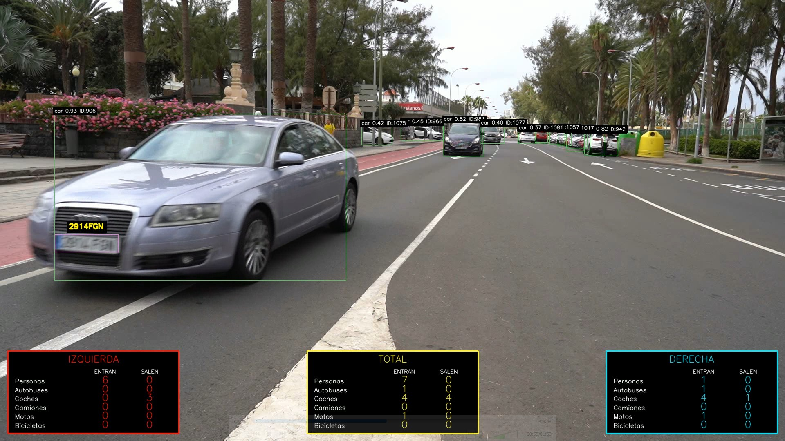
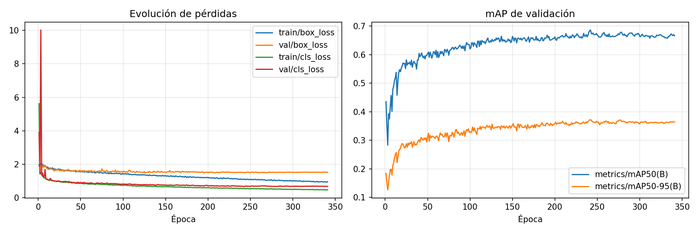
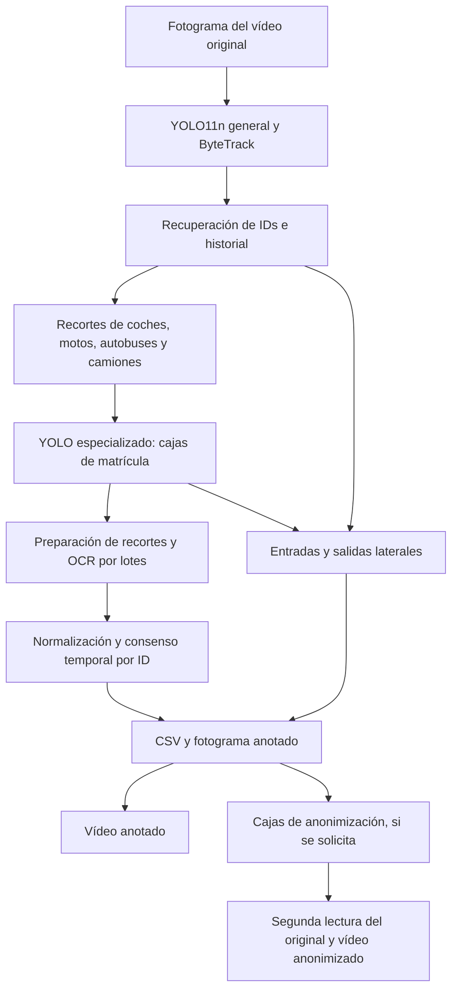
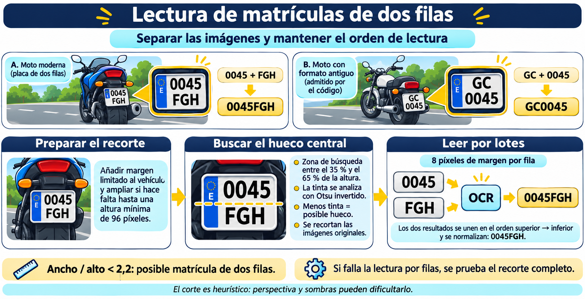
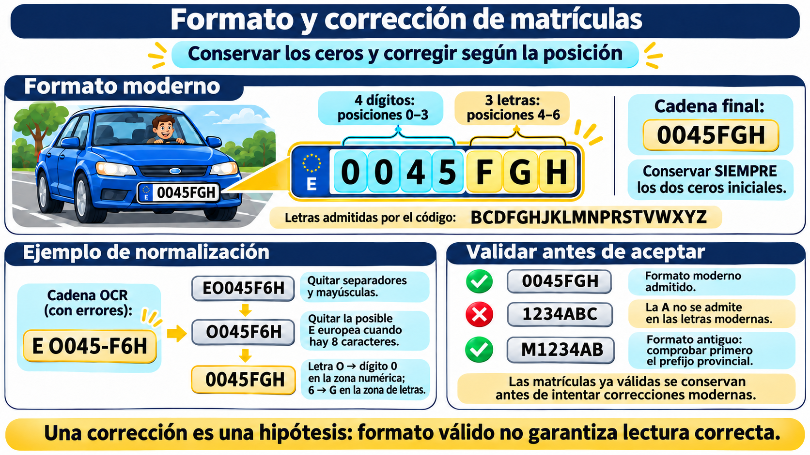
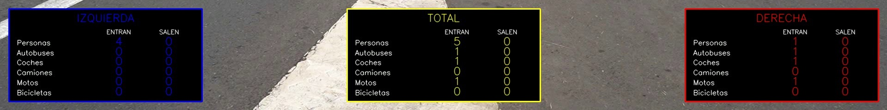
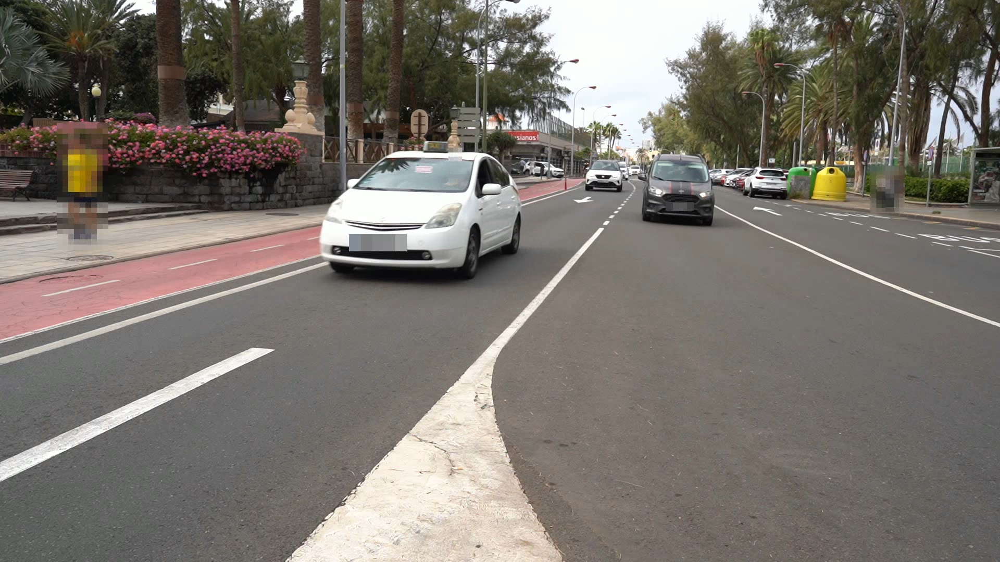
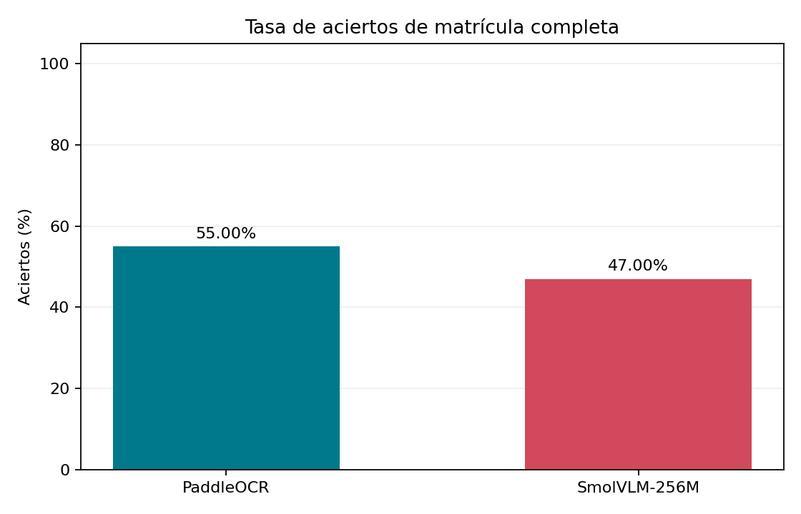
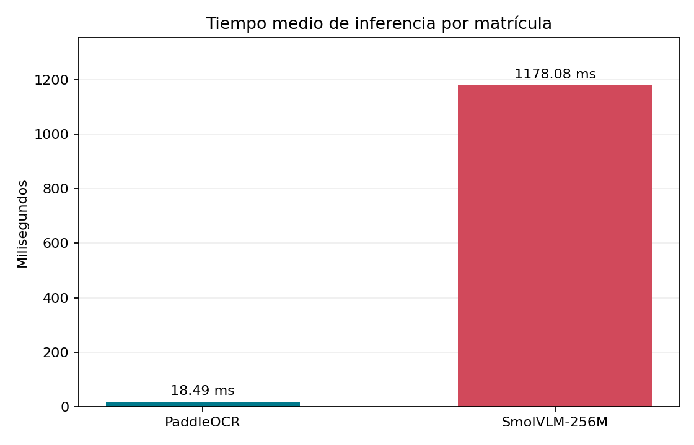

# Visión por Computador
---
# Práctica 4. Detección y seguimiento de personas, vehículos, matrículas y comparativa de motores de reconocimiento de texto (OCR).
---
## Introducción
- En esta práctica mostramos un prototipo de visión por computador desarrollado con los conocimientos adquiridos como base en la asignatura "Visión por Computador", en el que se procesa un vídeo de test (`video_test.mp4`), para  detectar y hacer seguimiento de personas y vehículos, manteniendo sus identidades (IDs), detectar matrículas y reconocer su texto. El sistema incorpora recuentos de entradas y salidas, recuperación de identidades tras ocultaciones, anonimización y exportación de resultados.

- Por último, se hace también se hace una comparativa entre PaddleOCR y SmolVLM sobre recortes anotados de matrículas.



*Figura 1. Captura de un fotograma de `video_anotado.mp4`: detecciones con ID, matrícula consolidada y paneles de flujo en la franja inferior.*

## Autores
- **[Alba Ramos Quintana](https://github.com/albaquiintanaa)**.
- **[Néstor J. Henríquez Medina](https://github.com/NestorJHM)**.

## Repositorio de trabajo:
- [Enlace a GitHub](https://github.com/albaquiintanaa/VC_PRACTICAS)

## Datasets utilizados
- [Enlace al conjunto de datos de vehiculos - Google Drive](https://drive.google.com/drive/folders/1e3HIy9WbX5XRJiuF93kMnaqINn3kzk8M?usp=sharing)
- [Enlace al conjunto de datos de recortes de matrículas para comparativa de OCRs - Google Drive](https://drive.google.com/drive/folders/1ZyorLemKLo0Tep22Nx83Fj17AdP1MqF3?usp=sharing)

## Vídeos y fichero CSV
- ### [Vídeo con detección, tracking y flujo](https://youtu.be/P4tNQSdu4bE)

- ### [Vídeo anonimizado](https://youtu.be/IMW8r0eyln4)

- ### [Fichero CSV con detecciones](/results/plates_secuencial/detecciones.csv)

---

## Tabla de contenidos

- [Autores](#autores)
- [1. Objetivos y alcance](#1-objetivos-y-alcance)
- [2. Organización del proyecto](#2-organización-del-proyecto)
- [3. Entorno y puesta en marcha](#3-entorno-y-puesta-en-marcha)
  - [3.1. Dependencias y GPU](#31-dependencias-y-gpu)
  - [3.2. Instalación del entorno](#32-instalación-del-entorno)
  - [3.3. Ejecución del cuaderno](#33-ejecución-del-cuaderno)
- [4. Datos y detector de matrículas](#4-datos-y-detector-de-matrículas)
  - [4.1. Particiones y anotaciones](#41-particiones-y-anotaciones)
  - [4.2. Formatos JSON y YOLO](#42-formatos-json-y-yolo)
  - [4.3. Entrenamiento y métricas de validación](#43-entrenamiento-y-métricas-de-validación)
- [5. Arquitectura del procesamiento](#5-arquitectura-del-procesamiento)
  - [5.1. Dos detectores con funciones diferentes](#51-dos-detectores-con-funciones-diferentes)
  - [5.2. Detección y seguimiento](#52-detección-y-seguimiento)
  - [5.3. Recuperación y fusión de identidades](#53-recuperación-y-fusión-de-identidades)
  - [5.4. Historial y clase estable para el flujo](#54-historial-y-clase-estable-para-el-flujo)
- [6. Detección y reconocimiento de matrículas](#6-detección-y-reconocimiento-de-matrículas)
  - [6.1. Localización dentro del vehículo](#61-localización-dentro-del-vehículo)
  - [6.2. Preparación de los recortes](#62-preparación-de-los-recortes)
  - [6.3. Matrículas de dos filas](#63-matrículas-de-dos-filas)
  - [6.4. Variantes y reconocimiento por lotes](#64-variantes-y-reconocimiento-por-lotes)
  - [6.5. Formatos modernos y antiguos](#65-formatos-modernos-y-antiguos)
  - [6.6. Corrección posicional de dígitos y letras](#66-corrección-posicional-de-dígitos-y-letras)
  - [6.7. Votación y consenso temporal](#67-votación-y-consenso-temporal)
  - [6.8. Frecuencia de OCR y GPU](#68-frecuencia-de-ocr-y-gpu)
- [7. Recuento de entradas y salidas](#7-recuento-de-entradas-y-salidas)
  - [7.1. Objetos admitidos y evidencia de matrícula](#71-objetos-admitidos-y-evidencia-de-matrícula)
  - [7.2. Entradas laterales](#72-entradas-laterales)
  - [7.3. Salidas estimadas](#73-salidas-estimadas)
  - [7.4. Paneles del vídeo](#74-paneles-del-vídeo)
- [8. Anonimización](#8-anonimización)
- [9. Configuración y selección temporal](#9-configuración-y-selección-temporal)
  - [9.1. Parámetros principales](#91-parámetros-principales)
  - [9.2. Recuperación de identidades y flujo](#92-recuperación-de-identidades-y-flujo)
  - [9.3. Procesamiento de un tramo](#93-procesamiento-de-un-tramo)
- [10. Bucle principal y archivos de salida](#10-bucle-principal-y-archivos-de-salida)
  - [10.1. Orden de ejecución y recursos](#101-orden-de-ejecución-y-recursos)
  - [10.2. Registro por fotograma](#102-registro-por-fotograma)
  - [10.3. Trayectorias, flujo y resumen](#103-trayectorias-flujo-y-resumen)
- [11. Evaluación del detector YOLO](#11-evaluación-del-detector-yolo)
- [12. Comparación de motores OCR](#12-comparación-de-motores-ocr)
  - [12.1. Protocolo y ejecución](#121-protocolo-y-ejecución)
  - [12.2. Resultados guardados](#122-resultados-guardados)
- [13. Limitaciones y líneas de mejora](#13-limitaciones-y-líneas-de-mejora)
- [14. Referencias](#14-referencias)

## 1. Objetivos y alcance

La práctica integra detección, seguimiento y reconocimiento de texto sobre una secuencia de tráfico. Se distinguen seis clases: personas, bicicletas, coches, motos, autobuses y camiones.

| Objetivo | Resolución en el prototipo |
|---|---|
| Localizar personas y vehículos | YOLO11n preentrenado sobre COCO, limitado a seis clases. |
| Seguir cada objeto | ByteTrack e identidades persistentes recuperadas de forma conservadora. |
| Localizar matrículas | YOLO especializado en la clase `plate`, aplicado a recortes de vehículos. |
| Leer los caracteres | PaddleOCR, normalización de formatos y consenso de varias lecturas. |
| Contar objetos y movimientos | Identidades por clase y eventos laterales de entrada y salida. |
| Visualizar y guardar | Vídeo anotado, CSV por fotograma y archivos de resumen. |
| Anonimizar | Pixelado local de personas y matrículas en un segundo vídeo opcional. |
| Evaluar | Métricas del detector de matrículas y comparación PaddleOCR–SmolVLM. |

## 2. Organización del proyecto

```text
VC_PRACTICAS/
├── README.md                        # Este fichero
├── vc_plates.ipynb                  # Cuaderno principal
├── video_test.mp4                   # Vídeo de entrada
├── yolo11n.pt                       # Detector general
├── dataset_plates/
│   ├── dataset_plates.yaml
│   ├── train/{images,labels}/
│   ├── validation/{images,labels}/
│   └── test/{images,labels}/
├── models/SmolVLM-256M-Instruct/    # Modelo local de la comparativa
├── results/
│   ├── model_yolo11n_detect_plates/ # Pesos y registros de entrenamiento
│   └── plates_secuencial/           # Vídeos, detecciones y recuentos
└── images/
    ├── readme/                      # Capturas e ilustraciones de esta memoria
    └── comparativa_ocr/             # Gráficas de exactitud y latencia
```

El dataset, los pesos, los modelos descargados, los vídeos  están excluidos del control de versiones mediante `.gitignore`. Para ejecutar el prototipo deben estar disponibles localmente en las rutas indicadas. Las imágenes incluidas en esta memoria se guardan en `images/`, de modo que puedan visualizarse desde GitHub.

## 3. Entorno y puesta en marcha

### 3.1. Dependencias y GPU

El entorno utilizado se denomina **`VC_P4`** y emplea Python **3.9.21** de 64 bits. Las versiones observadas en la instalación de trabajo son:

| Componente | Versión | Función |
|---|---|---|
| Ultralytics | 8.4.202 | Detección YOLO y seguimiento. |
| PyTorch | 2.8.0+cu128 | Ejecución de los detectores sobre GPU. |
| OpenCV contrib | 4.10.0.84 | Vídeo, recortes, dibujo, histogramas y pixelado. |
| PaddlePaddle GPU | 3.2.2 | Motor de inferencia del OCR; distribución CUDA 11.8. |
| PaddleOCR | 3.7.0 | Reconocedor `en_PP-OCRv5_mobile_rec`. |
| NumPy | 2.0.2 | Operaciones sobre imágenes, posiciones y métricas. |
| Transformers | 4.57.6 | Ejecución de SmolVLM en el apartado 4b. |

También se utilizan `lap`, Matplotlib, Pillow e IPykernel. PyTorch y PaddlePaddle tienen sus propias distribuciones CUDA.

### 3.2. Instalación del entorno

Comandos de referencia para reproducir el entorno de trabajo en Windows:

```powershell
conda create --name VC_P4 python=3.9.21
conda activate VC_P4

python -m pip install "torch==2.8.0" "torchvision==0.23.0" --index-url https://download.pytorch.org/whl/cu128
python -m pip install "ultralytics==8.4.202" lap matplotlib pillow ipykernel
python -m pip install "paddlepaddle-gpu==3.2.2" -i https://www.paddlepaddle.org.cn/packages/stable/cu118/
python -m pip install "paddleocr==3.7.0"

python -m ipykernel install --user --name VC_P4 --display-name "Python (VC_P4)"
```

La comparación con SmolVLM requiere además:

```powershell
python -m pip install "transformers==4.57.6" accelerate
```

### 3.3. Ejecución del cuaderno

1. Abrir `vc_plates.ipynb` desde la raíz del proyecto y seleccionar **Python (VC_P4)**.
2. Comprobar que existen el vídeo, `yolo11n.pt` y los pesos especializados `results/model_yolo11n_detect_plates/weights/best.pt`.

El bucle principal vuelve a cargar los detectores y reinicia las memorias de seguimiento y OCR en cada ejecución. Con `MOSTRAR=True`, se muestra el vídeo con las detecciones; la tecla **Esc** permite detener el procesamiento.

## 4. Datos y detector de matrículas

### 4.1. Particiones y anotaciones

El conjunto de datos utilizado para entrenar el modelo YOLO de detección de matrículas está disponible en [Google Drive](https://drive.google.com/drive/folders/1e3HIy9WbX5XRJiuF93kMnaqINn3kzk8M?usp=sharing).

En el proyecto se encuentra en `dataset_plates/`. El inventario consultado para esta memoria es:

| Partición | Imágenes | Archivos JSON | Cajas anotadas | Cajas con transcripción |
|---|---:|---:|---:|---:|
| Entrenamiento: `train` | 1.540 | 1.540 | 3.367 | 2.090 |
| Validación: `validation` | 481 | 481 | 1.065 | 645 |
| Prueba: `test` | 385 | 385 | 872 | 555 |

Las transcripciones pueden actualizarse durante la revisión manual. Los inventarios de experimentos guardados representan el estado de sus datos en el momento de la medición. El cuaderno acepta `val/` como nombre de validación si existe; en esta organización se utiliza `validation/`.

### 4.2. Formatos JSON y YOLO

Cada imagen tiene un JSON homónimo en `labels/`. Su contenido es una lista de anotaciones:

```json
[
  {
    "rectangle": [0.44288512, 0.54412842, 0.13772846, 0.03137207],
    "plate": "8712CHC"
  }
]
```

`rectangle` contiene **centro x, centro y, ancho y alto normalizados** respecto a la imagen. La conversión a esquinas se obtiene mediante `x1 = cx - w/2`, `x2 = cx + w/2`, y de manera equivalente para el eje vertical. Para obtener píxeles, las coordenadas horizontales se multiplican por el ancho de la imagen y las verticales por su altura.

`plate` es la transcripción de referencia. Un valor `"None"`, `null` o vacío indica que la caja sigue siendo una anotación positiva de matrícula, aunque no haya texto utilizable para evaluar OCR. Una lista vacía representa una imagen sin matrículas anotadas.

La función `leer_json` valida la estructura, los valores numéricos, las dimensiones positivas y que la caja quede dentro de la imagen. Para entrenar YOLO, las etiquetas TXT utilizan una línea por caja:

```text
0 centro_x centro_y ancho alto
```

El `0` corresponde a la única clase especializada, `plate`. El archivo `dataset_plates.yaml` define las rutas de las tres particiones, `nc: 1` y el nombre de esa clase. Su campo `path` debe apuntar a la ubicación local del dataset.

### 4.3. Entrenamiento y métricas de validación

El cuaderno principal carga un detector de matrículas ya entrenado. En `results/model_yolo11n_detect_plates/` se conservan `args.yaml`, `results.csv`, las curvas de entrenamiento, las matrices de confusión y los pesos `weights/best.pt`.

El registro de entrenamiento utiliza YOLO11n como punto de partida, imágenes de tamaño 640, lotes de 8 y un máximo configurado de 500 épocas, con paciencia de 100. El CSV contiene **341 épocas registradas**. La mayor mAP50-95 de validación aparece en la **época 241**:

| Métrica de validación | Valor |
|---|---:|
| Precisión | 0,90984 |
| Recall | 0,65164 |
| mAP50 | 0,68404 |
| mAP50-95 | 0,37166 |

Estas cifras describen el detector durante la validación del entrenamiento; no son medidas de exactitud del texto OCR ni resultados de seguimiento del vídeo.



*Figura 2. Gráficas guardadas del entrenamiento. La celda controlada por `VER_ENTRENAMIENTO` lee `results.csv`, representa pérdidas de entrenamiento y validación, muestra mAP50 y mAP50-95 y guarda `entrenamiento.png`.*

## 5. Arquitectura del procesamiento



### 5.1. Dos detectores con funciones diferentes

El detector general `yolo11n.pt` reconoce las clases COCO de interés. El detector `best.pt` reconoce exclusivamente matrículas. Cada modelo tiene una tarea y unos pesos distintos: uno localiza y sigue objetos; el otro busca placas dentro de las cajas de los vehículos.

El lector PaddleOCR constituye una etapa posterior de reconocimiento de caracteres. Las anotaciones JSON del dataset se utilizan como referencia para la evaluación; el procesamiento del vídeo lee las imágenes y las predicciones, sin consultar esas transcripciones.

### 5.2. Detección y seguimiento

`detectar_objetos` llama a `model.track` con `persist=True` y `tracker="bytetrack.yaml"`. El seguimiento conserva estado entre fotogramas y añade identificadores a las cajas. El uso de ByteTrack y del argumento `persist` se describe en la [documentación de seguimiento de Ultralytics](https://docs.ultralytics.com/modes/track/).

| ID COCO | Clase | Nombre en los paneles |
|---:|---|---|
| 0 | `person` | Personas |
| 1 | `bicycle` | Bicicletas |
| 2 | `car` | Coches |
| 3 | `motorcycle` | Motos |
| 5 | `bus` | Autobuses |
| 7 | `truck` | Camiones |

Las cajas se llevan a CPU, se limitan al fotograma mediante `limitar_caja` y se convierten en diccionarios con `box`, `conf`, `cls` e `id`. Un objeto puede carecer de ID, en cuyo caso su detección puede seguir representándose, aunque no contribuya a una trayectoria identificada.

Cuando se solicita anonimización, `guardar_cajas_anonimizar` conserva las cajas de personas con confianza desde `conf_anonimizar=0.15` antes del seguimiento y mantiene el filtrado de objetos con `conf_objeto=0.25`. Este callback aprovecha las predicciones de la misma red.

### 5.3. Recuperación y fusión de identidades

Un vehículo aparcado puede quedar oculto y reaparecer con un ID nuevo. Para reducir su recuento repetido se utilizan dos operaciones:

- **`apariencia_vehiculo`:** extrae la región interior de la caja, descarta aproximadamente el 10 % de cada borde, redimensiona a 48 × 48 y calcula un histograma HSV de 12 × 8 × 8 intervalos. La normalización permite comparar distribuciones de color.
- **`recuperar_identidades`:** compara una detección con identidades ausentes mediante antigüedad, posición, IoU, desplazamiento, tamaño, clase y apariencia. Utiliza una correspondencia uno a uno y descarta candidatos ambiguos. Conserva el ID original del tracker y el ID persistente.

El estado estacionario se estima observando la variación de los centros durante un intervalo. Si el vehículo se aleja de su referencia de reposo, esa condición deja de ser válida. El método está planteado para una cámara fija.

`fusionar_identidades` reúne trayectorias, votos, clases iniciales y evidencia de matrícula cuando dos IDs ya han sido asociados. También elimina eventos duplicados del ID absorbido y combina las lecturas OCR, conservando la de mayor confianza cuando hay varias del mismo fotograma.

### 5.4. Historial y clase estable para el flujo

`actualizar_historial` guarda el centro de cada caja, el primer y último fotograma, el número de observaciones y los votos de clase. Mantiene las últimas 30 posiciones para el movimiento reciente y hasta 30 posiciones iniciales para evaluar entradas.

La lista `clases_inicio` contiene las clases de las primeras 30 observaciones. `clase_para_flujo` utiliza su mayoría para el recuento; durante la formación de esa ventana la votación se actualiza y después queda estable. Así se reduce la influencia de clasificaciones tardías cuando un vehículo se aleja. Los votos del seguimiento completo se conservan por separado.

Por ejemplo, una moto detectada inicialmente como tal puede recibir después etiquetas de coche al reducirse su tamaño en la imagen. La clase inicial estabilizada permite conservar su entrada como moto. Esta decisión sigue siendo una estimación y depende de la calidad de las observaciones iniciales.

## 6. Detección y reconocimiento de matrículas

### 6.1. Localización dentro del vehículo

`detectar_matriculas` procesa únicamente coches, motos, autobuses y camiones. Para cada uno:

1. Limita y recorta su caja en la imagen original.
2. Ejecuta el detector especializado sobre ese recorte.
3. Transforma las coordenadas locales de la matrícula a coordenadas del fotograma completo.
4. Guarda la confianza y el índice del vehículo de origen.

Los vehículos superpuestos pueden producir dos detecciones de una placa. Las candidatas se ordenan por confianza y se descartan duplicadas con IoU superior a 0,5. `asociar_matriculas` agrupa las placas por `vehiculo_indice` para la exportación.

### 6.2. Preparación de los recortes

`preparar_recorte_ocr` comprueba la caja de matrícula, añade un margen del 8 % por lado y lo limita a la imagen y al vehículo. Si la región resultante es inválida, la descarta. Amplía los recortes de menos de 96 píxeles de alto con interpolación bicúbica, conservando su proporción; los de mayor altura no se reducen por esta operación.

El OCR utiliza estos recortes antes de la anonimización. Las coordenadas de detección originales se mantienen para el dibujo y el CSV.

### 6.3. Matrículas de dos filas

Una proporción ancho/alto inferior a 2,2 indica una posible placa de dos filas. `separar_filas` analiza una imagen en gris con Otsu invertido y calcula la densidad de tinta por fila sobre el 80 % central del ancho. Busca el mínimo entre el 35 % y el 65 % de la altura; en caso de empate elige el corte más próximo al centro.

Las dos imágenes se extraen del recorte original y se leen en orden **superior → inferior**. Se añaden 8 píxeles de margen alrededor de cada fila. El resultado puede ser `0045` + `FGH` → `0045FGH`, o un formato antiguo como `GC` + `0045` → `GC0045`. Si el reconocimiento de las filas no produce un texto aceptado, se intenta la imagen completa.



*Figura 3. Preparación, búsqueda del hueco horizontal y reconstrucción ordenada del texto. Los vehículos y las matrículas de esta figura son ejemplos didácticos.*

### 6.4. Variantes y reconocimiento por lotes

`reader` es una instancia reutilizable de `TextRecognition`, configurada con `en_PP-OCRv5_mobile_rec`. Este módulo realiza reconocimiento sobre imágenes de texto, según la [documentación de PaddleOCR](https://www.paddleocr.ai/main/en/version3.x/module_usage/text_recognition.html). YOLO proporciona previamente la localización de la placa.

`variantes_ocr` es un generador que ofrece tres alternativas:

| Intento | Imagen utilizada | Finalidad |
|---|---|---|
| 1 | Recorte original. | Aprovechar la información disponible sin transformaciones adicionales. |
| 2 | Gris con CLAHE, convertido otra vez a BGR. | Mejorar contraste local con una cuadrícula de 4 × 4 regiones y `clipLimit=2.0`. |
| 3 | Binarización Otsu del contraste mejorado, en BGR. | Separar caracteres y fondo mediante un umbral automático. |

Las transformaciones se calculan cuando se solicita la siguiente alternativa. `leer_matriculas_lote` organiza hasta tres rondas y retira de las pendientes las placas que ya tienen un texto aceptado.

`reconocer_grupos_ocr` aplana las imágenes de los grupos, ejecuta lotes de hasta `OCR_TAMANO_LOTE=16` imágenes y reconstruye después su correspondencia con cada matrícula. Comprueba que exista un resultado por imagen. En placas de dos filas concatena los textos y utiliza la media de sus confianzas. Una fila sin caracteres alfanuméricos invalida la lectura del grupo.

### 6.5. Formatos modernos y antiguos

La validación implementada distingue dos estructuras:

| Formato | Estructura admitida | Ejemplos |
|---|---|---|
| Moderno | Cuatro dígitos y tres letras de `BCDFGHJKLMNPRSTVWXYZ`. | `0045FGH`, `8712CHC`. |
| Antiguo | Prefijo provincial reconocido de una o dos letras, cuatro dígitos y sufijo opcional de hasta dos letras. | `M1234AB`, `GC0045`, `TF1234BC`. |

Las expresiones del código son:

```python
RE_MODERNA = re.compile(r"([0-9]{4})([BCDFGHJKLMNPRSTVWXYZ]{3})")
RE_ANTIGUA = re.compile(r"([A-Z]{1,2})([0-9]{4})([A-PR-Z]{0,2})")
```

Se utiliza `fullmatch`, por lo que debe coincidir todo el texto. `PROVINCIAS` limita los prefijos antiguos a los recogidos por el código, incluidas variantes como GE, PM y OR. La restricción de consonantes del formato moderno no se aplica al prefijo y al sufijo del antiguo.

`partes_matricula` separa números, letras e información del formato. `matricula_valida` comprueba si esa separación ha reconocido una estructura admitida. La validación es sintáctica: no consulta un registro de vehículos ni demuestra que la lectura coincida con la placa real.

### 6.6. Corrección posicional de dígitos y letras

`normalizar_matricula` convierte a mayúsculas y conserva los caracteres alfanuméricos. Los ceros iniciales permanecen en el texto. Primero acepta las matrículas ya válidas, incluidos los formatos antiguos; después intenta corregir candidatos modernos.

Si el texto tiene ocho caracteres y comienza por `E`, se retira esa posible letra de la banda europea. El candidato restante debe tener siete caracteres para aplicar las siguientes sustituciones:

| Zona del candidato moderno | Sustituciones |
|---|---|
| Cuatro posiciones numéricas: 0–3 | `O→0`, `I→1`, `L→1`, `Z→2`, `B→8`, `S→5`, `G→6`. |
| Tres posiciones de letras: 4–6 | `0→D`, `1→L`, `2→Z`, `8→B`, `5→S`, `6→G`. |

`OCR_LETRA_PARA_UNO` permite elegir `T` en lugar de `L`. La validación final exige el patrón moderno completo. Las letras no admitidas no se eliminan para fabricar una coincidencia: por ejemplo, `1234ABC` se rechaza porque la A no pertenece al conjunto moderno.

```text
Lectura OCR:                 E O045-F6H
Mayúsculas y alfanuméricos:  EO045F6H
Retirada de la posible E:    O045F6H
Corrección por posición:    0045FGH
```

En este ejemplo, el primer carácter de `O045F6H` es la **letra O**; pasa a ser el **dígito 0**. El `6` de la zona de letras se convierte en `G`.



*Figura 4. Ejemplo didáctico de separación entre dígitos y letras, conservación de ceros y validación. Las sustituciones son hipótesis de corrección; una cadena con formato válido todavía puede ser una lectura incorrecta.*

### 6.7. Votación y consenso temporal

La memoria OCR está asociada al ID persistente del vehículo. `actualizar_consenso_ocr` admite **como máximo una lectura por ID y fotograma**, eligiendo primero la mayor confianza OCR y, en caso de empate, la confianza del detector de matrícula.

Se conservan las últimas **cinco lecturas válidas**, no necesariamente de fotogramas consecutivos. Los fotogramas sin lectura no añaden votos. `puntuar_lecturas` y su función interna `evidencia` evalúan:

1. Frecuencia del texto completo.
2. Puntos por coincidencia de los cuatro números entre lecturas válidas sucesivas; si también coinciden las letras, se añade otro punto.
3. Evidencia de caracteres iguales en la misma posición.
4. Confianza OCR media de las lecturas coincidentes.
5. Fotograma de la observación más reciente, para resolver los empates restantes.

Los formatos antiguos se comparan respetando las longitudes de sus prefijos y sufijos. El algoritmo elige textos que realmente se han leído; no construye una matrícula mezclando posiciones de candidatos distintos.

El consenso se confirma cuando el candidato completo aparece **al menos dos veces** en la ventana y cumple el formato. Sin una nueva lectura válida se conserva el último consenso confirmado. Otro candidato puede sustituirlo si gana la votación y alcanza ese mínimo de repeticiones.

La etiqueta consolidada aparece sobre la caja rosa de la matrícula, centrada, con letras amarillas y fondo negro. Los votos y puntos quedan en los datos exportados. Si desaparece la caja de matrícula, el consenso permanece en memoria y puede seguir figurando en la fila del vehículo, dejando vacías las coordenadas de placa.

### 6.8. Frecuencia de OCR y GPU

El OCR puede espaciarse mediante `OCR_CADA_N_FOTOGRAMAS`:

| Valor | Fotogramas procesados con intento de OCR |
|---:|---|
| 1 | 1, 2, 3, 4…; configuración actual. |
| 2 | 1, 3, 5, 7… |
| 3 | 1, 4, 7, 10… |

La cuenta comienza en el primer fotograma del tramo seleccionado. La detección, el seguimiento, la escritura del vídeo y el CSV se mantienen en todos los fotogramas. Espaciar el OCR reduce intentos, pero puede perder lecturas de placas visibles durante poco tiempo.

`ocr_device="gpu:0"` selecciona la GPU para PaddlePaddle. Se comprueba su soporte CUDA y la presencia de un dispositivo. `FLAGS_allocator_strategy=auto_growth` permite asignar memoria según se necesita. Los lotes agrupan imágenes del mismo fotograma, sin esperar a reunir varios fotogramas.

La instancia actual del lector utiliza `enable_mkldnn=True`. Esta opción corresponde al motor de CPU; su valor no sustituye a `ocr_device` para seleccionar GPU. Las notas del cuaderno recogen una alternativa con `False` ante un error PIR observado en Windows. Tras cambiar la configuración se debe recrear el lector.

## 7. Recuento de entradas y salidas

### 7.1. Objetos admitidos y evidencia de matrícula

El flujo se calcula exclusivamente para los bordes **izquierdo y derecho**. Se distinguen las seis clases del detector y se utiliza `clase_para_flujo` para estabilizar su clasificación.

`apto_para_flujo` exige a los coches que tengan una caja de matrícula detectada en algún momento de su trayectoria. Las demás clases superan directamente este requisito. `registrar_matriculas` guarda esa evidencia, el último fotograma con placa y el número de fotogramas que la contienen, evitando duplicar el mismo fotograma.

Una caja de matrícula es suficiente para este filtro; no necesita una transcripción OCR. La regla es una decisión del prototipo para limitar el recuento de coches aparcados y no demuestra por sí misma que un vehículo esté en movimiento.

### 7.2. Entradas laterales

`actualizar_entradas` analiza al menos cinco posiciones iniciales. Para considerar una entrada se necesita:

- Una caja inicial en la franja del 5 % del borde correspondiente.
- Desplazamiento predominantemente horizontal, normalizado respecto al tamaño de la imagen.
- Un desplazamiento horizontal superior al 0,5 % del ancho hacia el interior: a la derecha desde el borde izquierdo o a la izquierda desde el derecho.

Los objetos estacionarios se excluyen de esta evaluación. `CONTAR_ENTRADAS_INICIALES_EN_BORDE` permite inferir entradas de objetos que ya tocaban un lateral al comenzar el tramo. Esas entradas se identifican como inferidas.

Se guarda una candidata para que un coche pueda confirmar su entrada cuando aparezca una caja de matrícula más adelante. Si no se reconoce una entrada, la evaluación termina tras 30 posiciones iniciales o dos segundos, una vez reunidas al menos cinco posiciones.

### 7.3. Salidas estimadas

`borde_salida` comprueba el movimiento reciente y la última caja. Descarta trayectorias estacionarias, con menos de cinco observaciones o con menos de dos posiciones en el historial. Exige movimiento hacia fuera y proximidad a la franja lateral del 5 %, con el mismo umbral horizontal del 0,5 %.

`actualizar_salidas` espera a que la ausencia supere `ESPERA_SALIDA_S`, convertido a fotogramas. Si el objeto cumple el filtro y la geometría indica un lateral, registra una salida estimada. Una reaparición del mismo ID persistente invalida la salida previa.

### 7.4. Paneles del vídeo

`resumir_flujo` filtra los eventos y calcula los recuentos por lado, tipo de evento y clase. También devuelve los totales de identidades admitidas para los informes.

`dibujar_flujo` representa tres paneles en la parte inferior:

| Panel | Contenido |
|---|---|
| IZQUIERDA | Entradas y salidas por el lateral izquierdo. |
| TOTAL | Suma de las entradas y salidas de ambos laterales. |
| DERECHA | Entradas y salidas por el lateral derecho. |

Todos contienen únicamente las columnas **ENTRAN** y **SALEN**, con filas de personas, autobuses, coches, camiones, motos y bicicletas. `ESCALA_PANELES_FLUJO` regula su tamaño. La función interna `texto_centrado` adapta las etiquetas al ancho disponible.



*Figura 5. Recorte de la franja inferior del vídeo anotado, fotograma 601, a los 24,00 s. El total es la suma de ambos laterales y la entrada de una moto por la derecha permanece registrada.*

## 8. Anonimización

La anonimización se activa con:

```python
GENERAR_VIDEO_ANONIMIZADO = True
```



*Figura 6. Captura de un fotograma de `video_anonimizado.mp4`: personas y matrículas se ven pixeladas.*

Se realiza en dos fases consecutivas:

1. Durante el procesamiento se escribe `video_anotado.mp4` y se guardan las cajas en `cajas_anonimizacion.jsonl`.
2. Una vez cerrado el vídeo anotado, `generar_video_anonimizado` vuelve a leer el tramo original y aplica las cajas guardadas para escribir `video_anonimizado.mp4`.

`obtener_cajas_anonimizar` reúne las personas del callback, las detecciones actuales y las cajas de personas perdidas durante un máximo de 0,4 segundos. Añade las cajas actuales de matrículas. `anonimizar_imagen` aplica el pixelado exclusivamente a esas regiones; las carrocerías de los vehículos permanecen visibles.

`pixelar` amplía ligeramente cada caja, reduce su región con `INTER_AREA` y la vuelve a ampliar con `INTER_NEAREST`. Para personas utiliza los valores generales `max_celdas=25` y `bloque=8`; para matrículas aplica un pixelado más intenso con `max_celdas=6` y `bloque=12`.

La segunda fase reutiliza las detecciones guardadas y no necesita volver a ejecutar los modelos. Conserva las dimensiones y los FPS del tramo. Los archivos generados por OpenCV no incorporan la pista de audio del original. Con la constante en `False` se genera únicamente el vídeo anotado.

## 9. Configuración y selección temporal

### 9.1. Parámetros principales

| Parámetro | Valor actual | Significado |
|---|---|---|
| `filename` | `video_test.mp4` | Vídeo de entrada. |
| `pesos_general` | `yolo11n.pt` | Detector general. |
| `pesos_matriculas` | `results/model_yolo11n_detect_plates/weights/best.pt` | Detector de placas. |
| `carpeta_salida` | `results/plates_secuencial` | Directorio de resultados. |
| `carpeta_dataset` | `dataset_plates` | Imágenes y anotaciones para evaluación. |
| `classes` | `[0, 1, 2, 3, 5, 7]` | Clases COCO consideradas. |
| `conf_objeto` | `0.25` | Umbral para objetos y seguimiento. |
| `conf_matricula` | `0.25` | Umbral del detector de placas en el vídeo. |
| `conf_anonimizar` | `0.15` | Umbral de personas para privacidad. |
| `imgsz` | `640` | Tamaño de entrada solicitado a YOLO. |
| `device` | `0` si hay CUDA; si no, `"cpu"` | Dispositivo de PyTorch. |
| `ocr_device` | `"gpu:0"` | Dispositivo de Paddle; alternativa `"cpu"`. |
| `USAR_OCR` | `True` | Activa el reconocimiento de texto. |
| `OCR_TAMANO_LOTE` | `16` | Máximo de imágenes por lote de reconocimiento. |
| `OCR_CADA_N_FOTOGRAMAS` | `1` | Frecuencia del OCR. |
| `OCR_VENTANA_LECTURAS` | `5` | Últimas lecturas válidas por identidad; admite entre 5 y 10. |
| `OCR_MARGEN` | `0.08` | Margen proporcional por lado del recorte de matrícula. |
| `OCR_LETRA_PARA_UNO` | `"L"` | Sustitución del 1 en posiciones de letras; admite `"T"`. |
| `ESCALA_PANELES_FLUJO` | `0.75` | Tamaño de los paneles. |
| `MOSTRAR` | `True` | Visualización durante el procesamiento. |
| `GENERAR_VIDEO_ANONIMIZADO` | `False` | Segunda fase opcional. |
| `EVALUAR_YOLO` | `False` | Evaluación de detección sobre test. |
| `VER_ENTRENAMIENTO` | `True` | Gráficas del entrenamiento guardado. |

### 9.2. Recuperación de identidades y flujo

| Parámetro | Valor | Función |
|---|---:|---|
| `MEMORIA_ESTACIONADOS_S` | 120,0 s | Antigüedad máxima considerada para recuperar una identidad. |
| `TIEMPO_ESTACIONARIO_S` | 0,6 s | Intervalo mínimo de observación del reposo. |
| `IOU_RECUPERAR` | 0,55 | Solapamiento mínimo de las cajas candidatas. |
| `DISTANCIA_APARIENCIA_MAX` | 0,25 | Distancia máxima de apariencia en coincidencias sin geometría fuerte. |
| `VENTANA_REASOCIACION_S` | 1,0 s | Recuperación por continuidad ante pérdidas breves. |
| `TOLERANCIA_REPOSO` | 0,12 | Tolerancia proporcional al tamaño, limitada también en píxeles. |
| `ESPERA_SALIDA_S` | 0,2 s | Ausencia requerida antes de confirmar una salida estimada. |
| `CONTAR_ENTRADAS_INICIALES_EN_BORDE` | `True` | Admite entradas inferidas al comienzo del tramo. |

### 9.3. Procesamiento de un tramo

```python
INICIO_SEGUNDOS = 25
FIN_SEGUNDOS = 50
MAX_FRAMES = None
```

Este ejemplo procesa el intervalo **[25, 50)**. `FIN_SEGUNDOS=None` continúa hasta el final. `MAX_FRAMES` impone un límite adicional contado desde el inicio elegido. La configuración actual es `0`, `None` y `None`, respectivamente.

`seleccionar_tramo` valida FPS e intervalos, convierte los tiempos a índices y posiciona el lector en el inicio sin ejecutar detecciones sobre las imágenes anteriores. Los números exportados conservan la referencia al vídeo original, comenzando en 1. Los eventos del tramo dependen de la memoria inicializada en ese punto; los objetos que ya aparecen en pantalla no siempre permiten reconstruir su entrada anterior.

## 10. Bucle principal y archivos de salida

### 10.1. Orden de ejecución y recursos

Antes del bucle se comprueban rutas y parámetros, se cargan ambos detectores y se inicializan las memorias. `abrir_salidas` abre el vídeo, aplica la selección temporal y prepara el escritor del vídeo anotado y el CSV.

Cada fotograma sigue este orden:

1. Detectar y seguir personas y vehículos.
2. Recuperar identidades, fusionar registros y actualizar el historial.
3. Detectar matrículas y ejecutar el OCR según la frecuencia elegida.
4. Registrar la evidencia de matrícula y actualizar entradas y salidas.
5. Actualizar el consenso OCR y agrupar matrículas por vehículo.
6. Escribir las filas CSV y el fotograma con las cajas, textos y paneles.
7. Guardar las cajas de anonimización si se ha solicitado la segunda fase.
8. Mostrar el progreso y atender la tecla Esc cuando la visualización está activada.

`mostrar_progreso` informa de avance, velocidad y tiempo restante. El bloque `finally` libera los lectores, escritores, archivos y ventanas incluso ante una interrupción. La escritura del vídeo conserva los fotogramas procesados; los avisos de progreso no implican saltar grupos de imágenes.

### 10.2. Registro por fotograma

`escribir_csv` genera una fila por objeto y fotograma, o varias si tiene más de una matrícula asociada. Devuelve el número de filas escritas. Los CSV utilizan UTF-8 con BOM y los valores ausentes se dejan vacíos.

| Campos de `detecciones.csv` | Contenido |
|---|---|
| `fotograma`, `tipo_objeto` | Índice original desde 1 y nombre COCO del objeto. |
| `confianza`, `identificador_tracking` | Confianza del detector general e ID persistente, si existe. |
| `x1`, `y1`, `x2`, `y2` | Caja del objeto en píxeles del fotograma. |
| `matricula_en_su_caso` | 1 si hay una detección actual de matrícula asociada; 0 en caso contrario. |
| `confianza_matricula` | Confianza del detector especializado. |
| `mx1`, `my1`, `mx2`, `my2` | Caja actual de matrícula en píxeles del fotograma. |
| `texto_matricula`, `confianza_ocr` | Texto consolidado y confianza media de sus lecturas coincidentes. |
| `texto_ocr_fotograma` | Lectura válida obtenida en ese fotograma, antes de aplicar el consenso. |
| `ocr_ejecutado` | Indicador de intento OCR para la placa actual, incluso si la lectura no fue aceptada. |
| `votos_ocr`, `puntos_ocr` | Repeticiones del consenso y puntuación de coincidencia de bloques. |
| `puntos_numeros_ocr`, `puntos_letras_ocr` | Componentes de esa puntuación. |
| `puntos_posiciones_ocr` | Evidencia por posición, serializada como una lista JSON. |

Las confianzas de objeto, detección de matrícula y OCR describen etapas distintas. La del OCR procede de las lecturas del reconocedor y no es una probabilidad calibrada de acierto después de la corrección heurística.

Si no se ejecuta el OCR de una placa actual, su indicador vale 0. Cuando no hay placa asociada, los campos específicos de esa detección se dejan vacíos; un consenso previo del vehículo puede conservarse en `texto_matricula`.

### 10.3. Trayectorias, flujo y resumen

| Archivo en `results/plates_secuencial/` | Contenido o condición de generación |
|---|---|
| `video_anotado.mp4` | Detecciones, clase/confianza/ID sobre fondo negro, placas rosas y flujo. |
| `detecciones.csv` | Registro detallado por fotograma. |
| `trayectorias.csv` | Primer y último fotograma, observaciones, desplazamiento, dirección aparente, bordes y evidencia de matrícula por ID. |
| `entradas_por_clase.csv` | Entradas por izquierda, derecha y total de cada clase. |
| `salidas_por_clase.csv` | Salidas estimadas por izquierda, derecha y total de cada clase. |
| `resumen.json` | Estado de ejecución, tramo, conteos, flujo, consensos OCR, dispositivos y tiempo. |
| `cajas_anonimizacion.jsonl` | Un registro de personas y matrículas por fotograma cuando se solicita anonimización. |
| `video_anonimizado.mp4` | Segundo vídeo opcional con pixelado local. |
| `evaluacion_yolo.json`, `evaluacion_detalle.csv` | Métricas y correspondencias si se activa la evaluación del detector. |
| `entrenamiento.png` | Curvas obtenidas del registro de entrenamiento. |

`guardar_csv` se reutiliza para las tablas de resumen. Los conteos de identidades, los eventos de flujo y las detecciones por fotograma representan magnitudes diferentes. El panel TOTAL agrega eventos laterales, no el número de objetos visibles en un instante.

El resumen distingue ejecuciones completas, tramos, límites de prueba e interrupciones. Los archivos conservados de ejecuciones diferentes deben interpretarse con su propio estado y configuración, especialmente cuando no se regenera el vídeo anonimizado o no se vuelve a ejecutar la celda de resumen.

## 11. Evaluación del detector YOLO

Con `EVALUAR_YOLO=True`, el cuaderno verifica la correspondencia entre imágenes y JSON de las particiones y evalúa los pesos de matrículas sobre las imágenes de **test**. En esta evaluación el detector recibe imágenes completas del dataset; en el vídeo recibe recortes de vehículos.

`evaluar_predicciones` ordena las detecciones por confianza y las asigna a referencias de la misma imagen mediante IoU, utilizando cada referencia como máximo una vez. Obtiene verdaderos positivos, falsos positivos y referencias no detectadas.

Se calculan AP50, mAP50-95, precisión, recall y F1. La AP emplea 101 niveles de recall y la mAP recorre umbrales IoU de 0,50 a 0,95. Las métricas operativas utilizan `conf_matricula` e IoU 0,5; el detalle exportado incluye TP, FP y FN.

Esta evaluación mide **localización de cajas de matrícula**. La coincidencia de sus caracteres se estudia en el apartado OCR. La configuración principal mantiene desactivada la evaluación YOLO hasta que se solicita expresamente su ejecución.

## 12. Comparación de motores OCR

Se comparan el reconocedor de PaddleOCR `en_PP-OCRv5_mobile_rec` y el modelo visual con instrucciones [SmolVLM-256M-Instruct](https://huggingface.co/HuggingFaceTB/SmolVLM-256M-Instruct). La implementación se encuentra en [comparativa_ocr.py](comparativa_ocr.py) y el informe específico en [README-COMPARATIVA-OCR.md](README-COMPARATIVA-OCR.md).

### 12.1. Protocolo y ejecución

Ambos motores reciben los mismos recortes de referencia. Se utiliza el preprocesamiento interno de cada motor, sin añadir el margen, las variantes, las correcciones posicionales ni el consenso temporal del procesamiento de vídeo. La normalización común conserva únicamente caracteres ASCII `A–Z` y `0–9`, en mayúsculas.

La exactitud exige coincidencia de la matrícula completa. También se registra CER, o tasa de error por carácter, y la latencia. El cronometraje incluye preprocesamiento del motor, transferencias, inferencia y decodificación; excluye la lectura de disco, la carga inicial y el calentamiento. La carga se informa por separado. Se sincroniza CUDA para medir las inferencias y cada motor se ejecuta en un proceso independiente.

La respuesta inicial determina la exactitud y las repeticiones permiten estudiar tiempos y estabilidad. El prompt de SmolVLM pide únicamente los caracteres de la placa, leyendo primero la fila superior cuando hay dos líneas. Las explicaciones adicionales forman parte de la predicción y pueden penalizar la coincidencia.

La salida incluye resultados por motor, CSV detallados, `metricas.csv` y gráficas. El cuaderno muestra las métricas y las imágenes guardadas al final del apartado.

### 12.2. Resultados guardados

El experimento evalúa **100 matrículas de 90 imágenes**, con tres repeticiones y tres iteraciones de calentamiento, sobre una **NVIDIA GeForce RTX 3060 Laptop GPU**:

| Motor | Aciertos | Exactitud | Media por matrícula | Mediana | P95 |
|---|---:|---:|---:|---:|---|
| PaddleOCR | 55/100 | 55,00 % | 18,49 ms | 18,05 ms | 23,55 ms |
| SmolVLM-256M | 47/100 | 47,00 % | 1.178,08 ms | 1.090,15 ms | 1.845,14 ms |

En esa muestra PaddleOCR obtiene ocho puntos porcentuales más de exactitud y un tiempo medio aproximadamente 63,71 veces menor. 





*Figuras 7 y 8. Resultados de la comparativa guardada. Las medidas corresponden a recortes individuales sin el consenso temporal del vídeo.*


## 13. Limitaciones y líneas de mejora

- **Identidad estimada:** las ocultaciones y las asociaciones entre objetos próximos pueden producir cambios de ID. La recuperación reduce duplicados, pero no garantiza un censo exacto.
- **Clase inicial:** la ventana inicial estabiliza el flujo; una mayoría inicial equivocada también puede fijar una clase incorrecta.
- **Dependencia de la detección de vehículos:** si el detector general pierde un vehículo, no se busca una matrícula nueva fuera de sus recortes.
- **Resolución de las placas:** ampliarlas facilita la entrada al reconocedor, pero no recupera detalles que no fueron capturados por la cámara.
- **Doble fila:** la división por densidad puede fallar con perspectiva, tornillos, sombras o cajas incompletas.
- **Correcciones OCR:** sustituciones como `0→D` y `1→L/T` pueden producir textos formalmente válidos que no coinciden con la placa. Repetir un error también puede consolidarlo.
- **Flujo lateral:** una pérdida cerca del borde puede confundirse con una salida. Las entradas y salidas se consideran estimaciones basadas en movimiento y ausencia.
- **Filtro de coches:** exigir una caja de matrícula puede excluir coches en movimiento con placa oculta; la presencia de placa tampoco prueba movimiento por sí sola.
- **Anonimización basada en detecciones:** las regiones no detectadas pueden quedar visibles. La conservación temporal de cajas de personas cubre pérdidas breves, con las limitaciones del seguimiento.
- **Resultados experimentales:** los valores de exactitud y latencia dependen de la selección de recortes, sus referencias, la configuración y el equipo.

Entre las mejoras posibles se encuentran la rectificación de perspectiva, la selección de recortes por nitidez y tamaño, una evaluación anotada del seguimiento y del flujo, y el ajuste del reconocimiento con transcripciones verificadas. 


## 14. Referencias

- Material de la práctica: [enunciado original](README-ENUNCIADO.md) y [P4b](P4b/).
- Ultralytics: [seguimiento de objetos](https://docs.ultralytics.com/modes/track/).
- PaddleOCR: [módulo de reconocimiento de texto, API 3.x](https://www.paddleocr.ai/main/en/version3.x/module_usage/text_recognition.html).
- HuggingFaceTB: [ficha de SmolVLM-256M-Instruct](https://huggingface.co/HuggingFaceTB/SmolVLM-256M-Instruct).
