# Práctica 4 - Detección y seguimiento de personas, vehículos y matrículas

Práctica de la asignatura **Visión por Computador** dedicada a la detección y el seguimiento de personas y vehículos en un vídeo de tráfico, a la localización de sus matrículas y al reconocimiento de su texto (OCR). A partir de un vídeo de test, el prototipo asigna a cada objeto un identificador propio (ID) que conserva mientras está en la imagen, cuenta cuántos objetos hay de cada clase y guarda un vídeo con los resultados y un fichero CSV con todas las detecciones.

Para detectar las matrículas se han desarrollado y comparado **dos alternativas basadas en aprendizaje profundo**, entrenadas con el mismo conjunto de datos: una con **YOLO11** y otra con **RT-DETR**. Además, se incluyen como extras el recuento del flujo de personas y vehículos que entran y salen por la izquierda y la derecha, la anonimización del vídeo, una comparativa entre dos motores OCR (PaddleOCR y SmolVLM) y una tercera alternativa de detección de matrículas basada únicamente en **contornos**, sin aprendizaje profundo.


*Figura 1. Captura de un fotograma de `video_anotado.mp4` (alternativa YOLO): detecciones con ID, matrícula consolidada y paneles de flujo en la franja inferior.*

## 👥 Autores

Este trabajo ha sido realizado por el **`Grupo 27`**:
- [Alba Ramos Quintana](https://github.com/albaquiintanaa)
- [Néstor Jesús Henríquez Medina](https://github.com/NestorJHM)

## Datasets utilizados

- [Conjunto de datos original de matrículas, con las anotaciones y las auditorías de los participantes - Google Drive](https://drive.google.com/drive/folders/1RFd6sKH_QMQcpE_w5rWmy8rKiYUY5_SI)
- [Conjunto de datos de matrículas en formato COCO para RT-DETR (`dataset_1920`) - Google Drive](https://drive.google.com/drive/folders/1TtvzhPC0ugT72dqgFVYec5i-bdD2T3ER)
- [Conjunto de datos de vehículos en formato TXT para YOLO - Google Drive](https://drive.google.com/drive/folders/1e3HIy9WbX5XRJiuF93kMnaqINn3kzk8M?usp=sharing)
- [Conjunto de datos de recortes de matrículas para la comparativa de OCR - Google Drive](https://drive.google.com/drive/folders/1ZyorLemKLo0Tep22Nx83Fj17AdP1MqF3?usp=sharing)

## Vídeos y ficheros CSV resultado

| Alternativa | Vídeo | CSV |
|---|---|---|
| **YOLO11** + ByteTrack + PaddleOCR | [Vídeo con detección, tracking y flujo](https://youtu.be/P4tNQSdu4bE) · [Vídeo anonimizado](https://youtu.be/IMW8r0eyln4) | [detecciones.csv](results/plates_secuencial/detecciones.csv) |
| **RT-DETR** + seguidor propio | [resultado_rtdetr.mp4](resultado_rtdetr.mp4) | [resultado_rtdetr.csv](resultado_rtdetr.csv) |

---

## Contenidos

1. [Objetivos y alcance](#1-objetivos-y-alcance)
2. [Entorno y puesta en marcha](#2-entorno-y-puesta-en-marcha)
    - [2.1. Dependencias y GPU](#21-dependencias-y-gpu)
    - [2.2. Instalación del entorno](#22-instalación-del-entorno)
    - [2.3. Ejecución del cuaderno](#23-ejecución-del-cuaderno)
    - [2.4. Puesta en marcha de la alternativa RT-DETR](#24-puesta-en-marcha-de-la-alternativa-rt-detr)
    - [2.5. Archivos que no se incluyen en el repositorio](#25-archivos-que-no-se-incluyen-en-el-repositorio)
3. [Datos y detector de matrículas](#3-datos-y-detector-de-matrículas)
    - [3.1. Particiones y anotaciones](#31-particiones-y-anotaciones)
    - [3.2. Formatos JSON y YOLO](#32-formatos-json-y-yolo)
    - [3.3. Entrenamiento y métricas de validación](#33-entrenamiento-y-métricas-de-validación)
4. [Arquitectura del procesamiento](#4-arquitectura-del-procesamiento)
    - [4.1. Dos detectores con funciones diferentes](#41-dos-detectores-con-funciones-diferentes)
    - [4.2. Detección y seguimiento](#42-detección-y-seguimiento)
    - [4.3. Recuperación y fusión de identidades](#43-recuperación-y-fusión-de-identidades)
    - [4.4. Historial y clase estable para el flujo](#44-historial-y-clase-estable-para-el-flujo)
5. [Detección y reconocimiento de matrículas](#5-detección-y-reconocimiento-de-matrículas)
    - [5.1. Localización dentro del vehículo](#51-localización-dentro-del-vehículo)
    - [5.2. Preparación de los recortes](#52-preparación-de-los-recortes)
    - [5.3. Matrículas de dos filas](#53-matrículas-de-dos-filas)
    - [5.4. Variantes y reconocimiento por lotes](#54-variantes-y-reconocimiento-por-lotes)
    - [5.5. Formatos modernos y antiguos](#55-formatos-modernos-y-antiguos)
    - [5.6. Corrección posicional de dígitos y letras](#56-corrección-posicional-de-dígitos-y-letras)
    - [5.7. Votación y consenso temporal](#57-votación-y-consenso-temporal)
    - [5.8. Frecuencia de OCR y GPU](#58-frecuencia-de-ocr-y-gpu)
6. [Recuento de entradas y salidas](#6-recuento-de-entradas-y-salidas)
    - [6.1. Objetos admitidos y evidencia de matrícula](#61-objetos-admitidos-y-evidencia-de-matrícula)
    - [6.2. Entradas laterales](#62-entradas-laterales)
    - [6.3. Salidas estimadas](#63-salidas-estimadas)
    - [6.4. Paneles del vídeo](#64-paneles-del-vídeo)
7. [Anonimización](#7-anonimización)
8. [Configuración y selección temporal](#8-configuración-y-selección-temporal)
    - [8.1. Parámetros principales](#81-parámetros-principales)
    - [8.2. Recuperación de identidades y flujo](#82-recuperación-de-identidades-y-flujo)
    - [8.3. Procesamiento de un tramo](#83-procesamiento-de-un-tramo)
9. [Bucle principal y archivos de salida](#9-bucle-principal-y-archivos-de-salida)
    - [9.1. Orden de ejecución y recursos](#91-orden-de-ejecución-y-recursos)
    - [9.2. Registro por fotograma](#92-registro-por-fotograma)
    - [9.3. Trayectorias, flujo y resumen](#93-trayectorias-flujo-y-resumen)
10. [Evaluación del detector YOLO](#10-evaluación-del-detector-yolo)
11. [Comparación de motores OCR](#11-comparación-de-motores-ocr)
    - [11.1. Protocolo y ejecución](#111-protocolo-y-ejecución)
    - [11.2. Resultados guardados](#112-resultados-guardados)
12. [Alternativa con RT-DETR](#12-alternativa-con-rt-detr)
    - [12.1. Modelos utilizados](#121-modelos-utilizados)
    - [12.2. Preparación del dataset](#122-preparación-del-dataset)
    - [12.3. Entrenamiento del detector de matrículas](#123-entrenamiento-del-detector-de-matrículas)
    - [12.4. Análisis del entrenamiento](#124-análisis-del-entrenamiento)
    - [12.5. Procesamiento del vídeo](#125-procesamiento-del-vídeo)
    - [12.6. Seguimiento de los objetos](#126-seguimiento-de-los-objetos)
    - [12.7. Matrícula de cada vehículo](#127-matrícula-de-cada-vehículo)
    - [12.8. Conteo de cada clase](#128-conteo-de-cada-clase)
    - [12.9. Resultados: vídeo y CSV](#129-resultados-vídeo-y-csv)
    - [12.10. Limitaciones de la alternativa RT-DETR](#1210-limitaciones-de-la-alternativa-rt-detr)
13. [Comparativa YOLO frente a RT-DETR](#13-comparativa-yolo-frente-a-rt-detr)
    - [13.1. Durante el entrenamiento](#131-durante-el-entrenamiento)
    - [13.2. Evaluación en test](#132-evaluación-en-test)
    - [13.3. Conclusiones](#133-conclusiones)
14. [Detección de matrículas por contornos](#14-detección-de-matrículas-por-contornos)
    - [14.1. Procedimiento](#141-procedimiento)
    - [14.2. Pasos intermedios en una imagen](#142-pasos-intermedios-en-una-imagen)
    - [14.3. Evaluación en test](#143-evaluación-en-test)
15. [Referencias](#15-referencias)
16. [Nota: uso de IA](#nota-uso-de-ia)

---

## 1. Objetivos y alcance

La práctica integra detección, seguimiento y reconocimiento de texto sobre una secuencia de tráfico. Se distinguen seis clases: personas, bicicletas, coches, motos, autobuses y camiones.

| Objetivo | Resolución en el prototipo |
|---|---|
| Localizar personas y vehículos | YOLO11n preentrenado sobre COCO, limitado a seis clases. |
| Seguir cada objeto | ByteTrack e identidades persistentes recuperadas de forma conservadora. |
| Localizar matrículas | YOLO especializado en la clase `plate`, aplicado a recortes de vehículos. |
| Leer los caracteres | PaddleOCR, normalización de formatos y consenso de varias lecturas. |
| Contar objetos y movimientos | Identidades por clase y eventos laterales de entrada y salida. |
| Visualizar y guardar | Vídeo anotado, CSV por fotograma y archivos de resumen. |
| Anonimizar | Pixelado local de personas y matrículas en un segundo vídeo opcional. |
| Evaluar | Métricas del detector de matrículas y comparación PaddleOCR–SmolVLM. |

Esta tabla resume la alternativa **YOLO**, que se describe en los apartados [3](#3-datos-y-detector-de-matrículas) a [11](#11-comparación-de-motores-ocr). La alternativa **RT-DETR** se explica en el apartado [12](#12-alternativa-con-rt-detr), la comparativa entre las dos en el [13](#13-comparativa-yolo-frente-a-rt-detr) y la detección por contornos en el [14](#14-detección-de-matrículas-por-contornos). La preparación del entorno de todas ellas está en el apartado [2](#2-entorno-y-puesta-en-marcha).

## 2. Entorno y puesta en marcha

### 2.1. Dependencias y GPU

El entorno utilizado se denomina **`VC_P4`** y emplea Python **3.9.21** de 64 bits. Las versiones observadas en la instalación de trabajo son:

| Componente | Versión | Función |
|---|---|---|
| Ultralytics | 8.4.202 | Detección YOLO y seguimiento. |
| PyTorch | 2.8.0+cu128 | Ejecución de los detectores sobre GPU. |
| OpenCV contrib | 4.10.0.84 | Vídeo, recortes, dibujo, histogramas y pixelado. |
| PaddlePaddle GPU | 3.2.2 | Motor de inferencia del OCR; distribución CUDA 11.8. |
| PaddleOCR | 3.7.0 | Reconocedor `en_PP-OCRv5_mobile_rec`. |
| NumPy | 2.0.2 | Operaciones sobre imágenes, posiciones y métricas. |
| Transformers | 4.57.6 | Ejecución de SmolVLM en el apartado 4b. |

También se utilizan `lap`, Matplotlib, Pillow e IPykernel. PyTorch y PaddlePaddle tienen sus propias distribuciones CUDA.

### 2.2. Instalación del entorno

Comandos de referencia para reproducir el entorno de trabajo en Windows:

```powershell
conda create --name VC_P4 python=3.9.21
conda activate VC_P4

python -m pip install "torch==2.8.0" "torchvision==0.23.0" --index-url https://download.pytorch.org/whl/cu128
python -m pip install "ultralytics==8.4.202" lap matplotlib pillow ipykernel
python -m pip install "paddlepaddle-gpu==3.2.2" -i https://www.paddlepaddle.org.cn/packages/stable/cu118/
python -m pip install "paddleocr==3.7.0"

python -m ipykernel install --user --name VC_P4 --display-name "Python (VC_P4)"
```

La comparación con SmolVLM requiere además:

```powershell
python -m pip install "transformers==4.57.6" accelerate
```

### 2.3. Ejecución del cuaderno

1. Abrir `VC_P4_YOLO_OCR.ipynb` desde la raíz del proyecto y seleccionar **Python (VC_P4)**.
2. Comprobar que existen el vídeo, `yolo11n.pt` y los pesos especializados `results/model_yolo11n_detect_plates/weights/best.pt`.

El bucle principal vuelve a cargar los detectores y reinicia las memorias de seguimiento y OCR en cada ejecución. Con `MOSTRAR=True`, se muestra el vídeo con las detecciones; la tecla **Esc** permite detener el procesamiento.

### 2.4. Puesta en marcha de la alternativa RT-DETR

La alternativa RT-DETR usa el mismo entorno `VC_P4`, añadiendo las dependencias del repositorio oficial de RT-DETR:

```powershell
conda activate VC_P4
git clone https://github.com/lyuwenyu/RT-DETR.git        # el cuaderno lo clona solo si no existe
python -m pip install -r RT-DETR/rtdetrv2_pytorch/requirements.txt scipy
```

1. Abrir `VC_P4_RTDETR.ipynb` desde la raíz del proyecto, con el núcleo **Python (VC_P4)**.
2. Tener `dataset_1920/` (enlace en [Datasets utilizados](#datasets-utilizados)) y el vídeo `video_practica.MP4` en la raíz.
3. Ejecutar las celdas en orden. Si ya existen los pesos entrenados, la celda de entrenamiento no hace nada (`ENTRENAR = False`); para volver a entrenar se usa el script `train.py`.

El cuaderno de contornos, `VC_P4_contornos.ipynb`, solo necesita OpenCV, NumPy y Matplotlib, y también lee `dataset_1920/`.

### 2.5. Archivos que no se incluyen en el repositorio

Para que el repositorio no pese demasiado, el fichero `.gitignore` excluye los archivos grandes o que se pueden volver a generar o descargar. Para ejecutar los cuadernos deben estar disponibles localmente en estas rutas:

| Qué | Rutas | Cómo conseguirlo |
|---|---|---|
| Conjuntos de datos | `dataset/`, `dataset_1920/`, `dataset_plates/` | Enlaces en [Datasets utilizados](#datasets-utilizados). |
| Vídeos de entrada | `video_test.mp4`, `video_practica.MP4` | Material de la práctica. |
| Pesos de los modelos | `weights/`, `*.pt`, `*.pth`, `models/` | Los modelos preentrenados se descargan solos; los entrenados se generan con los cuadernos y `train.py`. |
| Repositorio de RT-DETR | `RT-DETR/` | Se clona desde el cuaderno (tiene su propio `.git`). |
| Resultados intermedios | `results/` (salvo `detecciones.csv`), `reports/` | Se generan al ejecutar el cuaderno de YOLO. |
| Archivos temporales | `__pycache__/`, `.ipynb_checkpoints/`, `*.log`, `*.tmp`... | Los crean Python, Jupyter y el sistema. |

Las imágenes de esta memoria se guardan en `images/` y las gráficas de RT-DETR en `graficas/`, de modo que puedan verse desde GitHub.

## 3. Datos y detector de matrículas

### 3.1. Particiones y anotaciones

El conjunto de datos utilizado para entrenar el modelo YOLO de detección de matrículas está disponible en [Google Drive](https://drive.google.com/drive/folders/1e3HIy9WbX5XRJiuF93kMnaqINn3kzk8M?usp=sharing).

En el proyecto se encuentra en `dataset_plates/`. El inventario consultado para esta memoria es:

| Partición | Imágenes | Archivos JSON | Cajas anotadas | Cajas con transcripción |
|---|---:|---:|---:|---:|
| Entrenamiento: `train` | 1.540 | 1.540 | 3.367 | 2.090 |
| Validación: `validation` | 481 | 481 | 1.065 | 645 |
| Prueba: `test` | 385 | 385 | 872 | 555 |

Las transcripciones pueden actualizarse durante la revisión manual. Los inventarios de experimentos guardados representan el estado de sus datos en el momento de la medición. El cuaderno acepta `val/` como nombre de validación si existe; en esta organización se utiliza `validation/`.

### 3.2. Formatos JSON y YOLO

Cada imagen tiene un JSON homónimo en `labels/`. Su contenido es una lista de anotaciones:

```json
[
  {
    "rectangle": [0.44288512, 0.54412842, 0.13772846, 0.03137207],
    "plate": "8712CHC"
  }
]
```

`rectangle` contiene **centro x, centro y, ancho y alto normalizados** respecto a la imagen. La conversión a esquinas se obtiene mediante `x1 = cx - w/2`, `x2 = cx + w/2`, y de manera equivalente para el eje vertical. Para obtener píxeles, las coordenadas horizontales se multiplican por el ancho de la imagen y las verticales por su altura.

`plate` es la transcripción de referencia. Un valor `"None"`, `null` o vacío indica que la caja sigue siendo una anotación positiva de matrícula, aunque no haya texto utilizable para evaluar OCR. Una lista vacía representa una imagen sin matrículas anotadas.

La función `leer_json` valida la estructura, los valores numéricos, las dimensiones positivas y que la caja quede dentro de la imagen. Para entrenar YOLO, las etiquetas TXT utilizan una línea por caja:

```text
0 centro_x centro_y ancho alto
```

El `0` corresponde a la única clase especializada, `plate`. El archivo `dataset_plates.yaml` define las rutas de las tres particiones, `nc: 1` y el nombre de esa clase. Su campo `path` debe apuntar a la ubicación local del dataset.

### 3.3. Entrenamiento y métricas de validación

El cuaderno principal carga un detector de matrículas ya entrenado. En `results/model_yolo11n_detect_plates/` se conservan `args.yaml`, `results.csv`, las curvas de entrenamiento, las matrices de confusión y los pesos `weights/best.pt`.

El registro de entrenamiento utiliza YOLO11n como punto de partida, imágenes de tamaño 640, lotes de 8 y un máximo configurado de 500 épocas, con paciencia de 100. El CSV contiene **341 épocas registradas**. La mayor mAP50-95 de validación aparece en la **época 241**:

| Métrica de validación | Valor |
|---|---:|
| Precisión | 0,90984 |
| Recall | 0,65164 |
| mAP50 | 0,68404 |
| mAP50-95 | 0,37166 |

Estas cifras describen el detector durante la validación del entrenamiento; no son medidas de exactitud del texto OCR ni resultados de seguimiento del vídeo.


*Figura 2. Gráficas guardadas del entrenamiento. La celda controlada por `VER_ENTRENAMIENTO` lee `results.csv`, representa pérdidas de entrenamiento y validación, muestra mAP50 y mAP50-95 y guarda `entrenamiento.png`.*

## 4. Arquitectura del procesamiento

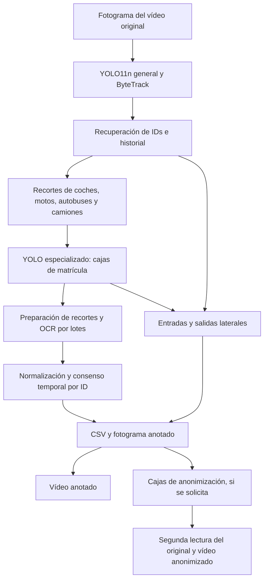

### 4.1. Dos detectores con funciones diferentes

El detector general `yolo11n.pt` reconoce las clases COCO de interés. El detector `best.pt` reconoce exclusivamente matrículas. Cada modelo tiene una tarea y unos pesos distintos: uno localiza y sigue objetos; el otro busca placas dentro de las cajas de los vehículos.

El lector PaddleOCR constituye una etapa posterior de reconocimiento de caracteres. Las anotaciones JSON del dataset se utilizan como referencia para la evaluación; el procesamiento del vídeo lee las imágenes y las predicciones, sin consultar esas transcripciones.

### 4.2. Detección y seguimiento

`detectar_objetos` llama a `model.track` con `persist=True` y `tracker="bytetrack.yaml"`. El seguimiento conserva estado entre fotogramas y añade identificadores a las cajas. El uso de ByteTrack y del argumento `persist` se describe en la [documentación de seguimiento de Ultralytics](https://docs.ultralytics.com/modes/track/).

| ID COCO | Clase | Nombre en los paneles |
|---:|---|---|
| 0 | `person` | Personas |
| 1 | `bicycle` | Bicicletas |
| 2 | `car` | Coches |
| 3 | `motorcycle` | Motos |
| 5 | `bus` | Autobuses |
| 7 | `truck` | Camiones |

Las cajas se llevan a CPU, se limitan al fotograma mediante `limitar_caja` y se convierten en diccionarios con `box`, `conf`, `cls` e `id`. Un objeto puede carecer de ID, en cuyo caso su detección puede seguir representándose, aunque no contribuya a una trayectoria identificada.

Cuando se solicita anonimización, `guardar_cajas_anonimizar` conserva las cajas de personas con confianza desde `conf_anonimizar=0.15` antes del seguimiento y mantiene el filtrado de objetos con `conf_objeto=0.25`. Este callback aprovecha las predicciones de la misma red.

### 4.3. Recuperación y fusión de identidades

Un vehículo aparcado puede quedar oculto y reaparecer con un ID nuevo. Para reducir su recuento repetido se utilizan dos operaciones:

- **`apariencia_vehiculo`:** extrae la región interior de la caja, descarta aproximadamente el 10 % de cada borde, redimensiona a 48 × 48 y calcula un histograma HSV de 12 × 8 × 8 intervalos. La normalización permite comparar distribuciones de color.
- **`recuperar_identidades`:** compara una detección con identidades ausentes mediante antigüedad, posición, IoU, desplazamiento, tamaño, clase y apariencia. Utiliza una correspondencia uno a uno y descarta candidatos ambiguos. Conserva el ID original del tracker y el ID persistente.

El estado estacionario se estima observando la variación de los centros durante un intervalo. Si el vehículo se aleja de su referencia de reposo, esa condición deja de ser válida. El método está planteado para una cámara fija.

`fusionar_identidades` reúne trayectorias, votos, clases iniciales y evidencia de matrícula cuando dos IDs ya han sido asociados. También elimina eventos duplicados del ID absorbido y combina las lecturas OCR, conservando la de mayor confianza cuando hay varias del mismo fotograma.

### 4.4. Historial y clase estable para el flujo

`actualizar_historial` guarda el centro de cada caja, el primer y último fotograma, el número de observaciones y los votos de clase. Mantiene las últimas 30 posiciones para el movimiento reciente y hasta 30 posiciones iniciales para evaluar entradas.

La lista `clases_inicio` contiene las clases de las primeras 30 observaciones. `clase_para_flujo` utiliza su mayoría para el recuento; durante la formación de esa ventana la votación se actualiza y después queda estable. Así se reduce la influencia de clasificaciones tardías cuando un vehículo se aleja. Los votos del seguimiento completo se conservan por separado.

Por ejemplo, una moto detectada inicialmente como tal puede recibir después etiquetas de coche al reducirse su tamaño en la imagen. La clase inicial estabilizada permite conservar su entrada como moto. Esta decisión sigue siendo una estimación y depende de la calidad de las observaciones iniciales.

## 5. Detección y reconocimiento de matrículas

### 5.1. Localización dentro del vehículo

`detectar_matriculas` procesa únicamente coches, motos, autobuses y camiones. Para cada uno:

1. Limita y recorta su caja en la imagen original.
2. Ejecuta el detector especializado sobre ese recorte.
3. Transforma las coordenadas locales de la matrícula a coordenadas del fotograma completo.
4. Guarda la confianza y el índice del vehículo de origen.

Los vehículos superpuestos pueden producir dos detecciones de una placa. Las candidatas se ordenan por confianza y se descartan duplicadas con IoU superior a 0,5. `asociar_matriculas` agrupa las placas por `vehiculo_indice` para la exportación.

### 5.2. Preparación de los recortes

`preparar_recorte_ocr` comprueba la caja de matrícula, añade un margen del 8 % por lado y lo limita a la imagen y al vehículo. Si la región resultante es inválida, la descarta. Amplía los recortes de menos de 96 píxeles de alto con interpolación bicúbica, conservando su proporción; los de mayor altura no se reducen por esta operación.

El OCR utiliza estos recortes antes de la anonimización. Las coordenadas de detección originales se mantienen para el dibujo y el CSV.

### 5.3. Matrículas de dos filas

Una proporción ancho/alto inferior a 2,2 indica una posible placa de dos filas. `separar_filas` analiza una imagen en gris con Otsu invertido y calcula la densidad de tinta por fila sobre el 80 % central del ancho. Busca el mínimo entre el 35 % y el 65 % de la altura; en caso de empate elige el corte más próximo al centro.

Las dos imágenes se extraen del recorte original y se leen en orden **superior → inferior**. Se añaden 8 píxeles de margen alrededor de cada fila. El resultado puede ser `0045` + `FGH` → `0045FGH`, o un formato antiguo como `GC` + `0045` → `GC0045`. Si el reconocimiento de las filas no produce un texto aceptado, se intenta la imagen completa.


*Figura 3. Preparación, búsqueda del hueco horizontal y reconstrucción ordenada del texto. Los vehículos y las matrículas de esta figura son ejemplos didácticos.*

### 5.4. Variantes y reconocimiento por lotes

`reader` es una instancia reutilizable de `TextRecognition`, configurada con `en_PP-OCRv5_mobile_rec`. Este módulo realiza reconocimiento sobre imágenes de texto, según la [documentación de PaddleOCR](https://www.paddleocr.ai/main/en/version3.x/module_usage/text_recognition.html). YOLO proporciona previamente la localización de la placa.

`variantes_ocr` es un generador que ofrece tres alternativas:

| Intento | Imagen utilizada | Finalidad |
|---|---|---|
| 1 | Recorte original. | Aprovechar la información disponible sin transformaciones adicionales. |
| 2 | Gris con CLAHE, convertido otra vez a BGR. | Mejorar contraste local con una cuadrícula de 4 × 4 regiones y `clipLimit=2.0`. |
| 3 | Binarización Otsu del contraste mejorado, en BGR. | Separar caracteres y fondo mediante un umbral automático. |

Las transformaciones se calculan cuando se solicita la siguiente alternativa. `leer_matriculas_lote` organiza hasta tres rondas y retira de las pendientes las placas que ya tienen un texto aceptado.

`reconocer_grupos_ocr` aplana las imágenes de los grupos, ejecuta lotes de hasta `OCR_TAMANO_LOTE=16` imágenes y reconstruye después su correspondencia con cada matrícula. Comprueba que exista un resultado por imagen. En placas de dos filas concatena los textos y utiliza la media de sus confianzas. Una fila sin caracteres alfanuméricos invalida la lectura del grupo.

### 5.5. Formatos modernos y antiguos

La validación implementada distingue dos estructuras:

| Formato | Estructura admitida | Ejemplos |
|---|---|---|
| Moderno | Cuatro dígitos y tres letras de `BCDFGHJKLMNPRSTVWXYZ`. | `0045FGH`, `8712CHC`. |
| Antiguo | Prefijo provincial reconocido de una o dos letras, cuatro dígitos y sufijo opcional de hasta dos letras. | `M1234AB`, `GC0045`, `TF1234BC`. |

Las expresiones del código son:

```python
RE_MODERNA = re.compile(r"([0-9]{4})([BCDFGHJKLMNPRSTVWXYZ]{3})")
RE_ANTIGUA = re.compile(r"([A-Z]{1,2})([0-9]{4})([A-PR-Z]{0,2})")
```

Se utiliza `fullmatch`, por lo que debe coincidir todo el texto. `PROVINCIAS` limita los prefijos antiguos a los recogidos por el código, incluidas variantes como GE, PM y OR. La restricción de consonantes del formato moderno no se aplica al prefijo y al sufijo del antiguo.

`partes_matricula` separa números, letras e información del formato. `matricula_valida` comprueba si esa separación ha reconocido una estructura admitida. La validación es sintáctica: no consulta un registro de vehículos ni demuestra que la lectura coincida con la placa real.

### 5.6. Corrección posicional de dígitos y letras

`normalizar_matricula` convierte a mayúsculas y conserva los caracteres alfanuméricos. Los ceros iniciales permanecen en el texto. Primero acepta las matrículas ya válidas, incluidos los formatos antiguos; después intenta corregir candidatos modernos.

Si el texto tiene ocho caracteres y comienza por `E`, se retira esa posible letra de la banda europea. El candidato restante debe tener siete caracteres para aplicar las siguientes sustituciones:

| Zona del candidato moderno | Sustituciones |
|---|---|
| Cuatro posiciones numéricas: 0–3 | `O→0`, `I→1`, `L→1`, `Z→2`, `B→8`, `S→5`, `G→6`. |
| Tres posiciones de letras: 4–6 | `0→D`, `1→L`, `2→Z`, `8→B`, `5→S`, `6→G`. |

`OCR_LETRA_PARA_UNO` permite elegir `T` en lugar de `L`. La validación final exige el patrón moderno completo. Las letras no admitidas no se eliminan para fabricar una coincidencia: por ejemplo, `1234ABC` se rechaza porque la A no pertenece al conjunto moderno.

```text
Lectura OCR:                 E O045-F6H
Mayúsculas y alfanuméricos:  EO045F6H
Retirada de la posible E:    O045F6H
Corrección por posición:    0045FGH
```

En este ejemplo, el primer carácter de `O045F6H` es la **letra O**; pasa a ser el **dígito 0**. El `6` de la zona de letras se convierte en `G`.


*Figura 4. Ejemplo didáctico de separación entre dígitos y letras, conservación de ceros y validación. Las sustituciones son hipótesis de corrección; una cadena con formato válido todavía puede ser una lectura incorrecta.*

### 5.7. Votación y consenso temporal

La memoria OCR está asociada al ID persistente del vehículo. `actualizar_consenso_ocr` admite **como máximo una lectura por ID y fotograma**, eligiendo primero la mayor confianza OCR y, en caso de empate, la confianza del detector de matrícula.

Se conservan las últimas **cinco lecturas válidas**, no necesariamente de fotogramas consecutivos. Los fotogramas sin lectura no añaden votos. `puntuar_lecturas` y su función interna `evidencia` evalúan:

1. Frecuencia del texto completo.
2. Puntos por coincidencia de los cuatro números entre lecturas válidas sucesivas; si también coinciden las letras, se añade otro punto.
3. Evidencia de caracteres iguales en la misma posición.
4. Confianza OCR media de las lecturas coincidentes.
5. Fotograma de la observación más reciente, para resolver los empates restantes.

Los formatos antiguos se comparan respetando las longitudes de sus prefijos y sufijos. El algoritmo elige textos que realmente se han leído; no construye una matrícula mezclando posiciones de candidatos distintos.

El consenso se confirma cuando el candidato completo aparece **al menos dos veces** en la ventana y cumple el formato. Sin una nueva lectura válida se conserva el último consenso confirmado. Otro candidato puede sustituirlo si gana la votación y alcanza ese mínimo de repeticiones.

La etiqueta consolidada aparece sobre la caja rosa de la matrícula, centrada, con letras amarillas y fondo negro. Los votos y puntos quedan en los datos exportados. Si desaparece la caja de matrícula, el consenso permanece en memoria y puede seguir figurando en la fila del vehículo, dejando vacías las coordenadas de placa.

### 5.8. Frecuencia de OCR y GPU

El OCR puede espaciarse mediante `OCR_CADA_N_FOTOGRAMAS`:

| Valor | Fotogramas procesados con intento de OCR |
|---:|---|
| 1 | 1, 2, 3, 4…; configuración actual. |
| 2 | 1, 3, 5, 7… |
| 3 | 1, 4, 7, 10… |

La cuenta comienza en el primer fotograma del tramo seleccionado. La detección, el seguimiento, la escritura del vídeo y el CSV se mantienen en todos los fotogramas. Espaciar el OCR reduce intentos, pero puede perder lecturas de placas visibles durante poco tiempo.

`ocr_device="gpu:0"` selecciona la GPU para PaddlePaddle. Se comprueba su soporte CUDA y la presencia de un dispositivo. `FLAGS_allocator_strategy=auto_growth` permite asignar memoria según se necesita. Los lotes agrupan imágenes del mismo fotograma, sin esperar a reunir varios fotogramas.

La instancia actual del lector utiliza `enable_mkldnn=True`. Esta opción corresponde al motor de CPU; su valor no sustituye a `ocr_device` para seleccionar GPU. Las notas del cuaderno recogen una alternativa con `False` ante un error PIR observado en Windows. Tras cambiar la configuración se debe recrear el lector.

## 6. Recuento de entradas y salidas

### 6.1. Objetos admitidos y evidencia de matrícula

El flujo se calcula exclusivamente para los bordes **izquierdo y derecho**. Se distinguen las seis clases del detector y se utiliza `clase_para_flujo` para estabilizar su clasificación.

`apto_para_flujo` exige a los coches que tengan una caja de matrícula detectada en algún momento de su trayectoria. Las demás clases superan directamente este requisito. `registrar_matriculas` guarda esa evidencia, el último fotograma con placa y el número de fotogramas que la contienen, evitando duplicar el mismo fotograma.

Una caja de matrícula es suficiente para este filtro; no necesita una transcripción OCR. La regla es una decisión del prototipo para limitar el recuento de coches aparcados y no demuestra por sí misma que un vehículo esté en movimiento.

### 6.2. Entradas laterales

`actualizar_entradas` analiza al menos cinco posiciones iniciales. Para considerar una entrada se necesita:

- Una caja inicial en la franja del 5 % del borde correspondiente.
- Desplazamiento predominantemente horizontal, normalizado respecto al tamaño de la imagen.
- Un desplazamiento horizontal superior al 0,5 % del ancho hacia el interior: a la derecha desde el borde izquierdo o a la izquierda desde el derecho.

Los objetos estacionarios se excluyen de esta evaluación. `CONTAR_ENTRADAS_INICIALES_EN_BORDE` permite inferir entradas de objetos que ya tocaban un lateral al comenzar el tramo. Esas entradas se identifican como inferidas.

Se guarda una candidata para que un coche pueda confirmar su entrada cuando aparezca una caja de matrícula más adelante. Si no se reconoce una entrada, la evaluación termina tras 30 posiciones iniciales o dos segundos, una vez reunidas al menos cinco posiciones.

### 6.3. Salidas estimadas

`borde_salida` comprueba el movimiento reciente y la última caja. Descarta trayectorias estacionarias, con menos de cinco observaciones o con menos de dos posiciones en el historial. Exige movimiento hacia fuera y proximidad a la franja lateral del 5 %, con el mismo umbral horizontal del 0,5 %.

`actualizar_salidas` espera a que la ausencia supere `ESPERA_SALIDA_S`, convertido a fotogramas. Si el objeto cumple el filtro y la geometría indica un lateral, registra una salida estimada. Una reaparición del mismo ID persistente invalida la salida previa.

### 6.4. Paneles del vídeo

`resumir_flujo` filtra los eventos y calcula los recuentos por lado, tipo de evento y clase. También devuelve los totales de identidades admitidas para los informes.

`dibujar_flujo` representa tres paneles en la parte inferior:

| Panel | Contenido |
|---|---|
| IZQUIERDA | Entradas y salidas por el lateral izquierdo. |
| TOTAL | Suma de las entradas y salidas de ambos laterales. |
| DERECHA | Entradas y salidas por el lateral derecho. |

Todos contienen únicamente las columnas **ENTRAN** y **SALEN**, con filas de personas, autobuses, coches, camiones, motos y bicicletas. `ESCALA_PANELES_FLUJO` regula su tamaño. La función interna `texto_centrado` adapta las etiquetas al ancho disponible.


*Figura 5. Recorte de la franja inferior del vídeo anotado, fotograma 601, a los 24,00 s. El total es la suma de ambos laterales y la entrada de una moto por la derecha permanece registrada.*

## 7. Anonimización

La anonimización se activa con:

```python
GENERAR_VIDEO_ANONIMIZADO = True
```


*Figura 6. Captura de un fotograma de `video_anonimizado.mp4`: personas y matrículas se ven pixeladas.*

Se realiza en dos fases consecutivas:

1. Durante el procesamiento se escribe `video_anotado.mp4` y se guardan las cajas en `cajas_anonimizacion.jsonl`.
2. Una vez cerrado el vídeo anotado, `generar_video_anonimizado` vuelve a leer el tramo original y aplica las cajas guardadas para escribir `video_anonimizado.mp4`.

`obtener_cajas_anonimizar` reúne las personas del callback, las detecciones actuales y las cajas de personas perdidas durante un máximo de 0,4 segundos. Añade las cajas actuales de matrículas. `anonimizar_imagen` aplica el pixelado exclusivamente a esas regiones; las carrocerías de los vehículos permanecen visibles.

`pixelar` amplía ligeramente cada caja, reduce su región con `INTER_AREA` y la vuelve a ampliar con `INTER_NEAREST`. Para personas utiliza los valores generales `max_celdas=25` y `bloque=8`; para matrículas aplica un pixelado más intenso con `max_celdas=6` y `bloque=12`.

La segunda fase reutiliza las detecciones guardadas y no necesita volver a ejecutar los modelos. Conserva las dimensiones y los FPS del tramo. Los archivos generados por OpenCV no incorporan la pista de audio del original. Con la constante en `False` se genera únicamente el vídeo anotado.

## 8. Configuración y selección temporal

### 8.1. Parámetros principales

| Parámetro | Valor actual | Significado |
|---|---|---|
| `filename` | `video_test.mp4` | Vídeo de entrada. |
| `pesos_general` | `yolo11n.pt` | Detector general. |
| `pesos_matriculas` | `results/model_yolo11n_detect_plates/weights/best.pt` | Detector de placas. |
| `carpeta_salida` | `results/plates_secuencial` | Directorio de resultados. |
| `carpeta_dataset` | `dataset_plates` | Imágenes y anotaciones para evaluación. |
| `classes` | `[0, 1, 2, 3, 5, 7]` | Clases COCO consideradas. |
| `conf_objeto` | `0.25` | Umbral para objetos y seguimiento. |
| `conf_matricula` | `0.25` | Umbral del detector de placas en el vídeo. |
| `conf_anonimizar` | `0.15` | Umbral de personas para privacidad. |
| `imgsz` | `640` | Tamaño de entrada solicitado a YOLO. |
| `device` | `0` si hay CUDA; si no, `"cpu"` | Dispositivo de PyTorch. |
| `ocr_device` | `"gpu:0"` | Dispositivo de Paddle; alternativa `"cpu"`. |
| `USAR_OCR` | `True` | Activa el reconocimiento de texto. |
| `OCR_TAMANO_LOTE` | `16` | Máximo de imágenes por lote de reconocimiento. |
| `OCR_CADA_N_FOTOGRAMAS` | `1` | Frecuencia del OCR. |
| `OCR_VENTANA_LECTURAS` | `5` | Últimas lecturas válidas por identidad; admite entre 5 y 10. |
| `OCR_MARGEN` | `0.08` | Margen proporcional por lado del recorte de matrícula. |
| `OCR_LETRA_PARA_UNO` | `"L"` | Sustitución del 1 en posiciones de letras; admite `"T"`. |
| `ESCALA_PANELES_FLUJO` | `0.75` | Tamaño de los paneles. |
| `MOSTRAR` | `True` | Visualización durante el procesamiento. |
| `GENERAR_VIDEO_ANONIMIZADO` | `False` | Segunda fase opcional. |
| `EVALUAR_YOLO` | `False` | Evaluación de detección sobre test. |
| `VER_ENTRENAMIENTO` | `True` | Gráficas del entrenamiento guardado. |

### 8.2. Recuperación de identidades y flujo

| Parámetro | Valor | Función |
|---|---:|---|
| `MEMORIA_ESTACIONADOS_S` | 120,0 s | Antigüedad máxima considerada para recuperar una identidad. |
| `TIEMPO_ESTACIONARIO_S` | 0,6 s | Intervalo mínimo de observación del reposo. |
| `IOU_RECUPERAR` | 0,55 | Solapamiento mínimo de las cajas candidatas. |
| `DISTANCIA_APARIENCIA_MAX` | 0,25 | Distancia máxima de apariencia en coincidencias sin geometría fuerte. |
| `VENTANA_REASOCIACION_S` | 1,0 s | Recuperación por continuidad ante pérdidas breves. |
| `TOLERANCIA_REPOSO` | 0,12 | Tolerancia proporcional al tamaño, limitada también en píxeles. |
| `ESPERA_SALIDA_S` | 0,2 s | Ausencia requerida antes de confirmar una salida estimada. |
| `CONTAR_ENTRADAS_INICIALES_EN_BORDE` | `True` | Admite entradas inferidas al comienzo del tramo. |

### 8.3. Procesamiento de un tramo

```python
INICIO_SEGUNDOS = 25
FIN_SEGUNDOS = 50
MAX_FRAMES = None
```

Este ejemplo procesa el intervalo **[25, 50)**. `FIN_SEGUNDOS=None` continúa hasta el final. `MAX_FRAMES` impone un límite adicional contado desde el inicio elegido. La configuración actual es `0`, `None` y `None`, respectivamente.

`seleccionar_tramo` valida FPS e intervalos, convierte los tiempos a índices y posiciona el lector en el inicio sin ejecutar detecciones sobre las imágenes anteriores. Los números exportados conservan la referencia al vídeo original, comenzando en 1. Los eventos del tramo dependen de la memoria inicializada en ese punto; los objetos que ya aparecen en pantalla no siempre permiten reconstruir su entrada anterior.

## 9. Bucle principal y archivos de salida

### 9.1. Orden de ejecución y recursos

Antes del bucle se comprueban rutas y parámetros, se cargan ambos detectores y se inicializan las memorias. `abrir_salidas` abre el vídeo, aplica la selección temporal y prepara el escritor del vídeo anotado y el CSV.

Cada fotograma sigue este orden:

1. Detectar y seguir personas y vehículos.
2. Recuperar identidades, fusionar registros y actualizar el historial.
3. Detectar matrículas y ejecutar el OCR según la frecuencia elegida.
4. Registrar la evidencia de matrícula y actualizar entradas y salidas.
5. Actualizar el consenso OCR y agrupar matrículas por vehículo.
6. Escribir las filas CSV y el fotograma con las cajas, textos y paneles.
7. Guardar las cajas de anonimización si se ha solicitado la segunda fase.
8. Mostrar el progreso y atender la tecla Esc cuando la visualización está activada.

`mostrar_progreso` informa de avance, velocidad y tiempo restante. El bloque `finally` libera los lectores, escritores, archivos y ventanas incluso ante una interrupción. La escritura del vídeo conserva los fotogramas procesados; los avisos de progreso no implican saltar grupos de imágenes.

### 9.2. Registro por fotograma

`escribir_csv` genera una fila por objeto y fotograma, o varias si tiene más de una matrícula asociada. Devuelve el número de filas escritas. Los CSV utilizan UTF-8 con BOM y los valores ausentes se dejan vacíos.

| Campos de `detecciones.csv` | Contenido |
|---|---|
| `fotograma`, `tipo_objeto` | Índice original desde 1 y nombre COCO del objeto. |
| `confianza`, `identificador_tracking` | Confianza del detector general e ID persistente, si existe. |
| `x1`, `y1`, `x2`, `y2` | Caja del objeto en píxeles del fotograma. |
| `matricula_en_su_caso` | 1 si hay una detección actual de matrícula asociada; 0 en caso contrario. |
| `confianza_matricula` | Confianza del detector especializado. |
| `mx1`, `my1`, `mx2`, `my2` | Caja actual de matrícula en píxeles del fotograma. |
| `texto_matricula`, `confianza_ocr` | Texto consolidado y confianza media de sus lecturas coincidentes. |
| `texto_ocr_fotograma` | Lectura válida obtenida en ese fotograma, antes de aplicar el consenso. |
| `ocr_ejecutado` | Indicador de intento OCR para la placa actual, incluso si la lectura no fue aceptada. |
| `votos_ocr`, `puntos_ocr` | Repeticiones del consenso y puntuación de coincidencia de bloques. |
| `puntos_numeros_ocr`, `puntos_letras_ocr` | Componentes de esa puntuación. |
| `puntos_posiciones_ocr` | Evidencia por posición, serializada como una lista JSON. |

Las confianzas de objeto, detección de matrícula y OCR describen etapas distintas. La del OCR procede de las lecturas del reconocedor y no es una probabilidad calibrada de acierto después de la corrección heurística.

Si no se ejecuta el OCR de una placa actual, su indicador vale 0. Cuando no hay placa asociada, los campos específicos de esa detección se dejan vacíos; un consenso previo del vehículo puede conservarse en `texto_matricula`.

### 9.3. Trayectorias, flujo y resumen

| Archivo en `results/plates_secuencial/` | Contenido o condición de generación |
|---|---|
| `video_anotado.mp4` | Detecciones, clase/confianza/ID sobre fondo negro, placas rosas y flujo. |
| `detecciones.csv` | Registro detallado por fotograma. |
| `trayectorias.csv` | Primer y último fotograma, observaciones, desplazamiento, dirección aparente, bordes y evidencia de matrícula por ID. |
| `entradas_por_clase.csv` | Entradas por izquierda, derecha y total de cada clase. |
| `salidas_por_clase.csv` | Salidas estimadas por izquierda, derecha y total de cada clase. |
| `resumen.json` | Estado de ejecución, tramo, conteos, flujo, consensos OCR, dispositivos y tiempo. |
| `cajas_anonimizacion.jsonl` | Un registro de personas y matrículas por fotograma cuando se solicita anonimización. |
| `video_anonimizado.mp4` | Segundo vídeo opcional con pixelado local. |
| `evaluacion_yolo.json`, `evaluacion_detalle.csv` | Métricas y correspondencias si se activa la evaluación del detector. |
| `entrenamiento.png` | Curvas obtenidas del registro de entrenamiento. |

`guardar_csv` se reutiliza para las tablas de resumen. Los conteos de identidades, los eventos de flujo y las detecciones por fotograma representan magnitudes diferentes. El panel TOTAL agrega eventos laterales, no el número de objetos visibles en un instante.

El resumen distingue ejecuciones completas, tramos, límites de prueba e interrupciones. Los archivos conservados de ejecuciones diferentes deben interpretarse con su propio estado y configuración, especialmente cuando no se regenera el vídeo anonimizado o no se vuelve a ejecutar la celda de resumen.

## 10. Evaluación del detector YOLO

Con `EVALUAR_YOLO=True`, el cuaderno verifica la correspondencia entre imágenes y JSON de las particiones y evalúa los pesos de matrículas sobre las imágenes de **test**. En esta evaluación el detector recibe imágenes completas del dataset; en el vídeo recibe recortes de vehículos.

`evaluar_predicciones` ordena las detecciones por confianza y las asigna a referencias de la misma imagen mediante IoU, utilizando cada referencia como máximo una vez. Obtiene verdaderos positivos, falsos positivos y referencias no detectadas.

Se calculan AP50, mAP50-95, precisión, recall y F1. La AP emplea 101 niveles de recall y la mAP recorre umbrales IoU de 0,50 a 0,95. Las métricas operativas utilizan `conf_matricula` e IoU 0,5; el detalle exportado incluye TP, FP y FN.

Esta evaluación mide **localización de cajas de matrícula**. La coincidencia de sus caracteres se estudia en el apartado OCR. La configuración principal mantiene desactivada la evaluación YOLO hasta que se solicita expresamente su ejecución.

## 11. Comparación de motores OCR

Se comparan el reconocedor de PaddleOCR `en_PP-OCRv5_mobile_rec` y el modelo visual con instrucciones [SmolVLM-256M-Instruct](https://huggingface.co/HuggingFaceTB/SmolVLM-256M-Instruct). La implementación se encuentra en [comparativa_ocr.py](comparativa_ocr.py) y sus resultados en el [apartado 11.2](#112-resultados-guardados).

### 11.1. Protocolo y ejecución

Ambos motores reciben los mismos recortes de referencia. Se utiliza el preprocesamiento interno de cada motor, sin añadir el margen, las variantes, las correcciones posicionales ni el consenso temporal del procesamiento de vídeo. La normalización común conserva únicamente caracteres ASCII `A–Z` y `0–9`, en mayúsculas.

La exactitud exige coincidencia de la matrícula completa. También se registra CER, o tasa de error por carácter, y la latencia. El cronometraje incluye preprocesamiento del motor, transferencias, inferencia y decodificación; excluye la lectura de disco, la carga inicial y el calentamiento. La carga se informa por separado. Se sincroniza CUDA para medir las inferencias y cada motor se ejecuta en un proceso independiente.

La respuesta inicial determina la exactitud y las repeticiones permiten estudiar tiempos y estabilidad. El prompt de SmolVLM pide únicamente los caracteres de la placa, leyendo primero la fila superior cuando hay dos líneas. Las explicaciones adicionales forman parte de la predicción y pueden penalizar la coincidencia.

La salida incluye resultados por motor, CSV detallados, `metricas.csv` y gráficas. El cuaderno muestra las métricas y las imágenes guardadas al final del apartado.

### 11.2. Resultados guardados

El experimento evalúa **100 matrículas de 90 imágenes**, con tres repeticiones y tres iteraciones de calentamiento, sobre una **NVIDIA GeForce RTX 3060 Laptop GPU**:

| Motor | Aciertos | Exactitud | Media por matrícula | Mediana | P95 |
|---|---:|---:|---:|---:|---|
| PaddleOCR | 55/100 | 55,00 % | 18,49 ms | 18,05 ms | 23,55 ms |
| SmolVLM-256M | 47/100 | 47,00 % | 1.178,08 ms | 1.090,15 ms | 1.845,14 ms |

En esa muestra PaddleOCR obtiene ocho puntos porcentuales más de exactitud y un tiempo medio aproximadamente 63,71 veces menor. 


*Figuras 7 y 8. Resultados de la comparativa guardada. Las medidas corresponden a recortes individuales sin el consenso temporal del vídeo.*


## 12. Alternativa con RT-DETR

La segunda alternativa resuelve la misma tarea que la de YOLO (detectar y seguir personas y vehículos, localizar sus matrículas, contar cada clase y guardar el vídeo y el CSV), pero con detectores **RT-DETR** y un seguidor programado por nosotros. Todo está en el cuaderno [`VC_P4_RTDETR.ipynb`](VC_P4_RTDETR.ipynb), que se entrega ejecutado con sus salidas, y el entrenamiento en el script [`train.py`](train.py).

### 12.1. Modelos utilizados

**RT-DETR** (*Real-Time DEtection TRansformer*) es un detector basado en *transformers*. A diferencia de YOLO, que propone muchísimas cajas y después elimina las repetidas con NMS (*Non-Maximum Suppression*), RT-DETR predice directamente un conjunto fijo de **300 cajas** ("consultas"), y durante el entrenamiento aprende a que cada objeto quede representado por una sola de ellas. Por eso **no necesita NMS**. Se ha usado la versión **RT-DETRv2** del [repositorio oficial](https://github.com/lyuwenyu/RT-DETR) (`rtdetrv2_pytorch`).

Igual que en la alternativa YOLO, se usan dos detectores con funciones diferentes:

| Función | Modelo | Red base (*backbone*) | Parámetros | Origen de los pesos |
|---|---|---|---:|---|
| Personas y vehículos | **RT-DETRv2-L** | ResNet-50 | ≈ 42 M | Preentrenado en COCO (80 clases), cargado con `load_rtdetr.py` de la asignatura. No se entrena. |
| Matrículas | **RT-DETRv2-S** | ResNet-18 | 20,1 M | **Entrenado por nosotros** a partir de los pesos de COCO (ajuste fino). |

Para las matrículas elegimos el tamaño **S** (el más pequeño de la familia) porque es el que cabe en la GPU del portátil con que se entrenó, una **NVIDIA RTX 3050 Laptop con 4 GB**. El detector general, en cambio, solo se usa para predecir, así que podemos permitirnos el modelo L, más preciso.

### 12.2. Preparación del dataset

Partimos del mismo conjunto de datos que la alternativa YOLO: carpetas `train`, `validation` y `test`, con un JSON por imagen que guarda cada matrícula como `[centro x, centro y, ancho, alto]` normalizados y su texto. RT-DETR necesita las anotaciones en **formato COCO** (un único JSON por partición con las cajas en píxeles), así que el cuaderno las convierte y escribe la carpeta `dataset_1920/`. Durante la conversión:

- Se guardan **todas** las matrículas, también las ilegibles: aunque no se pueda leer el texto, para el detector siguen siendo matrículas.
- Se **endereza cada foto** según su orientación EXIF y se guardan los píxeles ya girados. Muchas fotos de móvil se guardan "tumbadas" con una etiqueta EXIF que indica cómo girarlas. OpenCV aplica esa etiqueta al leer la imagen, pero PIL (que es lo que usa RT-DETR) no, así que sin este paso las cajas no coincidían con la imagen que veía el modelo.
- Se detectan las fotos que se **anotaron viéndolas tumbadas** (se reconocen porque sus matrículas salen más altas que anchas, algo imposible en una matrícula real) y se giran también sus cajas.
- Se reducen las imágenes a **1920 px** de lado mayor para que el entrenamiento sea más rápido.

| Partición | Imágenes | Matrículas |
|---|---:|---:|
| Entrenamiento: `train` | 1.540 | 3.367 |
| Validación: `validation` | 481 | 1.065 |
| Prueba: `test` | 385 | 872 |

Las cifras coinciden con las de la alternativa YOLO ([apartado 3.1](#31-particiones-y-anotaciones)): **los dos detectores se entrenan, validan y prueban con las mismas imágenes**, lo que permite compararlos de forma justa en el [apartado 13](#13-comparativa-yolo-frente-a-rt-detr).

Para comprobar a ojo que las cajas quedan bien, el cuaderno guarda unos mosaicos de revisión (`dataset_1920/revision_*.jpg`). En el siguiente se ven algunas de las fotos cuyas cajas hubo que girar, ya corregidas (en rojo, matrícula con texto; en azul, ilegible):

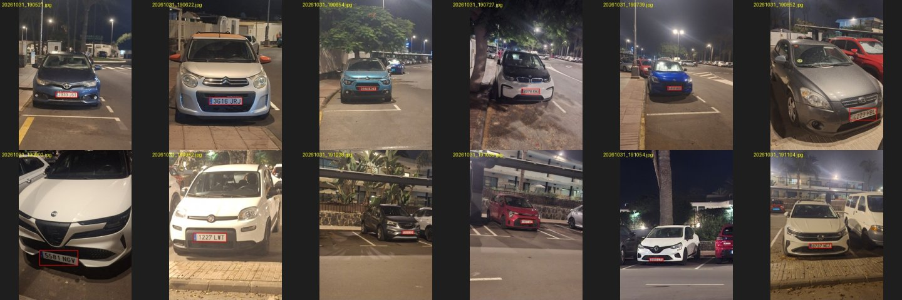

*Figura 9. Parte del mosaico `revision_train_corregidas.jpg`: tras enderezar la foto y girar sus cajas, cada recuadro cae sobre su matrícula.*

### 12.3. Entrenamiento del detector de matrículas

El entrenamiento se lanza con nuestro propio script **`train.py`**, en lugar de usar desde la consola el `tools/train.py` del repositorio.

El script hace, en orden:

1. **Comprueba que PyTorch ve la GPU** y, si no, se detiene con un mensaje claro (así no se queda entrenando en la CPU sin avisar).
2. **Descarga los pesos de partida** de RT-DETRv2-S entrenado en COCO, si no están en `weights/`.
3. **Carga la configuración** (`rtdetrv2_matriculas.yml`) y lanza el *solver* del repositorio, que se encarga del bucle de entrenamiento y de evaluar sobre validación al final de cada época.
4. **Muestra la mejor época** leyendo el registro `log.txt` que deja el *solver*.

```python
cfg = YAMLConfig(
    str(CFG),
    tuning=str(PESOS_COCO),         # ajuste fino: parte de los pesos de COCO
    device="cuda:0",
    use_amp=True,                   # precisión mixta: menos memoria y más rápido
    seed=SEMILLA,
    output_dir=str(SALIDA),
    PResNet={"pretrained": False},  # el backbone ya viene en los pesos de partida
)
solver = TASKS[cfg.yaml_cfg["task"]](cfg)
solver.fit()
```

Hacemos un **ajuste fino** (*fine-tuning*): el modelo ya sabe "ver" porque viene entrenado con las 80 clases de COCO, y solo tiene que aprender la clase nueva (`num_classes: 1`). Así aprende mucho más rápido que desde cero. La configuración principal es:

| Parámetro | Valor | Motivo |
|---|---|---|
| Resolución | 800 × 800 | Las matrículas son pequeñas; a 640 px se pierden detalles. |
| Épocas | 50, con parada temprana | Paciencia de 10 épocas sin mejorar, nunca antes de la 20. |
| Optimizador | AdamW, *learning rate* 1e-4 | El de la configuración oficial; con calentamiento en las primeras 2.000 iteraciones. |
| Bajada del *learning rate* | ÷ 10 en la época 40 | La bajada final da un último empujón a las métricas. |
| Lote (*batch*) | 4 imágenes | Lo que cabe en 4 GB usando precisión mixta (AMP). |
| Aumentos de datos | Cambios de color, recortes aleatorios y volteo horizontal | Quitamos `RandomZoomOut`, que encoge la imagen y hace aún más pequeñas las matrículas. Los aumentos fuertes se apagan en la época 46. |
| Media móvil de pesos (EMA) | Sí | Se guarda una versión "suavizada" de los pesos, más estable, que es la que se usa después. |

El repositorio oficial no incluye **parada temprana** (*early stopping*), así que el cuaderno aplica un pequeño parche a `det_solver.py`: si la métrica de validación no mejora en 10 épocas seguidas, el entrenamiento se detiene y se conserva la mejor época en `best.pth`. En nuestro caso no llegó a activarse, porque el modelo siguió mejorando poco a poco hasta el final.

El entrenamiento completo duró **3,1 horas** en la RTX 3050 y la mejor época fue la **44**.

### 12.4. Análisis del entrenamiento

El *solver* escribe en `log.txt` una línea por época con las pérdidas de entrenamiento y las métricas COCO sobre validación. El cuaderno las representa y guarda en `graficas/`:

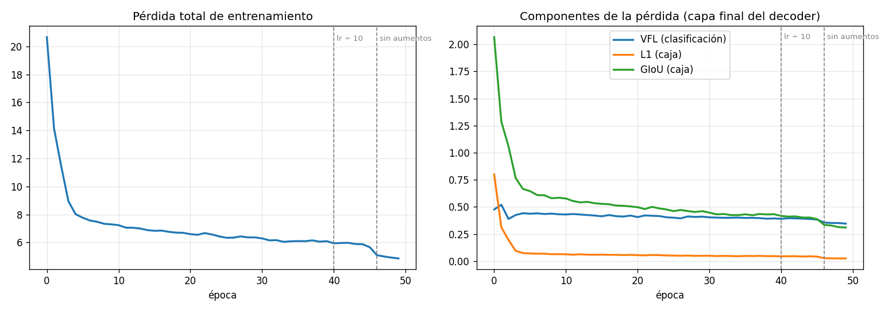

*Figura 10. Pérdidas de entrenamiento de RT-DETR. Las líneas discontinuas marcan la bajada del learning rate (época 40) y el apagado de los aumentos fuertes (época 46).*

Las pérdidas indican cuánto se equivoca el modelo con las imágenes de entrenamiento (cuanto más bajas, mejor):

| Pérdida | Qué mide |
|---|---|
| **Pérdida total** | La suma de todas las pérdidas del modelo (las de cada capa del *decoder*, las del *encoder* y las de *denoising*). Por eso vale entre 5 y 20 aunque cada componente sea pequeño. |
| **VFL** (*Varifocal Loss*) | El error de **clasificación**: si cada caja es matrícula o fondo, y con qué confianza. |
| **L1** | El error de **posición**: la diferencia entre las coordenadas de la caja predicha y las de la real. |
| **GIoU** | El error de **solape** entre la caja predicha y la real; penaliza las cajas mal encajadas. |

La pérdida cae deprisa en las cinco primeras épocas (el modelo aprende la clase nueva) y luego sigue bajando despacio. Los dos escalones finales coinciden con la bajada del *learning rate* y con el apagado de los aumentos. No son sobreajuste, porque las métricas de validación no empeoran:

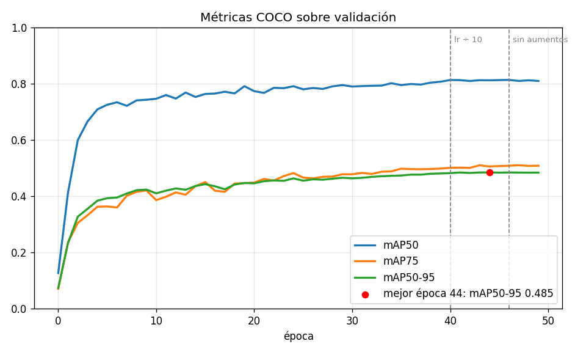

*Figura 11. Métricas COCO sobre validación. El punto rojo marca la mejor época (44), que es la que se guarda en `best.pth`.*

| Métrica | Valor en la época 44 | Qué nos dice |
|---|---:|---|
| **mAP50** | 0,812 | Una detección es un acierto si solapa al menos un **50 %** con la matrícula real. Mide si el modelo **encuentra** la matrícula. |
| **mAP75** | 0,506 | Igual, pero exige un **75 %** de solape: la caja tiene que estar muy bien ajustada. |
| **mAP50-95** | 0,485 | La media con umbrales de solape de 0,50 a 0,95. Es la **métrica oficial de COCO** y la que se usa para elegir la mejor época. |

Por tamaños, el mAP50-95 es de 0,313 en las matrículas pequeñas, 0,594 en las medianas y 0,693 en las grandes: **las matrículas pequeñas son el punto débil**, porque con pocos píxeles es difícil ajustar bien la caja.

A diferencia de YOLO, el repositorio de RT-DETR **no calcula la pérdida sobre validación** (solo las métricas COCO); por eso la gráfica de pérdidas es solo de entrenamiento y el sobreajuste se vigila con las métricas de validación. Como solo hay una clase, AP y mAP valen lo mismo; usamos los nombres de la parte de YOLO (mAP50 y mAP50-95) para que se lean igual.

### 12.5. Procesamiento del vídeo

El vídeo se procesa fotograma a fotograma. Para cada uno:

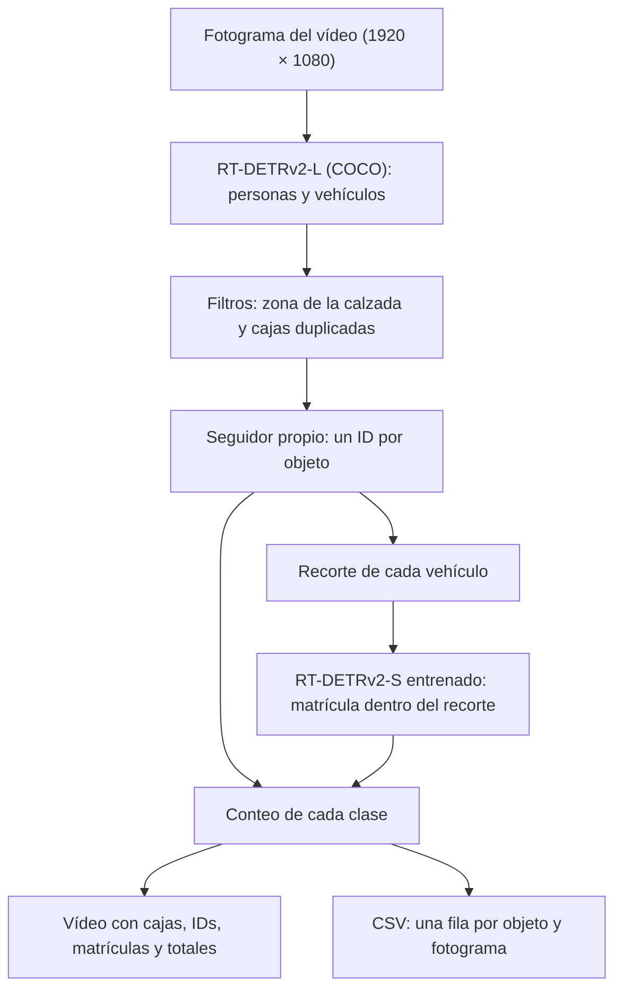

1. **Detección general.** RT-DETRv2-L recibe el fotograma reducido a 640 × 640 y devuelve cajas de seis clases de COCO: persona, bicicleta, coche, moto, autobús y camión. Se guardan también las detecciones de confianza baja (desde 0,15), porque el seguidor las usa para no perder objetos que ya conoce.
2. **Filtro de la calzada.** Como la cámara está fija, se descartan los vehículos cuyo borde inferior queda por encima de la calzada (y < 300 px). Eran objetos del parque de la izquierda que el detector confundía con coches.
3. **Quitar duplicados.** Aunque RT-DETR no necesita NMS, a veces un mismo objeto sale dos veces: como coche y como camión (cajas casi iguales), o como una caja entera y otra que solo cubre un trozo. Se elimina la caja de menor confianza cuando el solape es mayor del 70 %, y las cajas que quedan en un 80 % o más **dentro** de otra mayor.
4. **Seguimiento**, **matrícula** y **conteo**, que se explican en los apartados [12.6](#126-seguimiento-de-los-objetos), [12.7](#127-matrícula-de-cada-vehículo) y [12.8](#128-conteo-de-cada-clase).
5. **Salida.** Se dibujan las cajas con su ID, las matrículas en amarillo y un panel con los totales, y se escribe una fila del CSV por objeto.

### 12.6. Seguimiento de los objetos

El seguimiento consiste en saber que el coche del fotograma actual es el mismo que el del fotograma anterior, para que conserve su identificador. En lugar de usar el ByteTrack ya hecho de Ultralytics, programamos un **seguidor propio que sigue la idea de ByteTrack**. Hay un seguidor para personas y otro para vehículos, que comparten el contador de IDs.

Cada objeto seguido es una **pista** que guarda su caja, una estimación de su velocidad y los votos de su clase. En cada fotograma:

1. **Predicción.** Cada pista avanza según su velocidad para estimar dónde estará. Para ello se usa un filtro **alfa-beta**, una versión sencilla del filtro de Kalman: corrige la posición con un 70 % de lo observado y la velocidad con un 25 %.
2. **Primera pasada: detecciones fuertes** (confianza ≥ 0,45). Se comparan con todas las pistas usando el **IoU** (área compartida entre área total) y se emparejan con el **algoritmo húngaro** (`linear_sum_assignment` de SciPy), que busca el reparto global con más solape.
3. **Segunda pasada: detecciones débiles.** Solo sirven para mantener las pistas que no se emparejaron antes; nunca crean pistas nuevas. Esta es la idea clave de ByteTrack: un coche medio tapado da una detección débil, pero sigue siendo el mismo coche.
4. **Pistas nuevas.** Las detecciones fuertes sin pareja crean una pista, que solo recibe identificador tras **3 aciertos**, para no dar ID a falsas detecciones de un único fotograma.
5. **Pistas perdidas.** Una pista sin detección sobrevive hasta **60 fotogramas** (2,4 s), por si el objeto reaparece tras una ocultación.

```python
# 1.ª pasada: detecciones fuertes contra todas las pistas
pares, libres, nuevas = self._asociar(self.activas, ca, self.iou_alta)
for f, c in pares:
    self.activas[f].corregir(ca[c], sa[c], la[c])

# 2.ª pasada: detecciones débiles solo para no perder pistas existentes
resto = [self.activas[i] for i in libres]
pares2, libres2, _ = self._asociar(resto, cb, self.iou_baja)
```

Al probarlo sobre el vídeo aparecieron dos problemas, que se resolvieron así:

- **Objetos pequeños que pierden el ID.** En los coches del fondo, un temblor de pocos píxeles deja el solape en 0 y la pista se pierde. Para comparar, las cajas se **amplían un 30 %** manteniendo su centro (*buffered IoU*), de modo que siguen solapando.
- **Coches aparcados que se cuentan muchas veces.** Cada vez que un coche que pasa tapaba a uno aparcado, este perdía su pista y, al reaparecer, recibía un identificador nuevo: **un mismo coche llegó a tener 25 IDs**. Para evitarlo, una pista **quieta** (vista al menos 1 s y con un centro que apenas se mueve) no se borra al perderse, sino que queda "dormida". Si vuelve a aparecer una detección en su sitio, recupera su identificador antiguo. Además, una pista quieta no se desplaza por inercia, y si se confirma una pista nueva justo donde ya hay un objeto quieto con ID, se considera el mismo objeto.

La clase de cada pista se decide **por votación**: cada detección vota por su clase con un peso igual a su confianza. Así, un coche que en algún fotograma se confunde con un camión sigue contando como coche.

### 12.7. Matrícula de cada vehículo

Igual que en la alternativa YOLO, la matrícula se busca **dentro de cada vehículo** y no en el fotograma completo, donde sería diminuta:

1. De cada vehículo seguido cuyo lado menor mida al menos 40 px se toma un **recorte cuadrado** con un 10 % de margen. Es cuadrado para no deformar la matrícula al redimensionarlo a 800 × 800, la resolución con que se entrenó el detector.
2. El detector de matrículas procesa los recortes por lotes de 8 y devuelve las candidatas con confianza ≥ 0,40.
3. Se elige la candidata más segura cuyo centro cae dentro del vehículo y que mide **entre 10 px y el 60 % del ancho del vehículo**. Una matrícula real ocupa entre un 10 y un 40 % del ancho; las cajas mayores eran errores (por ejemplo, la parte trasera entera de un autobús). Este filtro eliminó unas 800 detecciones falsas.

Las coordenadas de la matrícula se pasan del recorte al fotograma sumando la posición del recorte. El campo `texto_matricula` queda preparado para conectar un OCR (la función `procesar_video` admite un parámetro `ocr`); en esta alternativa se deja vacío, porque el reconocimiento de texto se ha desarrollado en la alternativa YOLO.

### 12.8. Conteo de cada clase

El total de cada clase es el número de **pistas distintas** que cumplen un criterio de conteo. Contar todas las pistas daba cifras muy altas (la primera versión contaba **294 coches**), sobre todo por los coches del horizonte: sus cajas son diminutas, pierden y recuperan el identificador, y cada vez sumaban uno más. Por eso **solo cuentan los objetos que llegan a verse bien**:

- el lado mayor de su caja alcanza alguna vez los **60 px**, y
- se han detectado en al menos **10 fotogramas**.

Una matrícula cuenta si su vehículo cumple el criterio y se ha detectado en al menos **2 fotogramas**. Con esto, los totales al final del vídeo son:

| Clase | Total |
|---|---:|
| Coche | 60 |
| Persona | 55 |
| Matrícula | 43 |
| Moto | 3 |
| Autobús | 2 |
| Bicicleta | 1 |

Para validarlo revisamos el vídeo a ojo: los coches que circulan coinciden casi exactamente (29 contados frente a unos 30 reales), mientras que los aparcados se siguen contando algo de más, y el autobús se cuenta dos veces porque cambia de identificador al alejarse. El CSV guarda **todos** los objetos seguidos, también los lejanos que no cuentan, por eso en él aparecen más identificadores distintos (150 de coche y 105 de persona) que en el panel de totales.

### 12.9. Resultados: vídeo y CSV

El vídeo resultado es [`resultado_rtdetr.mp4`](resultado_rtdetr.mp4) (1920 × 1080, 25 fps, 2.832 fotogramas). Cada objeto se dibuja con una caja de un color propio según su ID, su clase y su confianza; las matrículas, en amarillo, y en la esquina superior izquierda, los totales acumulados.

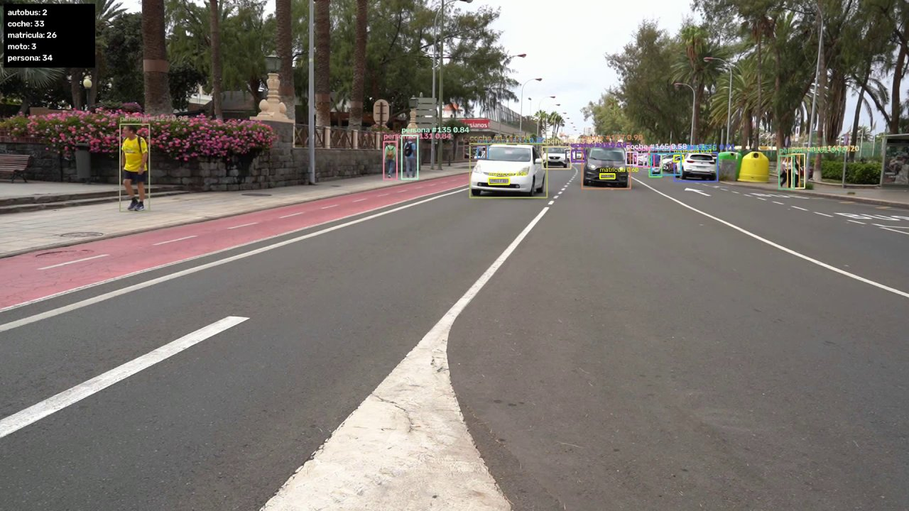

*Figura 12. Fotograma 1622 de `resultado_rtdetr.mp4`, con el panel de totales acumulados hasta ese momento.*

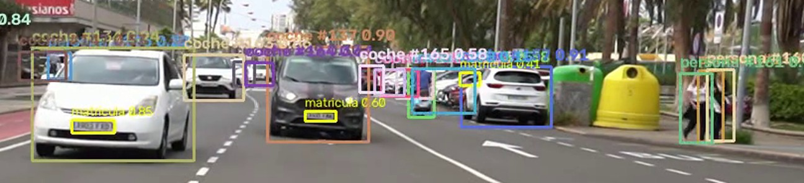

*Figura 13. Detalle ampliado del mismo fotograma: cada vehículo con su ID y confianza, y sus matrículas detectadas en amarillo (también la de un coche más lejano, con confianza 0,41).*

El fichero [`resultado_rtdetr.csv`](resultado_rtdetr.csv) tiene **una fila por objeto seguido y fotograma** (36.733 filas) con el formato que propone el enunciado:

| Columna | Contenido |
|---|---|
| `fotograma` | Número de fotograma, empezando en 0. |
| `tipo_objeto` | `persona`, `bicicleta`, `coche`, `moto`, `autobus` o `camion`. |
| `confianza` | Confianza de la detección, de 0 a 1. |
| `identificador_tracking` | ID del objeto, el mismo en todos los fotogramas en que aparece. |
| `x1, y1, x2, y2` | Esquinas de la caja del objeto, en píxeles. |
| `matrícula_en_su_caso` | `si` si se ha detectado la matrícula del vehículo, `no` si no; vacío en las personas. |
| `confianza_mat` | Confianza de la detección de la matrícula. |
| `mx1, my1, mx2, my2` | Esquinas de la caja de la matrícula, en píxeles del fotograma. |
| `texto_matricula` | Reservado para el OCR (vacío en esta alternativa). |

Un ejemplo de las primeras filas, con los tres casos posibles (persona, vehículo con matrícula y vehículo sin ella):

```text
fotograma,tipo_objeto,confianza,identificador_tracking,x1,y1,x2,y2,matrícula_en_su_caso,confianza_mat,mx1,my1,mx2,my2,texto_matricula
2,persona,0.6690,1,978,307,1011,375,,,,,,,
2,autobus,0.9582,2,1392,61,1919,479,si,0.7779,1868,407,1919,426,
2,coche,0.8904,3,1317,313,1398,371,no,,,,,,
```

RT-DETR devuelve números (cajas, confianzas y clases como *arrays* de NumPy), no texto, así que las **expresiones regulares** solo hacen falta para dejar el CSV limpio y para comprobarlo:

- `limpiar_etiqueta` pasa los nombres de clase a minúsculas y cambia por `_` todo lo que no sea letra o número: `re.sub(r"[^a-z0-9_]+", "_", nombre)`.
- `a_id` extrae el número de un identificador venga en el formato que venga (`12`, `12.0`, `#12`...): `re.search(r"\d+", valor)`.
- La última celda del cuaderno comprueba con una expresión regular que la cabecera es la pedida y que **cada fila** tiene el formato esperado según su caso. Resultado: **36.733 filas, 0 con formato incorrecto**.

```python
FILA_OK = re.compile(
    rf"^{ENTERO},({TIPOS}),{CONF},{ENTERO},{ENTERO},{ENTERO},{ENTERO},{ENTERO},"   # objeto
    rf"(si,{CONF},-?{ENTERO},-?{ENTERO},{ENTERO},{ENTERO},[^,]*"                    # con matrícula
    rf"|no,,,,,,|,,,,,,)$"                                                         # sin / persona
)
```

### 12.10. Limitaciones de la alternativa RT-DETR

- **Coches aparcados y ocultaciones largas:** la recuperación de pistas quietas reduce mucho los duplicados, pero un coche aparcado que queda tapado mucho tiempo puede recibir un ID nuevo y contarse de más.
- **Cambios de ID al alejarse:** un vehículo grande que se aleja cambia mucho de tamaño y puede perder su identificador (le ocurre al autobús).
- **Criterio de conteo:** los objetos que nunca llegan a 60 px (los del horizonte) no se cuentan, aunque sean reales.
- **Matrículas pequeñas:** son el punto débil del detector (mAP50-95 de 0,31 frente a 0,69 en las grandes).
- **Velocidad:** el procesado va a unos 6 fotogramas por segundo en la RTX 3050, lejos del tiempo real, porque cada fotograma pasa por el modelo L y por un recorte por vehículo.

---

## 13. Comparativa YOLO frente a RT-DETR

Los dos detectores de matrículas se han entrenado con las mismas imágenes, así que podemos compararlos de dos formas: cómo evolucionan durante el entrenamiento y, sobre todo, cómo se comportan con imágenes que **ninguno de los dos ha visto nunca** (el conjunto de test). Las dos comparaciones están en las secciones 4.3 y 7 del cuaderno [`VC_P4_RTDETR.ipynb`](VC_P4_RTDETR.ipynb).

### 13.1. Durante el entrenamiento

Se leen las métricas de validación de los dos registros de entrenamiento (`results.csv` de YOLO y `log.txt` de RT-DETR) y se dibujan juntas. Las pérdidas no se comparan: cada modelo usa funciones de pérdida distintas (YOLO: *box*, *cls* y DFL; RT-DETR: VFL, L1 y GIoU) y sus valores no significan lo mismo.

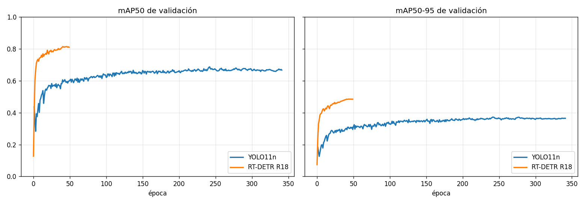

*Figura 14. mAP50 y mAP50-95 de validación de los dos modelos en cada época.*

| Modelo | Épocas | Mejor época | mAP50 | mAP50-95 |
|---|---:|---:|---:|---:|
| YOLO11n | 341 | 241 | 0,684 | 0,372 |
| RT-DETR-S (R18) | 50 | 44 | **0,812** | **0,485** |

RT-DETR supera ya en las primeras épocas el valor final de YOLO, y con muchas menos épocas. Ayuda que parte de pesos de COCO y entrena a 800 px en lugar de 640, lo que le permite ver mejor las matrículas pequeñas.

### 13.2. Evaluación en test

Para que la comparación sea justa, los dos detectores se evalúan **sobre las mismas 385 imágenes de test (872 matrículas)** y **con el mismo código**: las funciones `iou` y `evaluar_predicciones` se copian sin cambios del cuaderno de YOLO y se sigue su mismo protocolo ([apartado 10](#10-evaluación-del-detector-yolo)):

- Se guardan todas las predicciones con confianza ≥ 0,001 para calcular **AP50** y **mAP50-95** (con 101 niveles de recall y umbrales de solape de 0,50 a 0,95).
- **Precisión, recall y F1** se calculan con un solape mínimo del 50 % y el umbral de confianza que usa cada modelo en el vídeo (YOLO: 0,25; RT-DETR: 0,40).
- Cada modelo recibe la imagen completa a su resolución de entrenamiento (YOLO 640 px, RT-DETR 800 px), y se mide el tiempo por imagen en la GPU (preproceso, red y postproceso).

| Modelo | AP50 | mAP50-95 | Precisión | Recall | F1 | Aciertos (TP) | Sobrantes (FP) | Perdidas (FN) | ms/imagen |
|---|---:|---:|---:|---:|---:|---:|---:|---:|---:|
| YOLO11n | 0,701 | 0,389 | **0,857** | 0,689 | 0,764 | 601 | **100** | 271 | **9,2** |
| RT-DETR-S (R18) | **0,828** | **0,476** | 0,842 | **0,805** | **0,823** | **702** | 132 | **170** | 41,4 |

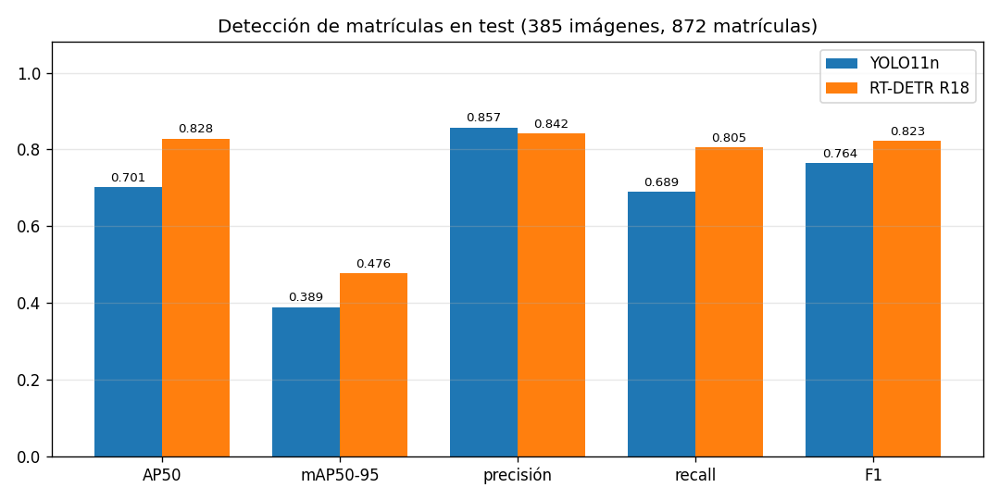

*Figura 15. Métricas de los dos detectores de matrículas sobre el conjunto de test.*

- **RT-DETR detecta mejor:** +0,13 en AP50 y +0,09 en mAP50-95. La diferencia está sobre todo en el **recall**: encuentra 702 de las 872 matrículas, 101 más que YOLO, que se deja casi un tercio sin detectar.
- **La precisión es parecida** (0,84-0,86): cuando cualquiera de los dos dice "matrícula", casi siempre acierta.
- **YOLO11n es unas 4,5 veces más rápido** (9,2 frente a 41,4 ms por imagen en la RTX 3050) y mucho más ligero (2,6 M de parámetros frente a 20,1 M). Los tiempos varían de una ejecución a otra según el estado del portátil (en distintas ejecuciones han salido entre 9 y 17 ms para YOLO y entre 41 y 59 ms para RT-DETR), pero YOLO es siempre entre 3,5 y 5 veces más rápido.
- Los valores de test coinciden con los de validación, así que ninguno de los dos está sobreajustado.

Como referencia se usan las anotaciones de `dataset_1920`, con las cajas corregidas en las fotos con orientación EXIF ([apartado 12.2](#122-preparación-del-dataset)). Para comprobar que esto no perjudica a YOLO, se evaluó también con el protocolo exacto de su cuaderno (dataset original y sus JSON): obtiene AP50 0,685 y mAP50-95 0,378, algo menos que aquí.

### 13.3. Conclusiones

| Aspecto | YOLO11n | RT-DETR-S (R18) |
|---|---|---|
| Matrículas encontradas en test | 69 % | **81 %** |
| Precisión de lo que detecta | **86 %** | 84 % |
| Tiempo por imagen (RTX 3050) | **9,2 ms** | 41,4 ms |
| Tamaño del modelo | **2,6 M parámetros** | 20,1 M parámetros |
| Entrenamiento | 341 épocas | **50 épocas, 3,1 h** |

Para esta práctica, en la que importa encontrar el mayor número posible de matrículas y el vídeo se procesa sin prisa, **RT-DETR es la mejor opción**: encuentra muchas más matrículas con una precisión similar. **YOLO11n sería preferible para tiempo real** o equipos modestos, donde su velocidad y su tamaño compensan la pérdida de matrículas.

---

## 14. Detección de matrículas por contornos

Como tercera alternativa, en el cuaderno [`VC_P4_contornos.ipynb`](VC_P4_contornos.ipynb) se detectan las matrículas **sin aprendizaje profundo**, solo con técnicas clásicas de procesamiento de imagen como las de la práctica anterior: filtros, umbralizado, operaciones morfológicas y análisis de contornos.

### 14.1. Procedimiento

1. **Multiescala.** La imagen se procesa a tres resoluciones distintas (640, 1100 y 1920 px de ancho) para encontrar tanto las matrículas de coches lejanos como las de coches cercanos.
2. **Tres pistas para generar candidatas.** En cada escala se buscan regiones que puedan ser una matrícula de tres maneras distintas:
    - **Texto:** ecualización CLAHE, operación morfológica *Black-hat* y gradiente Sobel horizontal, para encontrar zonas con muchas letras oscuras juntas sobre fondo claro.
    - **Bordes:** filtro bilateral y detector de Canny, para encontrar formas rectangulares bien delimitadas.
    - **Color:** filtro HSV que se queda con las zonas blancas y brillantes, como el fondo reflectante de la placa.
3. **Filtro geométrico.** De cada máscara se extraen los contornos con `findContours` y se conservan los que tienen forma de matrícula: área mínima de 150 px², una proporción entre lado largo y corto de 2 a 7,5 y una buena rectangularidad.
4. **Verificación de contenido.** Cada candidata se recorta, se binariza y se cuentan sus **caracteres** con `connectedComponentsWithStats`: manchas de altura parecida y alineadas. Con menos de 4 caracteres se descarta.
5. **Puntuación y NMS.** Se puntúa cada candidata según su número de caracteres (lo ideal, entre 5 y 9) y su proporción (cercana a la de una matrícula española, 4,7), y se eliminan las repetidas con una supresión de no máximos (NMS).

### 14.2. Pasos intermedios en una imagen

En la siguiente figura se ve cómo el algoritmo va "esculpiendo" una imagen del dataset paso a paso hasta aislar la matrícula:

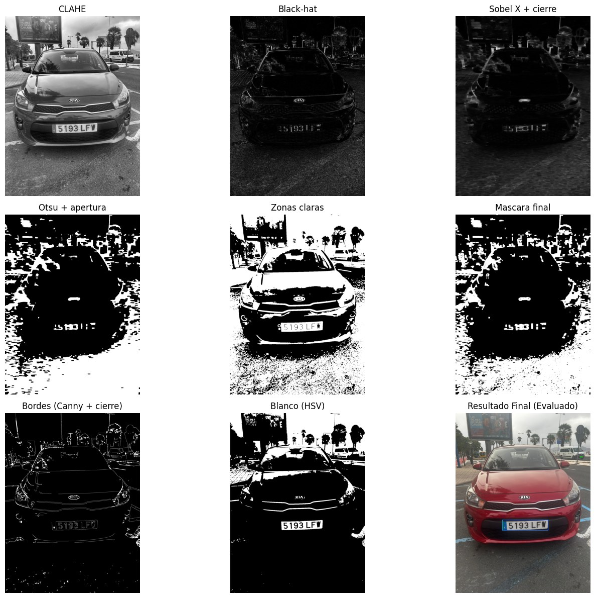

*Figura 16. Pasos intermedios del método de contornos sobre una imagen de test.*

| Paso | Qué ocurre |
|---|---|
| **CLAHE** | La imagen pasa a escala de grises y se ecualiza la luz por zonas. El contraste aumenta mucho y la matrícula destaca tanto si está a la sombra como a pleno sol. |
| **Black-hat** | La imagen se vuelve casi negra. Solo brillan los pequeños detalles más oscuros que su entorno: las letras y números de la placa, y las rejillas y el logotipo del coche. |
| **Sobel X + cierre** | Se buscan los bordes verticales y se emborronan en horizontal. Los caracteres de la matrícula se "funden" en una única mancha rectangular. |
| **Otsu + apertura** | La imagen pasa a blanco y negro puro. Los caracteres de la matrícula quedan como manchas blancas alineadas, junto a mucho ruido del suelo y del fondo que la apertura reduce pero no elimina. |
| **Zonas claras** | Resalta el fondo reflectante de la placa, el cielo y gran parte del suelo; la carrocería roja queda en negro. |
| **Máscara final** | Es el cruce de las dos anteriores: solo quedan las zonas con texto sobre fondo claro. La matrícula se conserva, pero aquí el cruce apenas quita ruido porque el suelo y el fondo también son claros; por eso hacen falta los filtros posteriores de forma y de número de caracteres. |
| **Bordes (Canny + cierre)** | Saca las siluetas finas del coche y de la escena; el rectángulo de la matrícula queda perfectamente dibujado. |
| **Blanco (HSV)** | Aísla los colores brillantes y sin saturación. Como el coche es rojo (un color muy saturado), su carrocería desaparece y la placa salta a la vista como un rectángulo blanco, junto con el cielo y los edificios claros del fondo. |
| **Resultado final** | Tras extraer los contornos rectangulares de las máscaras y contar sus caracteres, el algoritmo dibuja una caja **azul** (acierto: solape con la real ≥ 50 %) encajada sobre la matrícula `5193 LFW`, sin ningún falso positivo. La matrícula de la furgoneta del fondo (pequeño recuadro verde a la derecha) es demasiado pequeña y no se detecta. |

### 14.3. Evaluación en test

El método se evalúa sobre las mismas **385 imágenes de test** de `dataset_1920`. Una detección es un acierto si solapa al menos un 50 % con una matrícula real.

| Métrica | Resultado | Proporción |
|---|---:|---:|
| Éxito por imagen (la mejor candidata acierta) | 60,3 % | - |
| Recall (matrículas halladas) | 40,3 % | 351 / 872 |
| Recall de matrículas ≥ 60 px de ancho | 67,2 % | 287 / 427 |
| Precisión (detecciones correctas) | 46,6 % | 351 / 754 |

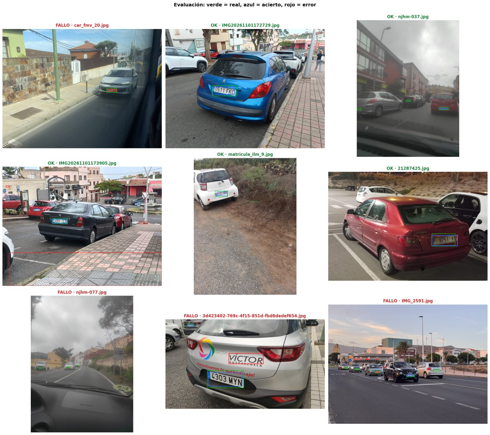

*Figura 17. Nueve imágenes de test al azar. Verde: matrícula real; azul: detección correcta; rojo: detección errónea.*

- **El tamaño es clave.** El recall general es del 40,3 %, algo esperable en un método que analiza la imagen píxel a píxel sin entender el contexto: en las matrículas lejanas o con poca resolución, los cierres morfológicos funden las letras en una mancha y la verificación de caracteres falla. Si nos fijamos solo en las matrículas grandes (≥ 60 px), el acierto sube al **67,2 %**.
- **Muchos falsos positivos** (precisión del 46,6 %). En la calle hay muchos elementos con forma de matrícula, como faros, señales, rótulos o calandras, que engañan a los filtros de bordes y de color; se ven como recuadros rojos en la figura (por ejemplo, el rótulo de la autoescuela).
- **Éxito por imagen del 60,3 %.** Pese a perder las matrículas pequeñas, el método encuentra la matrícula principal en más de la mitad de las fotos, gracias a procesar varias escalas y a cruzar tres pistas distintas.

Comparado con las alternativas de aprendizaje profundo, que encuentran el 69 % (YOLO11n) y el 81 % (RT-DETR) de las matrículas del mismo test con una precisión superior al 84 %, el método clásico es rápido y funciona bien en primeros planos, pero sufre ante la variedad del mundo real: escalas diminutas, ocultaciones y objetos parecidos a una matrícula.

---


## 15. Referencias

- Material de la práctica: [Práctica 4](https://github.com/otsedom/otsedom.github.io/tree/main/VC/P4) y [Práctica 4b](https://github.com/otsedom/otsedom.github.io/tree/main/VC/P4b).
- Ultralytics: [seguimiento de objetos](https://docs.ultralytics.com/modes/track/).
- Ultralytics: [conversión de anotaciones de COCO a YOLO](https://docs.ultralytics.com/es/guides/coco-to-yolo).
- PaddleOCR: [módulo de reconocimiento de texto, API 3.x](https://www.paddleocr.ai/main/en/version3.x/module_usage/text_recognition.html).
- HuggingFaceTB: [ficha de SmolVLM-256M-Instruct](https://huggingface.co/HuggingFaceTB/SmolVLM-256M-Instruct).
- [Repositorio oficial de RT-DETR (lyuwenyu/RT-DETR)](https://github.com/lyuwenyu/RT-DETR), carpeta `rtdetrv2_pytorch`.
- Zhao et al. (2024). [DETRs Beat YOLOs on Real-time Object Detection](https://arxiv.org/abs/2304.08069). CVPR 2024.
- Lv et al. (2024). [RT-DETRv2: Improved Baseline with Bag-of-Freebies for Real-Time Detection Transformer](https://arxiv.org/abs/2407.17140).
- Zhang et al. (2022). [ByteTrack: Multi-Object Tracking by Associating Every Detection Box](https://arxiv.org/abs/2110.06864). ECCV 2022.
- Yang et al. (2023). [Hard To Track Objects With Irregular Motions and Similar Appearances? Make It Easier by Buffering the Matching Space](https://arxiv.org/abs/2211.14317) (*buffered IoU*). WACV 2023.
- SciPy: [`linear_sum_assignment`](https://docs.scipy.org/doc/scipy/reference/generated/scipy.optimize.linear_sum_assignment.html) (algoritmo húngaro).
- COCO: [métricas de detección](https://cocodataset.org/#detection-eval).
- OpenCV: [operaciones morfológicas](https://docs.opencv.org/4.x/d9/d61/tutorial_py_morphological_ops.html).
- OpenCV: [contornos](https://docs.opencv.org/4.x/d4/d73/tutorial_py_contours_begin.html).

---

## Nota: uso de IA

* En la elaboración de esta práctica se ha empleado IA como apoyo para automatizar el entrenamiento de los modelos y para la redacción de este documento `README.md`, con revisión previa por parte de los autores.

---
