# Práctica 5 - Biometría: detección y caracterización de caras

Práctica de la asignatura **Visión por Computador** dedicada a detectar caras, localizar sus elementos mediante *landmarks* y extraer información del rostro para provocar *reacciones*. Se proponen dos prototipos de temática libre: uno de ellos debe incluir un modelo biométrico **entrenado por nosotros**, con el proceso de entrenamiento, la elección del dataset y la discusión de los resultados, y el otro es completamente libre. 

* Como extras, se comparan modelos clásicos y redes neuronales (resultados, facilidad de uso y rapidez) y se comparan los modelos entrenados con la función `analyze` de DeepFace.

## 👥 Autores

Este trabajo ha sido realizado por el **`Grupo 27`**:
- [Alba Ramos Quintana](https://github.com/albaquiintanaa)
- [Néstor Jesús Henríquez Medina](https://github.com/NestorJHM)

## Resultados

<div align="center">

| Prototipo | Demostración | Descripción |
|---|---|---|
| **A** - [GESTO GALÁCTICO](#2-prototipo-a-gesto-galáctico) | <a href="https://youtu.be/0eNo2aBeK-M">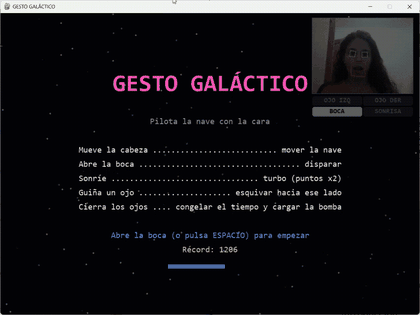</a><br>[▶ Ver vídeo con sonido](https://youtu.be/0eNo2aBeK-M) | Juego de naves controlado con la cara. Los gestos los detectan tres modelos entrenados por nosotros. |
| **B** - [MORPHING DE CARAS](#3-prototipo-b-facefusion---morphing-de-caras) | <a href="https://youtu.be/JUoVybd1Fl0"></a><br>[▶ Ver vídeo con sonido](https://youtu.be/JUoVybd1Fl0) | Morphing de caras controlado con los dedos índice y pulgar de la mano izquierda. |

</div>

---

## Contenidos

[1. Entorno y puesta en marcha](#1-entorno-y-puesta-en-marcha)\
&emsp;[1.1. Dependencias y GPU](#11-dependencias-y-gpu)\
&emsp;[1.2. Instalación del entorno](#12-instalación-del-entorno)\
&emsp;[1.3. Ejecución del prototipo A](#13-ejecución-del-prototipo-a)\
&emsp;[1.4. Ejecución del prototipo B](#14-ejecución-del-prototipo-b)\
&emsp;[1.5. Archivos que no se incluyen en el repositorio](#15-archivos-que-no-se-incluyen-en-el-repositorio)\
[2. Prototipo A: GESTO GALÁCTICO](#2-prototipo-a-gesto-galáctico)\
&emsp;[2.1. Datos y validación](#21-datos-y-validación)\
&emsp;[2.2. Modelos entrenados](#22-modelos-entrenados)\
&emsp;[2.3. Prueba en directo con la webcam](#23-prueba-en-directo-con-la-webcam)\
&emsp;[2.4. Extra: modelos clásicos frente a redes neuronales](#24-extra-modelos-clásicos-frente-a-redes-neuronales)\
&emsp;[2.5. Extra: comparación con DeepFace](#25-extra-comparación-con-deepface)\
&emsp;[2.6. Detector de gestos y juego](#26-detector-de-gestos-y-juego)\
&emsp;[2.7. Limitaciones](#27-limitaciones)\
[3. Prototipo B: MORPHING DE CARAS](#3-prototipo-b-facefusion---morphing-de-caras)\
&emsp;[3.1. Regula la intensidad "con mano izquierda"](#31-regula-la-intensidad-con-mano-izquierda--)\
&emsp;[3.2. Cómo ejecutar el morping](#32-cómo-ejecutar-el-morphing)\
&emsp;[3.3. Cómo se construye la mezcla](#33-cómo-se-construye-la-mezcla)\
&emsp;[3.4. Cómo se adapta el tono de piel](#34-cómo-se-adapta-el-tono-de-piel)\
[4. Referencias](#4-referencias)\
[5. Nota: uso de IA](#nota-uso-de-ia)

---

## 1. Entorno y puesta en marcha

### 1.1. Dependencias y GPU

El entorno se denomina **`VC_P5`** y emplea Python **3.11.5**, la versión que propone el enunciado:

<div align="center">

| Componente | Versión | Función |
|---|---|---|
| MediaPipe | 1.2.3 | *Landmarks* faciales y *blendshapes*. |
| OpenCV | 4.12.0.88 | Cámara, recortes y dibujo. |
| scikit-learn / scikit-image | 1.9.1 / 0.26.0 | SVM, KNN, k-fold y descriptores HOG y LBP. |
| TensorFlow / Keras | 2.21.0 / 3.15.1 | CNN. |
| DeepFace | 0.0.105 | Comparación con `analyze`. |
| pygame | 2.6.1 | Juego y sonido. |

</div>

Todo se ha ejecutado en la **CPU**, ya que TensorFlow no admite GPU en Windows nativo desde la versión 2.11; con modelos tan pequeños no es un problema.

### 1.2. Instalación del entorno

```powershell
conda create --name VC_P5 python=3.11.5
conda activate VC_P5

python -m pip install "mediapipe==1.2.3" "opencv-python==4.12.0.88" "numpy==2.2.6"
python -m pip install "tensorflow==2.21.0" "tf-keras==2.21.0" "deepface==0.0.105"
python -m pip install "scikit-learn==1.9.1" "scikit-image==0.26.0" "pygame==2.6.1" matplotlib joblib ipykernel

python -m ipykernel install --user --name VC_P5 --display-name "VC_P5"
```

### 1.3. Ejecución del prototipo A

Todo se ejecuta **desde la carpeta `prototipoA`**, con el núcleo **VC_P5**:

1. Descargar los datasets ([apartado 2.1](#21-datos-y-validación)) en `prototipoA/datasets/`, con una subcarpeta por clase: `ojos_CEW/` y `ojos_kaggle/` (`abierto`, `cerrado`), `boca/` (`abierta`, `cerrada`) y `sonrisa/` (`sonrie`, `no_sonrie`). 
    - Los ojos cerrados de CEW se renombraron como `cerrado_<foto>_c<cara>_<L|R>.jpg` para poder agruparlos por foto.
2. Ejecutar `VC_P5_gestos_datasets.ipynb`, que descarga `face_landmarker.task` y prepara los recortes de boca.
3. Ejecutar los cuadernos de ojos, boca y sonrisa, en cualquier orden. Cada uno guarda sus modelos en `modelos/`, sus gráficas en `figuras/` y sus tablas en `resultados/`.
4. Jugar con:

```powershell
cd prototipoA
python juego.py
```

`python gestos.py` abre la **ventana de prueba** del detector. Si no se ve la cámara, hay que cambiar `CAMARA` al principio de `gestos.py`. En el juego, **C** recentra la cabeza, **L** muestra los *landmarks*, **P** pausa y **ESC** sale; también se puede jugar con el teclado.

### 1.4. Ejecución del prototipo B

<!-- Puesta en marcha del prototipo B. -->

### 1.5. Archivos que no se incluyen en el repositorio

El fichero `.gitignore` excluye los archivos grandes o que se pueden volver a generar o descargar:

<div align="center">

| Qué | Rutas | Cómo conseguirlo |
|---|---|---|
| Datasets | `prototipoA/datasets/` | Enlaces en el [apartado 2.1](#21-datos-y-validación). |
| Modelo de MediaPipe | `prototipoA/face_landmarker.task` | Lo descarga `VC_P5_gestos_datasets.ipynb`. |
| Modelos que no usa el juego | `prototipoA/modelos/` salvo `ojos_cnn`, `boca_hog` y `sonrisa_hog` | Se regeneran con los cuadernos; sus resultados están en `resultados/` y `figuras/`. |
| Grabaciones de prueba | `prototipoA/grabaciones/`, `*.mp4` | Se graban con la tecla R de `gestos.py`. |
| Récord del juego | `prototipoA/record.txt` | Lo crea el juego. |

</div>

---

## 2. Prototipo A: GESTO GALÁCTICO

**GESTO GALÁCTICO** es un videojuego de naves que se maneja solo con la cara. MediaPipe localiza los *landmarks* del rostro y, a partir de ellos, recortamos los ojos y la boca y se los pasamos a **tres modelos entrenados por nosotros**:

<div align="center">

| Gesto | Cómo se detecta | Acción en el juego |
|---|---|---|
| Mover la cabeza | Desplazamiento de la punta de la nariz (landmark 1) | Mover la nave |
| Abrir la boca | **HOG + SVM** (boca abierta / cerrada) | Disparar en ráfaga |
| Sonreír | **HOG + SVM** (sonríe / no sonríe) | Turbo: todo va más rápido y los puntos valen el doble |
| Guiñar un ojo | **CNN** (ojo abierto / cerrado) con un solo ojo cerrado | Esquive rápido hacia ese lado |
| Cerrar los ojos más de 0,6 s | La misma CNN con un filtro de tiempo | El tiempo se congela y se carga una bomba que explota al abrirlos |

</div>

En el último gesto se tiene en cuenta que al parpadear los ojos se cierran solos, así que el programa mide **cuánto tiempo** están cerrados y solo carga la bomba si pasan de 0,6 s. 

* Y como con los ojos cerrados no se ve la pantalla, mientras se carga la bomba el tiempo se detiene y te avisa un sonido.

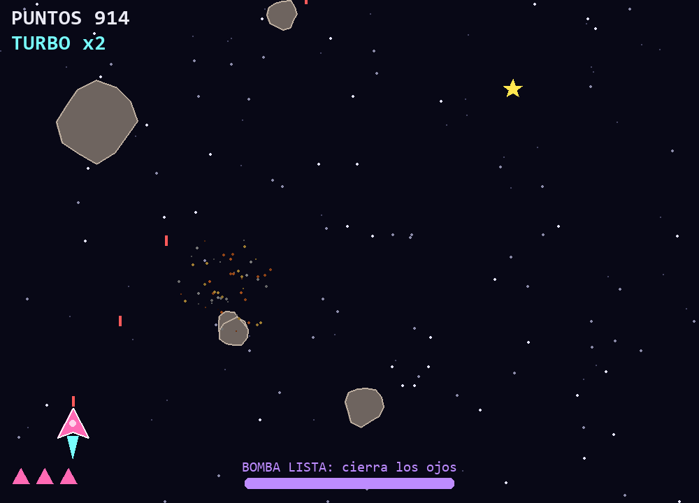

<p align="center"><em>Figura 1. Partida con el turbo activado (sonrisa): la nave dispara a los asteroides, la estrella amarilla da puntos extra y la barra inferior indica que la bomba está lista.</em></p>

Todo está en la carpeta [`prototipoA/`](prototipoA/), y los cuadernos se entregan **ejecutados con sus salidas**:

<div align="center">

| Archivo | Contenido |
|---|---|
| [`VC_P5_gestos_datasets.ipynb`](prototipoA/VC_P5_gestos_datasets.ipynb) | Revisión de los datasets y recorte de las bocas con MediaPipe. |
| [`VC_P5_gestos_ojos.ipynb`](prototipoA/VC_P5_gestos_ojos.ipynb), [`_boca`](prototipoA/VC_P5_gestos_boca.ipynb), [`_sonrisa`](prototipoA/VC_P5_gestos_sonrisa.ipynb) | Entrenamiento, comparación y elección de cada modelo. |
| [`VC_P5_gestos_prueba_directo.ipynb`](prototipoA/VC_P5_gestos_prueba_directo.ipynb) | Prueba del modelo de boca con una grabación de la webcam. |
| [`utilidades_gestos.py`](prototipoA/utilidades_gestos.py) | Funciones comunes: carga, descriptores, modelos, k-fold agrupado y guardado. |
| [`gestos.py`](prototipoA/gestos.py) | Detector de gestos en directo (también funciona solo, como ventana de prueba). |
| [`juego.py`](prototipoA/juego.py), [`sonidos_juego.py`](prototipoA/sonidos_juego.py) | El juego y sus sonidos, generados por síntesis. |
| `modelos/`, `figuras/`, `resultados/` | Los tres modelos del juego, las gráficas y las tablas de resultados. |

</div>

El proceso completo tiene dos partes: en los cuadernos se preparan los datos y se entrenan y eligen los modelos, y en directo esos modelos convierten cada fotograma de la webcam en los controles del juego.

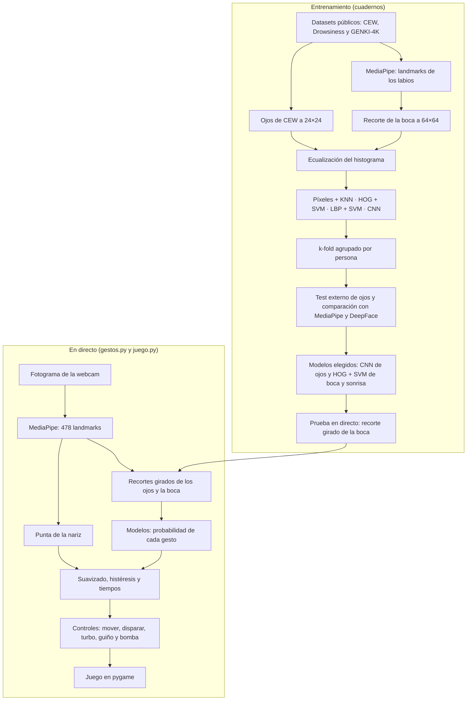

<p align="center"><em>Figura 2. Pipeline del prototipo A: entrenamiento y elección de los modelos en los cuadernos (arriba) y uso en directo en cada fotograma (abajo).</em></p>

### 2.1. Datos y validación

Cada gesto se entrena con un dataset público, y las clases están balanceadas.

<div align="center">

| Gesto | Dataset | Imágenes |
|---|---|---:|
| Ojo abierto / cerrado | [CEW](https://parnec.nuaa.edu.cn/_upload/tpl/02/db/731/template731/pages/xtan/ClosedEyeDatabases.html), recortes de ojo de 24×24 en gris | 2.462 / 2.384 |
| Ojo abierto / cerrado (**test externo**) | [Drowsiness dataset](https://www.kaggle.com/datasets/dheerajperumandla/drowsiness-dataset), clases *Open* / *Closed* | 726 / 726 |
| Boca abierta / cerrada | [Drowsiness dataset](https://www.kaggle.com/datasets/dheerajperumandla/drowsiness-dataset), clases *yawn* / *no_yawn* | 709 / 720 |
| Sonrisa / no sonrisa | [GENKI-4K](https://mplab.ucsd.edu/398) | 2.139 / 1.817 |

</div>

**CEW** (*Closed Eyes in the Wild*) trae ojos ya recortados a 24×24 en gris, de caras en condiciones reales (distintas luces, posturas y personas). Con él se entrena el modelo de ojos.

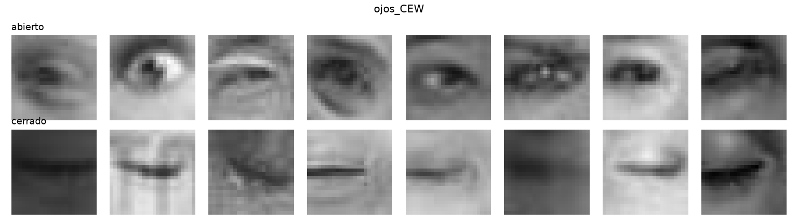

<p align="center"><em>Figura 3. Ojos abiertos y cerrados de CEW.</em></p>

Los **ojos del Drowsiness dataset** son de otras personas y otras cámaras, en color y con un encuadre más amplio. No se usan para entrenar, solo como **test externo**, para saber cómo se comporta el modelo con una cámara que no ha visto.

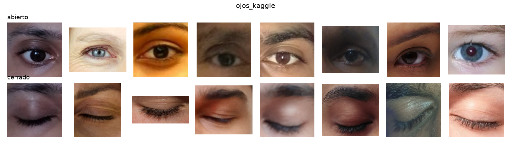

<p align="center"><em>Figura 4. Ojos abiertos y cerrados del Drowsiness dataset, usados como test externo.</em></p>

Los **bostezos del Drowsiness dataset** (fotogramas de conductores) y **GENKI-4K** (caras de internet con y sin sonrisa) traen la cara completa, pero en el juego el modelo solo verá la boca. Por eso recortamos la boca de cada foto con los *landmarks* de los labios de MediaPipe (un cuadrado de 64×64 con un 40 % de margen), igual que se recorta después la webcam.

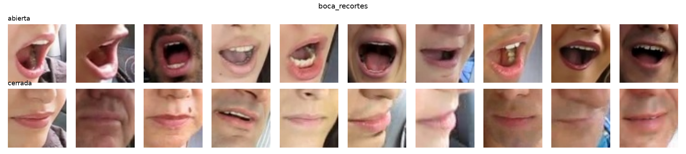

<p align="center"><em>Figura 5. Recortes de boca abierta (bostezo) y cerrada obtenidos con MediaPipe a partir del Drowsiness dataset.</em></p>

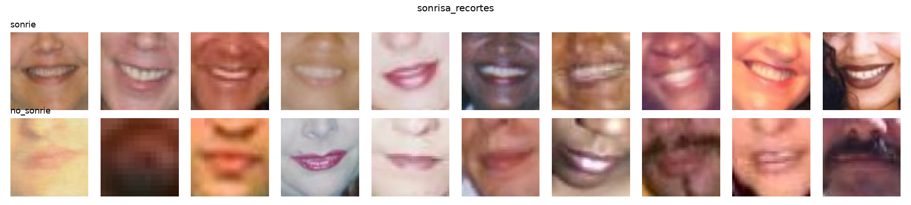

<p align="center"><em>Figura 6. Recortes de boca con y sin sonrisa obtenidos con MediaPipe a partir de GENKI-4K.</em></p>

Todas las imágenes se **ecualizan** antes de entrar al modelo, para que afecten menos las diferencias de luz entre cámaras.

Los métodos se comparan con una validación cruzada de **5 folds agrupada por persona** (`StratifiedGroupKFold`): si fotos de la misma persona caen unas en entrenamiento y otras en test, el modelo puede acertar porque "reconoce" a la persona y el resultado sale demasiado optimista.

- En **CEW**, el grupo sale del nombre del archivo, para que el ojo izquierdo y el derecho de una foto vayan juntos.
- En **boca**, el dataset son fotogramas de vídeos de conductores y no dice quién es quién. Agrupamos los fotogramas por **parecido visual** (persona, coche y fondo) con *clustering* jerárquico y salen 112 grupos.
- En **GENKI-4K** casi todas las personas son distintas; el mismo *clustering*, con un umbral muy estricto, junta solo las 4 parejas de fotos casi idénticas.

Así se forman los grupos de la boca y se usan después en el k-fold (`VC_P5_gestos_boca.ipynb` y `utilidades_gestos.py`):

```python
# Cada fotograma completo se reduce a una miniatura de 32×24, suavizada y normalizada
mini = cv2.GaussianBlur(cv2.resize(img, (32, 24), interpolation=cv2.INTER_AREA).astype(np.float32), (3, 3), 0)
v = mini.ravel()
miniaturas.append((v - v.mean()) / (v.std() + 1e-6))

# Los fotogramas a menos de 0,15 de distancia coseno quedan en el mismo grupo
etiquetas_grupo = AgglomerativeClustering(n_clusters=None, distance_threshold=0.15, metric='cosine',
                                          linkage='average').fit_predict(np.array(miniaturas))

# En el k-fold, todas las imágenes de un grupo van juntas a entrenamiento o a test
skf = StratifiedGroupKFold(n_splits=k, shuffle=True, random_state=semilla)
for fold, (tr, te) in enumerate(skf.split(X, y, grupos), start=1):
    ...
```

Para comprobar que importa, repetimos el k-fold de boca repartiendo las imágenes al azar: todos los métodos parecen mejores, sobre todo Píxeles + KNN (+0,043 de F1), que casi "memoriza" a las personas. Por eso todos los resultados que siguen son con el k-fold agrupado.

### 2.2. Modelos entrenados

Para cada gesto comparamos cuatro métodos con las mismas imágenes y los mismos folds:

- **Píxeles + KNN** (k = 5), como referencia mínima.
- **HOG + SVM**, que describe la orientación de los bordes en cada celda.
- **LBP + SVM**, que describe la textura comparando cada píxel con sus vecinos.
- Una **CNN** propia de unos 27.500 parámetros: tres capas convolucionales (16, 32 y 64 filtros), una densa y salida sigmoide, entrenada 30 épocas con **aumento de datos** (volteo, desplazamiento, zoom, brillo y contraste al azar).

En las SVM, `C` y `gamma` se eligen con una búsqueda en rejilla, y el modelo final se calibra (`CalibratedClassifierCV`) para que dé probabilidades, que es lo que usa el juego. Elegimos cada modelo por el **F1** de la clase que provoca la acción (ojo cerrado, boca abierta o sonrisa).

El descriptor LBP sigue la función `lbphist` del cuaderno de la práctica: un histograma de patrones por cada celda de la imagen, concatenados (`utilidades_gestos.py`):

```python
lbp = local_binary_pattern(img, 8, 1, method='nri_uniform')  # 8 vecinos y radio 1
n_bins = 59                                                 # patrones distintos con 'nri_uniform'
ch, cw = h // celdas, w // celdas
hists = []
for i in range(celdas):                                     # 3×3 celdas en los ojos y 4×4 en la boca
    for j in range(celdas):
        celda = lbp[i * ch:(i + 1) * ch, j * cw:(j + 1) * cw]
        hist, _ = np.histogram(celda, bins=n_bins, range=(0, n_bins), density=True)
        hists.append(hist)
return np.concatenate(hists)
```

Y la CNN es esta red de Keras (`utilidades_gestos.py`):

```python
modelo = keras.Sequential([
    keras.Input(shape=(tam, tam, canales)),
    *capas_aumento,                          # volteo, desplazamiento, zoom, brillo y contraste (solo al entrenar)
    layers.Rescaling(1.0 / 255),
    layers.Conv2D(16, 3, padding='same', activation='relu'),
    layers.MaxPooling2D(),
    layers.Conv2D(32, 3, padding='same', activation='relu'),
    layers.MaxPooling2D(),
    layers.Conv2D(64, 3, padding='same', activation='relu'),
    layers.GlobalAveragePooling2D(),
    layers.Dense(64, activation='relu'),
    layers.Dropout(0.3),                     # apaga neuronas al azar para que no memorice
    layers.Dense(1, activation='sigmoid'),   # probabilidad de ojo cerrado, boca abierta o sonrisa
])
modelo.compile(optimizer='adam', loss='binary_crossentropy', metrics=['accuracy'])
```


### Ojos

Además del k-fold sobre CEW, hacemos un **test externo**: entrenamos con todo CEW y evaluamos con los ojos del Drowsiness dataset, de otras personas y otras cámaras.

<div align="center">

| Método | F1 k-fold | F1 externo | ms por ojo |
|---|---:|---:|---:|
| Píxeles + KNN | 0,852 | - | - |
| HOG + SVM | 0,906 | 0,359 | 1,3 |
| LBP + SVM | **0,945** | 0,721 | 2,0 |
| **CNN** ★ | 0,943 | **0,980** | 0,9 |

</div>

Dentro de CEW, LBP y la CNN empatan, pero con otra cámara HOG se hunde y solo la CNN aguanta: **el k-fold, aunque esté bien agrupado, no basta para saber cómo funcionará el modelo con otra cámara**, y la webcam es otra cámara. 

También vimos que el **encuadre** importa: recortando el ojo como en CEW (centrado y ajustado) todos los modelos mejoran, y así lo hacemos en el juego. 

* Sin aumento de datos, la CNN baja a 0,948.

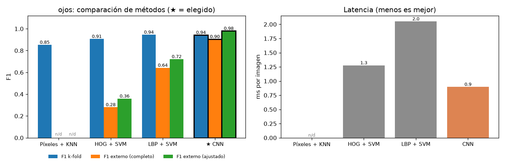

<p align="center"><em>Figura 7. F1 en k-fold y en el test externo (con el encuadre completo y ajustado) y latencia por ojo. La estrella marca el modelo elegido: la CNN.</em></p>

La matriz de confusión del test externo muestra por qué HOG se hunde: de los 726 ojos cerrados de otra cámara solo reconoce 162 y da **564 por abiertos**, así que en el juego casi nunca habría bombas ni guiños. LBP se equivoca en los dos sentidos, y la CNN solo falla 25 ojos cerrados y 4 abiertos.

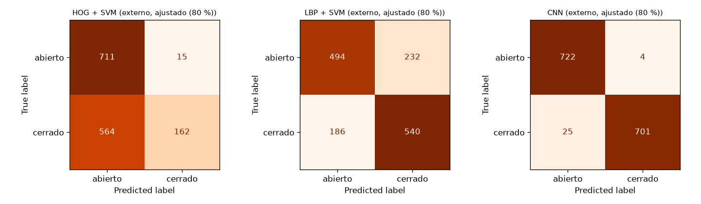

<p align="center"><em>Figura 8. Matrices de confusión en el test externo (Drowsiness dataset, encuadre ajustado al 80 %). Filas: clase real; columnas: clase predicha.</em></p>


### Boca y Sonrisa

Aquí también comparamos con lo que ya calcula MediaPipe junto a los *landmarks*: `jawOpen` para la boca y la media de `mouthSmileLeft` y `mouthSmileRight` para la sonrisa. 

Para usar esas puntuaciones como clasificador, en cada fold se elige el umbral con mejor F1 en entrenamiento.

<div align="center">

| Método | F1 boca | F1 sonrisa | ms por recorte |
|---|---:|---:|---:|
| Píxeles + KNN | 0,921 | 0,917 | - |
| **HOG + SVM** ★ | **0,983** | **0,939** | 2,4 / 3,3 |
| LBP + SVM | 0,983 | 0,933 | 2,4 / 2,9 |
| CNN (en color) | 0,904 | 0,891 | 1,1 / 1,0 |
| MediaPipe (sin entrenar) | 0,980 | 0,942 | - |

</div>

- **Los descriptores clásicos ganan a la CNN**: la boca abierta y la sonrisa se ven muy bien en los bordes, y con 1.100-3.200 imágenes por fold una red entrenada desde cero aprende peor que una SVM con buenos descriptores. En la boca, HOG y LBP empatan y elegimos HOG por ser algo más rápido.
- **MediaPipe iguala a nuestros mejores modelos sin entrenar nada.** El juego usa los nuestros porque la práctica pide un modelo propio.

En la sonrisa, la matriz de confusión del k-fold muestra el problema de la CNN: da **342 caras sin sonrisa como sonrientes**, más del triple que HOG + SVM (103). En el juego, eso sería el turbo activándose sin querer.

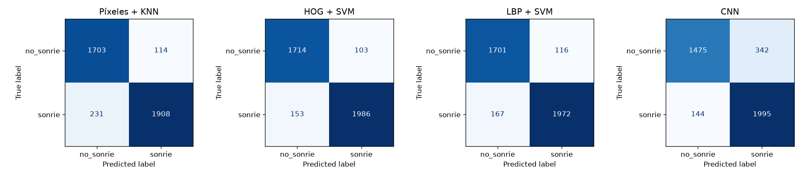

<p align="center"><em>Figura 9. Matrices de confusión de los cuatro métodos en el k-fold de sonrisa, sumando los 5 folds. Filas: clase real; columnas: clase predicha.</em></p>

---

> [!IMPORTANT]
> **Modelos elegidos:** CNN para los ojos (`modelos/ojos_cnn`) y HOG + SVM para la boca y la sonrisa (`modelos/boca_hog` y `modelos/sonrisa_hog`), que usan el mismo recorte de boca.

---

### 2.3. Prueba en directo con la webcam

Al probarlo con la webcam, el modelo de boca disparaba muchas veces **con la boca cerrada**, sobre todo al **inclinar la cabeza**. Para medirlo, hicimos una grabación de prueba, con la tecla R (boca cerrada, abierta, hablando e inclinando la cabeza) y la analizamos en [`VC_P5_gestos_prueba_directo.ipynb`](prototipoA/VC_P5_gestos_prueba_directo.ipynb). 

Para no etiquetar a mano, cada fotograma se etiqueta con la **apertura de los labios** según los *landmarks*: la distancia entre los puntos 13 y 14 dividida por la anchura de la boca. Por debajo de 0,07 la boca está cerrada y por encima de 0,12 está abierta (`gestos.py`):

```python
def apertura_labios(landmarks, w, h):
    p13, p14, p61, p291 = puntos(landmarks, (13, 14, 61, 291), w, h)
    # Distancia entre el centro de los labios (13-14) dividida por la anchura de la boca (61-291)
    return float(np.linalg.norm(p13 - p14) / max(np.linalg.norm(p61 - p291), 1e-6))
```

<div align="center">

| Variante | Falsos disparos | … con la cabeza inclinada | Aperturas detectadas |
|---|---:|---:|---:|
| HOG + SVM, recorte recto (elegido por k-fold) | 21,0 % | 45,7 % | 97,5 % |
| **HOG + SVM, recorte girado** ★ | **1,6 %** | **3,7 %** | 95,0 % |
| LBP + SVM, recorte girado | 7,0 % | 16,0 % | 85,7 % |
| CNN, recorte girado | 5,9 % | 13,6 % | 87,4 % |

</div>

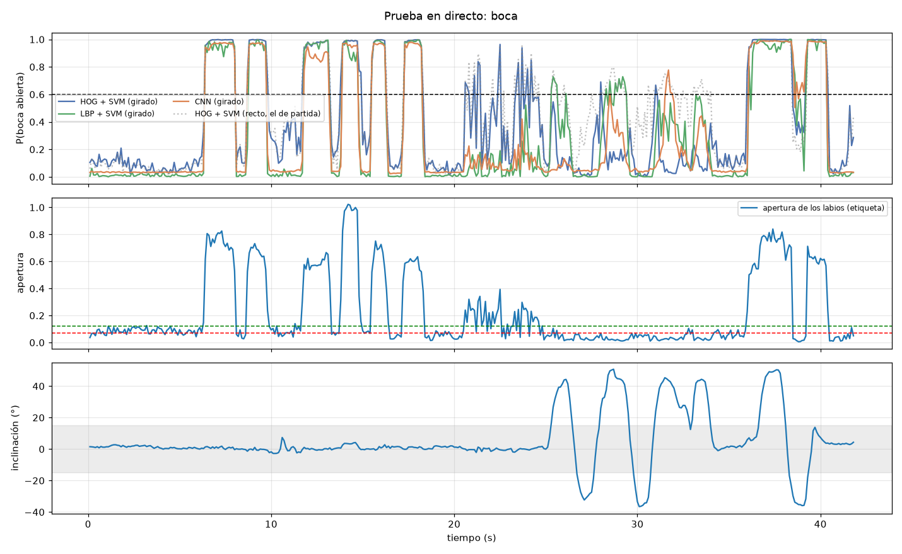

<p align="center"><em>Figura 10. Probabilidad de boca abierta de cada modelo (arriba), apertura de los labios que hace de etiqueta (centro) e inclinación de la cabeza (abajo). A partir del segundo 25 se inclina la cabeza: el modelo de partida (línea gris de puntos) dispara solo, y HOG + SVM con el recorte girado no.</em></p>

**El problema no era el modelo, sino el recorte.** Los datasets son casi siempre caras rectas; **girando el recorte** para que la línea entre las comisuras quede horizontal, los falsos disparos bajan en todos los modelos, y HOG + SVM sigue siendo el mejor. El giro se hace con una sola transformación afín (`recorta_boca` en `gestos.py`):

```python
a, b = puntos(landmarks, COMISURAS_BOCA, w, h)                    # comisuras de la boca (61 y 291)
angulo = float(np.degrees(np.arctan2(b[1] - a[1], b[0] - a[0])))  # inclinación de la boca
centro = p.mean(axis=0)                                           # centro de los labios
...
# Una sola transformación afín gira, escala a tam x tam y centra la boca
M = cv2.getRotationMatrix2D((float(centro[0]), float(centro[1])), angulo, tam / lado)
M[:, 2] += np.array([tam / 2, tam / 2]) - centro
recorte = cv2.warpAffine(img_bgr, M, (tam, tam), flags=cv2.INTER_AREA, borderMode=cv2.BORDER_REPLICATE)
```

Los ojos se recortan de la misma forma, con sus propias comisuras.

### 2.4. Extra: modelos clásicos frente a redes neuronales

Además de los resultados del [apartado 2.2](#22-modelos-entrenados), comparamos la **facilidad de uso** y la **rapidez** de cada método (tablas completas en `resultados/<gesto>_facilidad.md`):

<div align="center">

| Gesto | Método | Entrenamiento por fold | Predicción por imagen | Tamaño |
|---|---|---:|---:|---:|
| Ojos | HOG / LBP + SVM | 10,5 / 19,6 s | 1,3 / 2,0 ms | 4,6 / 8,5 MB |
| | **CNN** | 12,2 s | **0,9 ms** | **0,39 MB** |
| Sonrisa | HOG / LBP + SVM | 57,7 / 29,1 s | 3,3 / 2,9 ms | 21,6 / 13,0 MB |
| | **CNN** | 33,0 s | **1,0 ms** | **0,39 MB** |

</div>

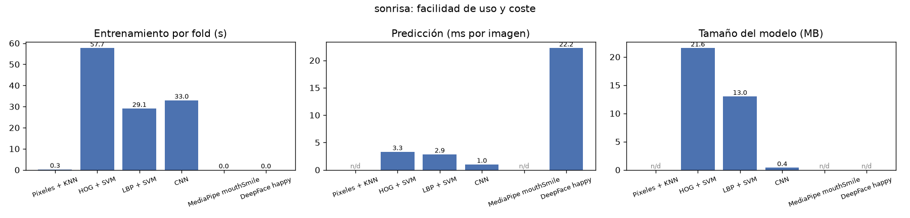

<p align="center"><em>Figura 11. Tiempo de entrenamiento por fold, tiempo de predicción y tamaño de cada modelo de sonrisa, el dataset más grande.</em></p>

- **Al predecir, la CNN es siempre la más rápida y la más ligera.** Para lograrlo fue clave compilarla con `tf.function`: llamando a Keras directamente tardaba unos 25 ms por imagen (`ModeloGesto` en `utilidades_gestos.py`):

    ```python
    # La red se compila una vez; después cada predicción tarda 1-2 ms en lugar de unos 25 ms
    self._red = tf.function(lambda x: self.modelo(x, training=False),
                            input_signature=[tf.TensorSpec([None, tam, tam, canales], tf.float32)])
    ```
- **El coste de la SVM crece con el dataset**, porque guarda miles de vectores soporte: en la sonrisa tarda casi un minuto por fold y ocupa 21,6 MB. El de la CNN depende sobre todo de las épocas.
- **Ajuste:** en los métodos clásicos, el descriptor (celdas, orientaciones, radio…) y `C` y `gamma`; en la CNN, la arquitectura, las épocas y el aumento de datos, y depende de TensorFlow. MediaPipe sale "gratis" con los *landmarks*, y DeepFace necesita su propio detector y es el más lento.

Ningún tipo de modelo gana siempre: la CNN es mejor cuando hay que **generalizar a otra cámara** (ojos), y los clásicos cuando el gesto se ve claramente en los bordes y hay pocas imágenes (boca y sonrisa). Por esa razón, el juego combina los dos.

### 2.5. Extra: comparación con DeepFace

Comparamos nuestro modelo de sonrisa con la función `analyze` de DeepFace, que estima la emoción de una cara. Usamos la probabilidad de la emoción *happy* sobre la cara completa de cada foto de GENKI-4K y, como con MediaPipe, en cada fold elegimos el umbral con mejor F1 en entrenamiento y evaluamos con los mismos folds que nuestros modelos (`VC_P5_gestos_sonrisa.ipynb`):

```python
an = DeepFace.analyze(orig, actions=['emotion'], detector_backend='opencv',  # detecta y recorta la cara
                      enforce_detection=False, silent=True)
feliz_df[i] = an[0]['emotion']['happy'] / 100                             # probabilidad de 'happy' (0-1)
```

<div align="center">

| Método | F1 sonrisa | Tiempo por imagen |
|---|---:|---:|
| **HOG + SVM** (nuestro) ★ | **0,939** | 3,3 ms por recorte |
| MediaPipe `mouthSmile` (sin entrenar) | 0,942 | - |
| DeepFace `happy` | 0,878 | 22 ms por cara |

</div>

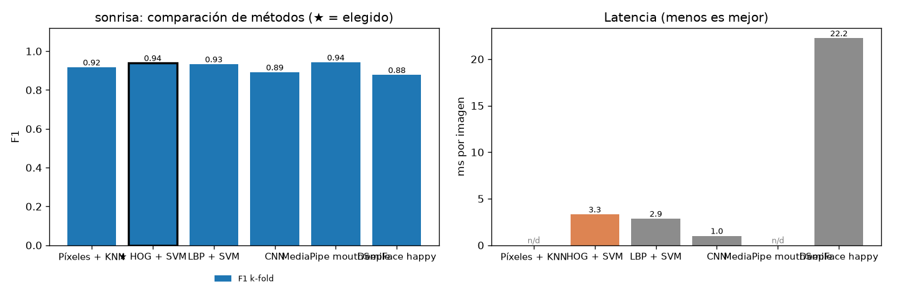

<p align="center"><em>Figura 12. F1 en k-fold de los modelos de sonrisa y de las referencias de MediaPipe y DeepFace, y tiempo por imagen.</em></p>

- **DeepFace queda por detrás** de nuestro modelo (0,878 frente a 0,939) y es **unas 7 veces más lento**, porque primero tiene que detectar la cara.
- **Estima una emoción, no un gesto.** *Happy* no es exactamente lo mismo que sonreír: DeepFace da casi 0 a bastantes sonrisas leves o de compromiso.
- **Depende mucho del recorte.** Pasándole la foto entera sin detectar la cara (`detector_backend='skip'`), su F1 caía a 0,56, casi al azar; con su detector `opencv` sube a 0,878. Su modelo de emociones espera una cara recortada y ajustada.

Para el juego, un modelo pequeño entrenado para el gesto concreto es más preciso y mucho más rápido que un analizador general de emociones.

### 2.6. Detector de gestos y juego

[`gestos.py`](prototipoA/gestos.py) sigue la estructura del cuaderno de MediaPipe de la práctica (`LIVE_STREAM` con `detect_async` y un *callback*). En cada fotograma:

1. MediaPipe localiza los 478 *landmarks*.
2. Cada ojo y la boca se recortan **girados** según sus comisuras, con una sola transformación afín (`warpAffine`), y se pasan a su modelo.
3. Las probabilidades se **suavizan** (media móvil) y pasan por una **histéresis**: un gesto se activa por encima de 0,6 y no se desactiva hasta bajar de 0,4, para que un valor cercano a 0,5 no lo encienda y apague sin parar. Al sonreír se entrecierran los ojos, así que mientras se sonríe hace falta 0,85 para dar un ojo por cerrado.
4. Con los tiempos se separan los gestos de los ojos: los dos cerrados menos de 0,6 s es un **parpadeo**; más de 0,6 s carga la **bomba**, y uno solo cerrado más de 0,2 s es un **guiño**.

En el *callback* de MediaPipe, además del resultado, guardamos la imagen exacta que analizó, para que los recortes coincidan con los puntos aunque la cabeza se mueva:

```python
def on_result(result, output_image, timestamp_ms):
    global latest
    latest = (result, output_image.numpy_view().copy(), timestamp_ms)  # resultado + imagen analizada

options = FaceLandmarkerOptions(
    base_options=BaseOptions(model_asset_path=MODELO_FACE),
    running_mode=VisionRunningMode.LIVE_STREAM,
    num_faces=1,
    result_callback=on_result,
)
...
landmarker.detect_async(mp_image, int(time.time() * 1000))
```

Y esta es la parte de `EstadoGestos` que convierte las probabilidades en gestos:

```python
# Suavizado e histéresis: se activa por encima de 0,6 (0,85 en los ojos al sonreír) y se apaga por debajo de 0,4
self.p[g] = SUAVIZADO * previo + (1 - SUAVIZADO) * probs[g]
if self.activo[g] and self.p[g] < UMBRAL_OFF:
    self.activo[g] = False
elif not self.activo[g] and self.p[g] > umbral_on:
    self.activo[g] = True

# Los dos ojos cerrados: al abrirlos se decide si fue un parpadeo o una bomba
if izq and der:
    if self.t_ambos is None:
        self.t_ambos = t                      # empieza a contar el tiempo con los ojos cerrados
    ...
elif self.t_ambos is not None:
    dur = t - self.t_ambos
    if dur >= T_BOMBA:                        # más de 0,6 s: bomba
        eventos.append('bomba')
    else:                                     # menos: parpadeo normal, se ignora
        eventos.append('parpadeo')
    self.t_ambos = None
```

Ejecutado solo, `gestos.py` abre una **ventana de prueba** que muestra qué ve cada modelo:

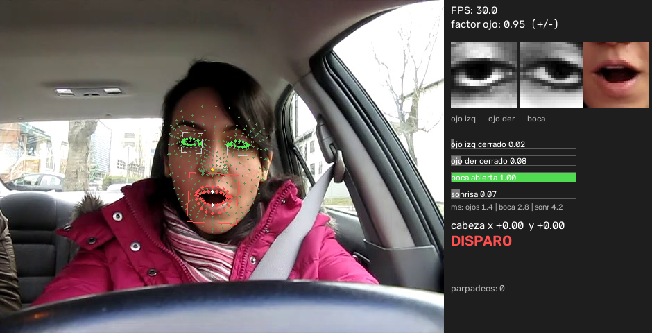

<p align="center"><em>Figura 13. Ventana de prueba de <code>gestos.py</code> sobre un fotograma del Drowsiness dataset. A la izquierda, los landmarks (tecla L), con los ojos en verde y los labios en rojo, y las cajas de los recortes; a la derecha, los recortes que recibe cada modelo, la probabilidad de cada gesto (en verde si está activo) y el control resultante: con la boca abierta, DISPARO. Al ser una imagen y no la webcam, el valor de FPS es fijo.</em></p>

[`juego.py`](prototipoA/juego.py) está hecho con **pygame**. Los gráficos se dibujan con primitivas y los sonidos y la música se generan con NumPy, sin imágenes ni sonidos de terceros. 

La cámara y los modelos van en un **hilo aparte**, para que el juego vaya a 60 FPS aunque analizar un fotograma tarde más, y los guiños y la bomba llegan por una **cola** para no perder ninguno. Si se pierde la cara más de 1 s, el juego se pausa, y si falla la cámara se puede seguir con el teclado.

<div align="center">

| Menú | Carga de la bomba |
|---|---|
| 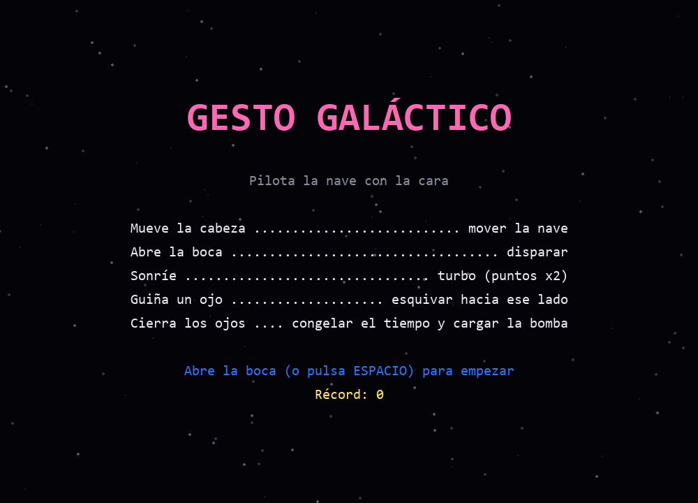 | 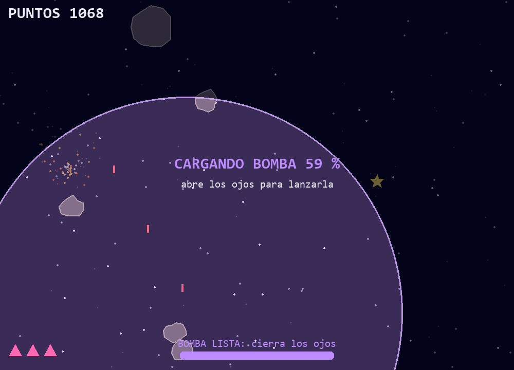 |

</div>

<p align="center"><em>Figura 14. Menú con los controles (la partida empieza manteniendo la boca abierta) y carga de la bomba: con los ojos cerrados el tiempo se congela y el círculo muestra hasta dónde llegará la explosión.</em></p>

### 2.7. Limitaciones

- **Bostezos frente a bocas abiertas.** El dataset de boca tiene bostezos; al hablar se detecta un tercio de las aperturas leves. Jugando no se habla, así que hemos priorizado tener pocos falsos disparos con la boca cerrada.
- **Etiquetas de la prueba en directo.** Salen de una medida geométrica y no de un etiquetado a mano.
- **Luz y posturas extremas.** Con poca luz o la cara muy girada, MediaPipe pierde los *landmarks* y el juego se pausa.

---

## 3. Prototipo B: FACEFUSION - MORPHING DE CARAS

Nuestro proyecto de _morphing_ transforma progresivamente el rostro que se ve en la webcam combinándolo con un vídeo grabado. La fusión de las caras se controla según la distancia de separación entre el pulgar y el índice de su **mano izquierda**.

### 3.1. Regula la intensidad "con mano izquierda" ;-)
La cantidad de fusión entre las caras la regulamos con la distancia entre nuestro pulgar e índice de la mano izquierda, según podemos ver en la _Figura 2_.


*Figura 2. Regulación de intesidad del morphing según separación entre dedos índice y pulgar de mano izquierda.*

Para interpretar el gesto se siguen las puntas del pulgar y del índice, puntos **4 y 8** del modelo de manos. Su distancia se divide por el ancho de palma entre los puntos **5 y 17**, medido en píxeles; con esto logramos que estar cerca o lejos de la cámara sea independiente. MediaPipe nos proporciona los puntos de la mano y su lateralidad.


*Figura 3. Puntos de referencia del modelo de manos. [Fuente: Hand Landmarker](https://ai.google.dev/edge/mediapipe/solutions/vision/hand_landmarker/python)*

Si la mano izquierda deja de verse en la webcam, se retiene brevemente el valor de mezcla de las caras, pero después vuelve gradualmente a cero.

### 3.2. Cómo ejecutar el morphing

Necesitarás **Python 3.12**, una webcam y un vídeo pregrabado con una cara de referencia.

Crea un entorno virtual con python desde `powershell` para instalar las dependencias y los modelos de caras y manos de MediaPipe:

```powershell
python -m venv .venv
.\.venv\Scripts\python.exe -m pip install -r requirements.txt
.\.venv\Scripts\python.exe scripts/download_models.py
```

Coloca tu vídeo pregrabado en `data/videos/` y ajusta el parámetro `--video` en el comando de ejecución.

Desde la raíz del proyecto, ejecuta:

```powershell
.\.venv\Scripts\python.exe scripts/preview_sources.py --video videos/video_reference.mp4 --camera 0 --morph
```

Colócate de frente y deja la cara despejada. Cierra y abre progresivamente la pinza izquierda.

En una primera calibración, sigue las instrucciones inferiores y pulsa **Espacio** para capturar cada postura cuando se indique. El ajuste se guarda localmente y se reutiliza en ejecuciones posteriores; **R** permite repetirlo si cambian la persona o la postura de uso.

| Tecla | Acción |
| --- | --- |
| Q / Esc | Cerrar y guardar el informe de sesión |
| R | Repetir la calibración |
| M | Mostrar u ocultar los triángulos del resultado |
| E | Alternar la presentación en espejo |
| A / N | Alternar puntos / índices en las fuentes |
| S | Guardar una captura y el resultado sin interfaz |
| 0 / 5 / 1 | Fijar intensidad 0 / 50 / 100 % para diagnóstico |
| G | Recuperar el control gestual después del diagnóstico |

Para una prueba guiada, sustituye `--morph` por `--validate-morph`. Cada postura se recoge después de dos segundos estables y suficientes observaciones válidas. Al terminar, cierra con **Q**.

### 3.3. Cómo se construye la mezcla

El proceso se divide en cuatro operaciones: **relacionar puntos → alinear las caras → deformar y mezclar → integrar el resultado**. 

#### 1. Encontrar puntos equivalentes


*Figura 4. Relación entre ambas caras: los puntos del mismo color señalan posiciones anatómicas equivalentes en los dos sujetos de prueba. Sus coordenadas pueden diferir, pero lo que debe coincidir es el significado del punto.*

Los **landmarks** son puntos estimados en posiciones del rostro: comisuras de los labios, ojos, nariz y contorno. Permiten relacionar, por ejemplo, la comisura de una cara con la misma comisura de la otra; o la punta de la nariz de una de las caras con la otra.

Cada fuente tiene su propio seguidor facial. El modelo utilizado devuelve **478 puntos** y el motor selecciona **68 correspondencias** para la deformación. Las capacidades del detector se describen en [Face Landmarker](https://ai.google.dev/edge/mediapipe/solutions/vision/face_landmarker/python); la selección de 68 puntos ha sido por decisión del equipo del proyecto.

#### 2. Poner ambas caras en una referencia común


*Figura 5. Comparar en el **mismo sistema de coordenadas**. La escala y la rotación sitúan los centros oculares sobre una guía común, conservando diferencias de proporción facial. Los dos lienzos muestran el espacio normalizado de 320 × 320.*

Una cara puede aparecer más grande, desplazada o ligeramente inclinada. La alineación usa los centros oculares para normalizar escala y rotación en un lienzo de **320 × 320**.

Así, ojos, nariz y boca ocupan posiciones comparables antes de combinar las imágenes.

#### 3. Deformar pequeños triángulos


*Figura 5. Primero compartir la forma, después combinar las texturas.*

Pensemos en una fotografía dividida en pequeñas piezas triangulares flexibles. La triangulación conecta los puntos correspondientes; después se combinan tanto **la forma** —dónde están los puntos— como **la textura** —qué color tiene cada zona—:

```text
forma_intermedia = (1 − α) × forma_webcam + α × forma_referencia
textura_intermedia = (1 − α) × textura_webcam + α × textura_referencia_corregida
```

OpenCV obtiene las texturas mediante mapas afines por triángulo y remuestreo. El código está en [engine.py](src/facefusion/morphing/engine.py); el fundamento de estas operaciones está en [Geometric Image Transformations](https://docs.opencv.org/4.x/da/d54/group__imgproc__transform.html).

#### 4. Devolver el rostro a la escena


*Figura 6. Se utiliza una máscara para suavizar los bordes de la cara con la que se fusiona.*

La cara mezclada vuelve a las coordenadas de webcam. Una máscara delimita la región que participa en la composición; el resto del fotograma conserva la webcam. Antes de mostrarlo se ajustan el tono y la unión del contorno.

### 3.4. Cómo se adapta el tono de piel

Si las fuentes tienen distinta iluminación, una mezcla puede parecer una cara pegada encima de otra, como nos pasaba al principio del proyecto.

| Paso | Explicación |
| --- | --- |
| Medir | Seleccionar pequeñas regiones geométricas de las mejillas, evitando ojos, dientes y fondo |
| Adaptar el tono | Comparar medianas y desplazar el tono de la referencia hacia el de webcam |
| Estabilizar | Suavizar el ajuste a lo largo del tiempo para reducir cambios bruscos |
| Integrar el contorno | Adaptar la región facial a las condiciones de color de su frontera |
| Suavizar | Aplicar una máscara con transición interior de 18 píxeles |

La integración local utiliza `cv2.seamlessClone` con `NORMAL_CLONE`. Puedes imaginar el contorno como una costura: se busca que el brillo y el color encajen con la piel de alrededor, mientras se conservan las variaciones del rostro insertado.

---

## 4. Referencias

### Prototipo A

- Material de la [Práctica 5](https://github.com/otsedom/otsedom.github.io/tree/main/VC/P5): [`VC_P5_mediapipe.ipynb`](https://github.com/otsedom/otsedom.github.io/blob/main/VC/P5/VC_P5_mediapipe.ipynb) (bucle de la webcam con *Face Landmarker*), [`VC_P5_eigenfaces_handcrafted_kfold.ipynb`](https://github.com/otsedom/otsedom.github.io/blob/main/VC/P5/VC_P5_eigenfaces_handcrafted_kfold.ipynb) (k-fold, KNN, HOG y LBP por celdas con SVM) y [`VC_P5_deepface_analyze.ipynb`](https://github.com/otsedom/otsedom.github.io/blob/main/VC/P5/VC_P5_deepface_analyze.ipynb) (`DeepFace.analyze`).
- MediaPipe: [Face Landmarker para Python](https://ai.google.dev/edge/mediapipe/solutions/vision/face_landmarker/python) y [conexiones de Face Mesh](https://github.com/google-ai-edge/mediapipe/blob/master/mediapipe/python/solutions/face_mesh_connections.py) (índices de labios y ojos).
- OpenCV: [transformaciones geométricas](https://docs.opencv.org/4.x/da/d6e/tutorial_py_geometric_transformations.html), [ecualización del histograma](https://docs.opencv.org/4.x/d5/daf/tutorial_py_histogram_equalization.html) y [vídeo](https://docs.opencv.org/4.x/dd/d43/tutorial_py_video_display.html).
- scikit-learn: [`StratifiedGroupKFold`](https://scikit-learn.org/stable/modules/generated/sklearn.model_selection.StratifiedGroupKFold.html), [`GridSearchCV`](https://scikit-learn.org/stable/modules/generated/sklearn.model_selection.GridSearchCV.html), [`CalibratedClassifierCV`](https://scikit-learn.org/stable/modules/generated/sklearn.calibration.CalibratedClassifierCV.html) y [*clustering* jerárquico](https://scikit-learn.org/stable/modules/clustering.html#hierarchical-clustering).
- scikit-image: [`hog` y `local_binary_pattern`](https://scikit-image.org/docs/stable/api/skimage.feature.html).
- Keras: [capas de aumento de imágenes](https://keras.io/api/layers/preprocessing_layers/image_augmentation/). TensorFlow: [`tf.function`](https://www.tensorflow.org/guide/function).
- [DeepFace](https://github.com/serengil/deepface).
- pygame: [documentación](https://www.pygame.org/docs/), [`sndarray`](https://www.pygame.org/docs/ref/sndarray.html) y [`mixer`](https://www.pygame.org/docs/ref/mixer.html). Python: [`threading`](https://docs.python.org/3/library/threading.html) y [`queue`](https://docs.python.org/3/library/queue.html).
- F. Song, X. Tan, X. Liu y S. Chen (2014). *Eyes Closeness Detection from Still Images with Multi-scale Histograms of Principal Oriented Gradients*. Pattern Recognition. Dataset [CEW](https://parnec.nuaa.edu.cn/_upload/tpl/02/db/731/template731/pages/xtan/ClosedEyeDatabases.html).
- *The MPLab GENKI Database, GENKI-4K Subset*. [MPLab, UC San Diego](https://mplab.ucsd.edu/398).
- D. Perumandla. [*Drowsiness dataset*](https://www.kaggle.com/datasets/dheerajperumandla/drowsiness-dataset). Kaggle.

### Prototipo B

- **Material de la asignatura "Visión por Computador".** *Práctica 5. Biometría: detección y caracterización de caras*. Material docente de Visión por Computador. [Repositorio y enunciado](https://github.com/otsedom/otsedom.github.io/tree/main/VC/P5). Contexto, requisitos y criterios de la tarea.
- **Google AI Edge.** *MediaPipe Face Landmarker, guía para Python*. [Documentación oficial](https://ai.google.dev/edge/mediapipe/solutions/vision/face_landmarker/python). Detección de landmarks faciales y procesamiento de imágenes y vídeos.
- **Google AI Edge.** *MediaPipe Hand Landmarker, guía para Python*. [Documentación oficial](https://ai.google.dev/edge/mediapipe/solutions/vision/hand_landmarker/python). Landmarks de mano y lateralidad.
- **SciPy.** *scipy.spatial.Delaunay*. [Documentación oficial](https://docs.scipy.org/doc/scipy/reference/generated/scipy.spatial.Delaunay.html). Triangulación y conectividad de puntos.
- **OpenCV.** *Geometric Image Transformations*. [Documentación oficial](https://docs.opencv.org/4.x/da/d54/group__imgproc__transform.html). Transformaciones afines, remuestreo y retorno de coordenadas.
- **OpenCV.** *Color conversions*. [Documentación oficial](https://docs.opencv.org/4.x/de/d25/imgproc_color_conversions.html). Conversión entre espacios de color, incluido Lab.
- **OpenCV.** *Seamless Cloning*. [Documentación oficial](https://docs.opencv.org/4.x/df/da0/group__photo__clone.html). Integración local mediante `seamlessClone` y modos de composición.
---

## Nota: uso de IA

En la elaboración del prototipo A se ha empleado [Claude](https://claude.ai), de Anthropic, como agente de IA en las siguientes tareas:

* **Preparación de los datasets:** organización de las carpetas por clase, renombrado de los archivos y recorte de las bocas con MediaPipe.
* **Tablas, gráficas y matrices de confusión:** generación de las figuras y de las tablas de resultados de los cuadernos.
* **Resúmenes de resultados:** los archivos de `prototipoA/resultados/` (`<gesto>_resumen.md` y `<gesto>_facilidad.md`) y las figuras `figuras/<gesto>_resumen.png`, que recogen de un vistazo la comparación de métodos, el modelo elegido y el motivo, por si se quiere consultar algún resultado sin abrir los cuadernos.
* **Sonidos del juego:** síntesis de los efectos y la música con NumPy.
* **Estructuración de este `README.md`.**

En la elaboración del prototipo B se ha empleado el agente [**Codex**](https://openai.com/es-ES/codex/), de OpenAI, en las siguientes tareas:

* **Descarga de modelos preentrenados:** elaboración del script de descarga de los modelos de MediaPipe para la detección de caras y manos.
* **Suavizado de la fusión:** suavizado del contorno y del color entre las caras que se fusionan.
* **Figuras ilustrativas** mostradas en este documento para el prototipo B.
* **Elaboración de la documentación** del prototipo B.


Todo el contenido generado ha sido **revisado y comprendido** por los autores antes de incorporarlo a la práctica.

---
