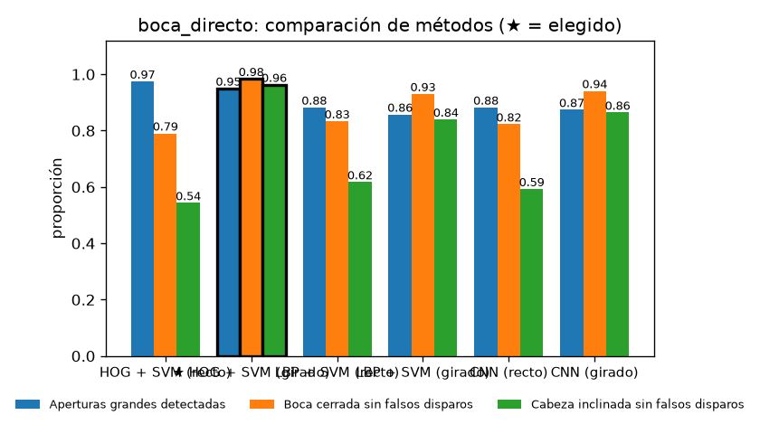

## Modelo de boca: prueba en directo (modelo usado en el juego)

| Método | Aperturas grandes detectadas | Boca cerrada sin falsos disparos | Cabeza inclinada sin falsos disparos |
|---|---|---|---|
| HOG + SVM (recto) | 0.975 | 0.790 | 0.543 |
| **HOG + SVM (girado)** ★ | 0.950 | 0.984 | 0.963 |
| LBP + SVM (recto) | 0.882 | 0.833 | 0.617 |
| LBP + SVM (girado) | 0.857 | 0.930 | 0.840 |
| CNN (recto) | 0.882 | 0.823 | 0.593 |
| CNN (girado) | 0.874 | 0.941 | 0.864 |

**Modelo elegido:** HOG + SVM (girado)

**Motivo:** En la grabación de prueba, HOG + SVM (girado) solo dispara en el 1.6 % de los fotogramas con la boca cerrada (3.7 % con la cabeza inclinada) y detecta el 95 % de las aperturas grandes. El modelo elegido por k-fold (HOG + SVM con el recorte sin girar) daba un 21.0 % de falsos disparos (45.7 % con la cabeza inclinada).

