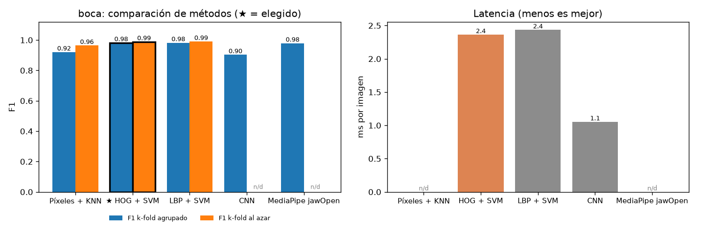

## Modelo de boca

| Método | F1 k-fold agrupado | F1 k-fold al azar | ms por imagen |
|---|---|---|---|
| Píxeles + KNN | 0.921 | 0.965 | — |
| **HOG + SVM** ★ | 0.983 | 0.989 | 2.4 |
| LBP + SVM | 0.983 | 0.991 | 2.4 |
| CNN | 0.904 | — | 1.1 |
| MediaPipe jawOpen | 0.980 | — | — |

**Modelo elegido:** HOG + SVM

**Motivo:** Mayor F1 en el k-fold agrupado por persona entre los modelos entrenados: 0.983 (empatado a menos de 0,005 con LBP + SVM, se elige por ser el más rápido), con 2.4 ms por recorte. Como referencia, MediaPipe jawOpen sin entrenar obtiene 0.980.

