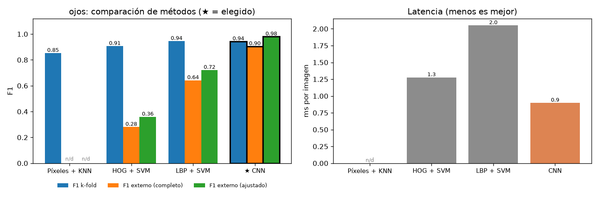

## Modelo de ojos

| Método | F1 k-fold | F1 externo (completo) | F1 externo (ajustado) | ms por imagen |
|---|---|---|---|---|
| Píxeles + KNN | 0.852 | — | — | — |
| HOG + SVM | 0.906 | 0.280 | 0.359 | 1.3 |
| LBP + SVM | 0.945 | 0.642 | 0.721 | 2.0 |
| **CNN** ★ | 0.943 | 0.905 | 0.980 | 0.9 |

**Modelo elegido:** CNN

**Motivo:** Es el que mejor generaliza a otra cámara: F1 externo 0.980 con encuadre ajustado frente a 0.721 del siguiente (LBP + SVM), con un F1 en k-fold de 0.943 y 0.9 ms por ojo, suficiente para clasificar los dos ojos en cada fotograma.

