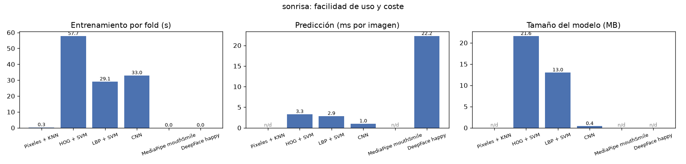

## Facilidad de uso y coste: sonrisa

| Método | Entrenamiento por fold (s) | Predicción (ms/imagen) | Tamaño (MB) | Qué hay que ajustar | Observaciones |
|---|---|---|---|---|---|
| Píxeles + KNN | 0.3 | — | — | k (vecinos) | No entrena: guarda todas las imágenes y compara con todas al predecir. |
| HOG + SVM | 57.7 | 3.3 | 21.57 | celdas, orientaciones, bloques + C y gamma (rejilla) | Hay que diseñar el descriptor; la búsqueda en rejilla de la SVM multiplica el tiempo de entrenamiento. |
| LBP + SVM | 29.1 | 2.9 | 13.00 | celdas, vecinos, radio, tipo de patrón + C y gamma (rejilla) | Igual que HOG; el descriptor es más lento de calcular. |
| CNN | 33.0 | 1.0 | 0.39 | arquitectura, épocas, lote, optimizador, aumento de datos | No hay que diseñar descriptores, pero sí la red; necesita TensorFlow. Su tiempo de entrenamiento depende de las épocas, no del número de vectores soporte, y en CPU es similar al de la SVM con búsqueda en rejilla. |
| MediaPipe mouthSmile | 0.0 | — | — | solo el umbral | Sin entrenamiento: ya se ejecuta para obtener los landmarks. |
| DeepFace happy | 0.0 | 22.2 | — | detector de caras y umbral | Sin entrenamiento; necesita detectar la cara y es la más lenta al predecir. |

