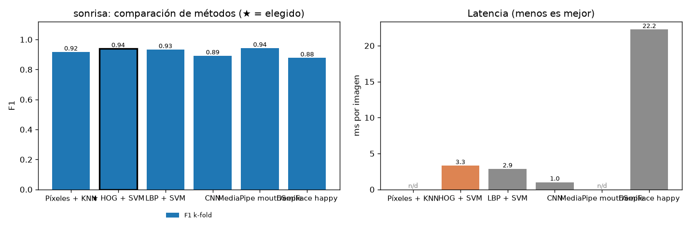

## Modelo de sonrisa

| Método | F1 k-fold | ms por imagen |
|---|---|---|
| Píxeles + KNN | 0.917 | — |
| **HOG + SVM** ★ | 0.939 | 3.3 |
| LBP + SVM | 0.933 | 2.9 |
| CNN | 0.891 | 1.0 |
| MediaPipe mouthSmile | 0.942 | — |
| DeepFace happy | 0.878 | 22.2 |

**Modelo elegido:** HOG + SVM

**Motivo:** Mayor F1 en el k-fold entre los modelos entrenados: 0.939, con 3.3 ms por recorte. Como referencia, MediaPipe mouthSmile obtiene 0.942 y DeepFace happy 0.878 (22 ms por cara).

