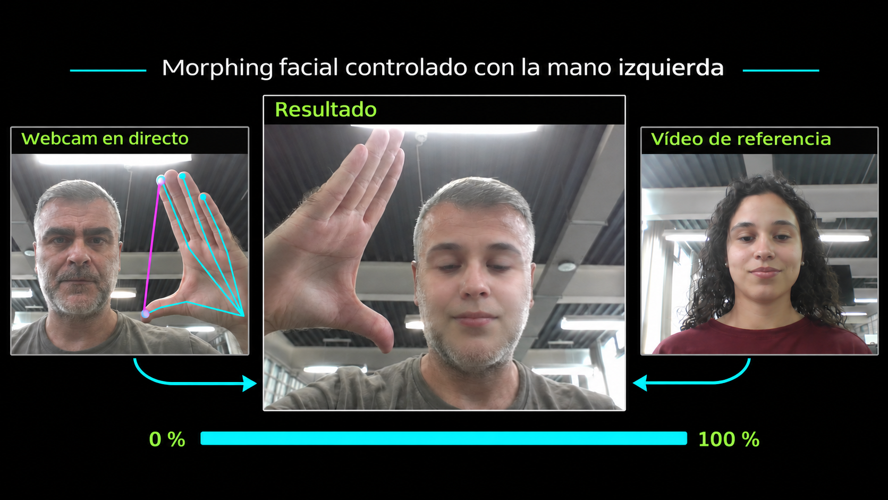
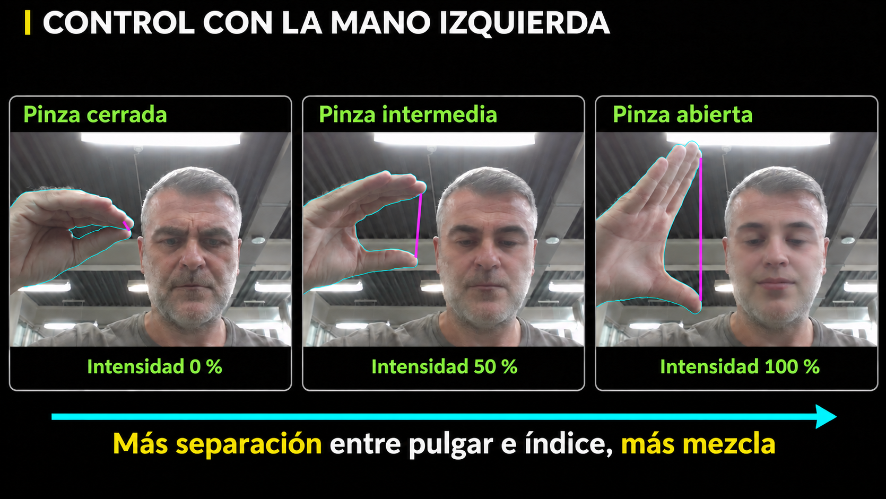
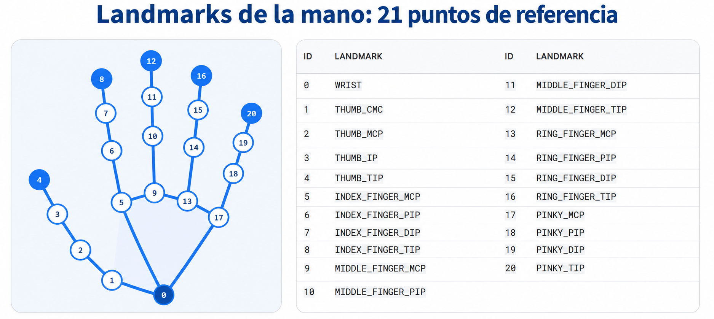
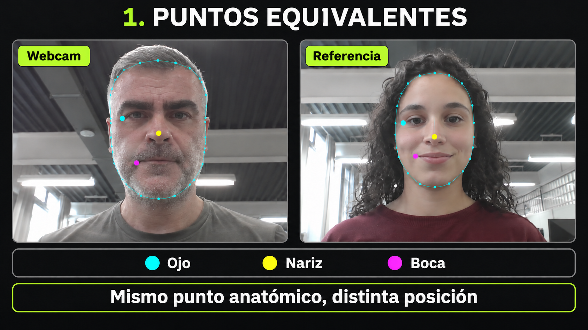
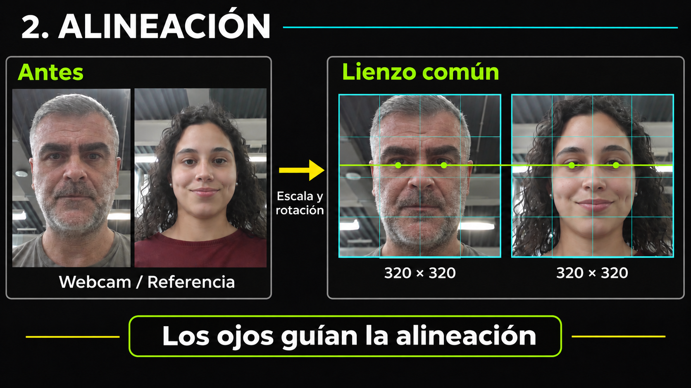
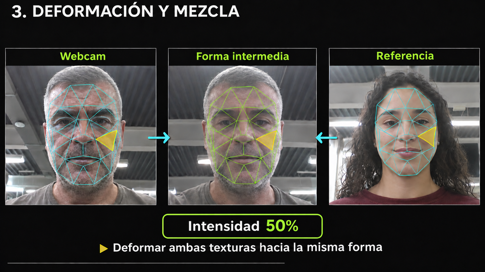
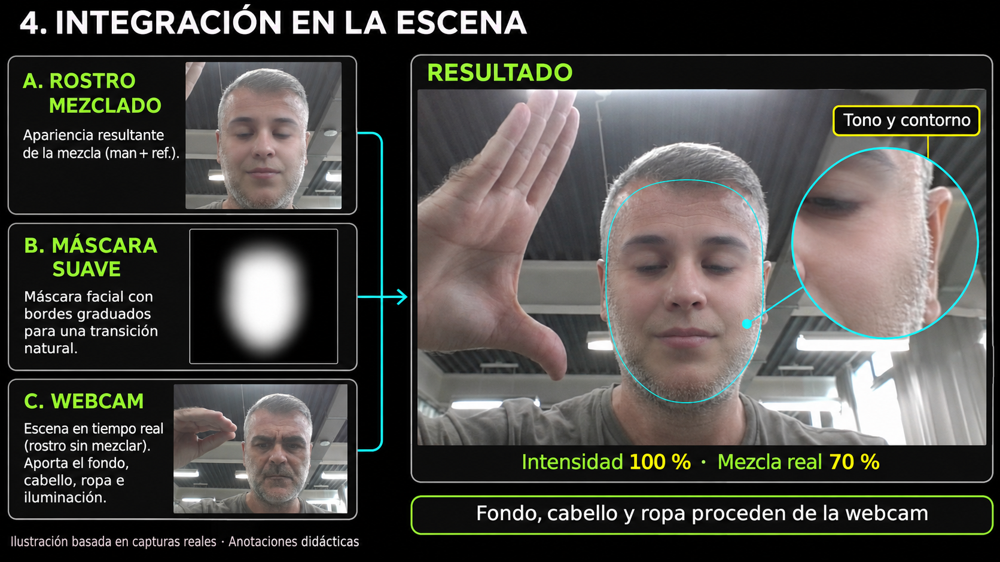

# **Visión por Computador: Práctica 5 - Biometría facial**

Nuestra proyecto de _morphing_ transforma progresivamente el rostro que se ve en la webcam combinándolo con un vídeo grabado. La fusión de las caras se controla según la distancia de separación entre el pulgar y el índice de su **mano izquierda**.


*Figura 1. Morphing en acción.*

## Autores

| Campo | Información |
| --- | --- |
| Autora | [Alba Ramos Quintana](https://github.com/albaquiintanaa) |
| Autor | [Néstor J. Henríquez Medina](https://github.com/NestorJHM/) |
| Asignatura | Visión por Computador |
| Práctica | P5 · Detección y caracterización de caras |

## Vídeo demostración

### [Enlace al vídeo de demostración en YouTube](https://youtu.be/JUoVybd1Fl0)


*GIF  de demostración.*

## Tabla de contenido

1. [Regula la intensidad "con mano izquierda"](#regula-la-intensidad-con-mano-izquierda--)
2. [Cómo ejecutar el morping](#cómo-ejecutar-el-morphing)
3. [Cómo se construye la mezcla](#cómo-se-construye-la-mezcla)
4. [Cómo se adapta el tono de piel](#cómo-se-adapta-el-tono-de-piel)
5. [Bibliografía y fuentes](#bibliografía-y-fuentes)


## Regula la intensidad "con mano izquierda" ;-)
La cantidad de fusión entre las caras la regulamos con la distancia entre nuestro pulgar e índice de la mano izquierda, según podemos ver en la _Figura 2_.


*Figura 2. Regulación de intesidad del morphing según separación entre dedos índice y pulgar de mano izquierda.*

Para interpretar el gesto se siguen las puntas del pulgar y del índice, puntos **4 y 8** del modelo de manos. Su distancia se divide por el ancho de palma entre los puntos **5 y 17**, medido en píxeles; con esto logramos que estar cerca o lejos de la cámara sea independiente. MediaPipe nos proporciona los puntos de la mano y su lateralidad.


*Figura 3. Puntos de referencia del modelo de manos. [Fuente: Hand Landmarker](https://ai.google.dev/edge/mediapipe/solutions/vision/hand_landmarker/python)*

Si la mano izquierda deja de verse en la webcam, se retiene brevemente el valor de mezcla de las caras, pero después vuelve gradualmente a cero.

## Cómo ejecutar el morphing

Necesitarás **Python 3.12**, una webcam y un vídeo pregrabado con una cara de referencia.

Crea un entorno virtual con python desde `powershell` para instalar las dependencias y los modelos de caras y manos de MediaPipe:

```powershell
python -m venv .venv
.\.venv\Scripts\python.exe -m pip install -r requirements.txt
.\.venv\Scripts\python.exe scripts/download_models.py
```

Coloca tu vídeo pregrabado en `data/videos/` y ajusta el parámetro `--video` en el comando de ejecución.

Desde la raíz del proyecto, ejecuta:

```powershell
.\.venv\Scripts\python.exe scripts/preview_sources.py --video videos/video_reference.mp4 --camera 0 --morph
```

Colócate de frente y deja la cara despejada. Cierra y abre progresivamente la pinza izquierda.

En una primera calibración, sigue las instrucciones inferiores y pulsa **Espacio** para capturar cada postura cuando se indique. El ajuste se guarda localmente y se reutiliza en ejecuciones posteriores; **R** permite repetirlo si cambian la persona o la postura de uso.

| Tecla | Acción |
| --- | --- |
| Q / Esc | Cerrar y guardar el informe de sesión |
| R | Repetir la calibración |
| M | Mostrar u ocultar los triángulos del resultado |
| E | Alternar la presentación en espejo |
| A / N | Alternar puntos / índices en las fuentes |
| S | Guardar una captura y el resultado sin interfaz |
| 0 / 5 / 1 | Fijar intensidad 0 / 50 / 100 % para diagnóstico |
| G | Recuperar el control gestual después del diagnóstico |

Para una prueba guiada, sustituye `--morph` por `--validate-morph`. Cada postura se recoge después de dos segundos estables y suficientes observaciones válidas. Al terminar, cierra con **Q**.

## Cómo se construye la mezcla

El proceso se divide en cuatro operaciones: **relacionar puntos → alinear las caras → deformar y mezclar → integrar el resultado**. 

### 1. Encontrar puntos equivalentes


*Figura 4. Relación entre ambas caras: los puntos del mismo color señalan posiciones anatómicas equivalentes en los dos sujetos de prueba. Sus coordenadas pueden diferir, pero lo que debe coincidir es el significado del punto.*

Los **landmarks** son puntos estimados en posiciones del rostro: comisuras de los labios, ojos, nariz y contorno. Permiten relacionar, por ejemplo, la comisura de una cara con la misma comisura de la otra; o la punta de la nariz de una de las caras con la otra.

Cada fuente tiene su propio seguidor facial. El modelo utilizado devuelve **478 puntos** y el motor selecciona **68 correspondencias** para la deformación. Las capacidades del detector se describen en [Face Landmarker](https://ai.google.dev/edge/mediapipe/solutions/vision/face_landmarker/python); la selección de 68 puntos ha sido por decisión del equipo del proyecto.

### 2. Poner ambas caras en una referencia común


*Figura 5. Comparar en el **mismo sistema de coordenadas**. La escala y la rotación sitúan los centros oculares sobre una guía común, conservando diferencias de proporción facial. Los dos lienzos muestran el espacio normalizado de 320 × 320.*

Una cara puede aparecer más grande, desplazada o ligeramente inclinada. La alineación usa los centros oculares para normalizar escala y rotación en un lienzo de **320 × 320**.

Así, ojos, nariz y boca ocupan posiciones comparables antes de combinar las imágenes.

### 3. Deformar pequeños triángulos


*Figura 5. Primero compartir la forma, después combinar las texturas.*

Pensemos en una fotografía dividida en pequeñas piezas triangulares flexibles. La triangulación conecta los puntos correspondientes; después se combinan tanto **la forma** —dónde están los puntos— como **la textura** —qué color tiene cada zona—:

```text
forma_intermedia = (1 − α) × forma_webcam + α × forma_referencia
textura_intermedia = (1 − α) × textura_webcam + α × textura_referencia_corregida
```

OpenCV obtiene las texturas mediante mapas afines por triángulo y remuestreo. El código está en [engine.py](src/facefusion/morphing/engine.py); el fundamento de estas operaciones está en [Geometric Image Transformations](https://docs.opencv.org/4.x/da/d54/group__imgproc__transform.html).

### 4. Devolver el rostro a la escena


*Figura 6. Se utiliza una máscara para suavizar los bordes de la cara con la que se fusiona.*

La cara mezclada vuelve a las coordenadas de webcam. Una máscara delimita la región que participa en la composición; el resto del fotograma conserva la webcam. Antes de mostrarlo se ajustan el tono y la unión del contorno.

## Cómo se adapta el tono de piel

Si las fuentes tienen distinta iluminación, una mezcla puede parecer una cara pegada encima de otra, como nos pasaba al principio del proyecto.

| Paso | Explicación |
| --- | --- |
| Medir | Seleccionar pequeñas regiones geométricas de las mejillas, evitando ojos, dientes y fondo |
| Adaptar el tono | Comparar medianas y desplazar el tono de la referencia hacia el de webcam |
| Estabilizar | Suavizar el ajuste a lo largo del tiempo para reducir cambios bruscos |
| Integrar el contorno | Adaptar la región facial a las condiciones de color de su frontera |
| Suavizar | Aplicar una máscara con transición interior de 18 píxeles |

La integración local utiliza `cv2.seamlessClone` con `NORMAL_CLONE`. Puedes imaginar el contorno como una costura: se busca que el brillo y el color encajen con la piel de alrededor, mientras se conservan las variaciones del rostro insertado.

## Bibliografía y fuentes

1. **Material de la asignatura "Visión por Computador".** *Práctica 5. Biometría: detección y caracterización de caras*. Material docente de Visión por Computador. [Repositorio y enunciado](https://github.com/otsedom/otsedom.github.io/tree/main/VC/P5). Contexto, requisitos y criterios de la tarea.
2. **Google AI Edge.** *MediaPipe Face Landmarker, guía para Python*. [Documentación oficial](https://ai.google.dev/edge/mediapipe/solutions/vision/face_landmarker/python). Detección de landmarks faciales y procesamiento de imágenes y vídeos.
3. **Google AI Edge.** *MediaPipe Hand Landmarker, guía para Python*. [Documentación oficial](https://ai.google.dev/edge/mediapipe/solutions/vision/hand_landmarker/python). Landmarks de mano y lateralidad.
4. **SciPy.** *scipy.spatial.Delaunay*. [Documentación oficial](https://docs.scipy.org/doc/scipy/reference/generated/scipy.spatial.Delaunay.html). Triangulación y conectividad de puntos.
5. **OpenCV.** *Geometric Image Transformations*. [Documentación oficial](https://docs.opencv.org/4.x/da/d54/group__imgproc__transform.html). Transformaciones afines, remuestreo y retorno de coordenadas.
6. **OpenCV.** *Color conversions*. [Documentación oficial](https://docs.opencv.org/4.x/de/d25/imgproc_color_conversions.html). Conversión entre espacios de color, incluido Lab.
7. **OpenCV.** *Seamless Cloning*. [Documentación oficial](https://docs.opencv.org/4.x/df/da0/group__photo__clone.html). Integración local mediante `seamlessClone` y modos de composición.